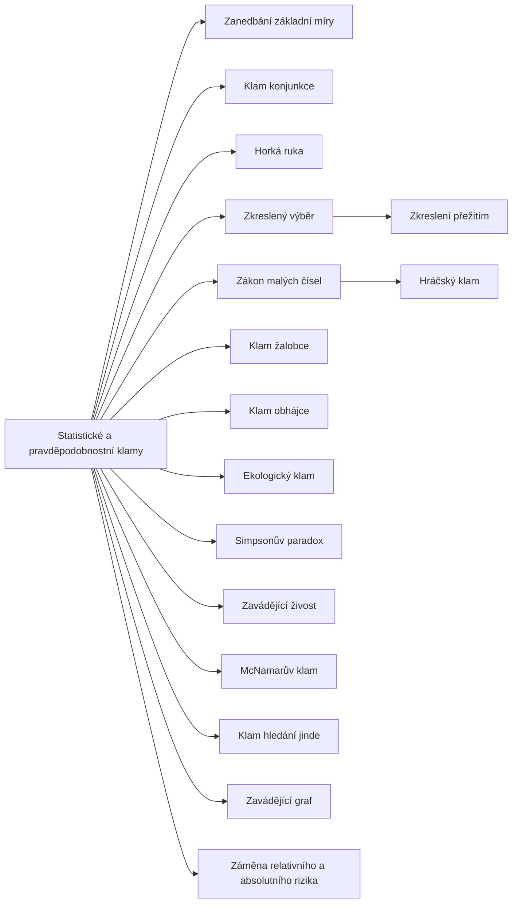

+++
title = "Statistické a pravděpodobnostní klamy"
description = "Klamy v úsudku o pravděpodobnosti, vzorcích a rizicích: základní míra, konjunkce, série, výběr a podmíněné pravděpodobnosti. Co je spojuje a jak se proti nim bránit."
weight = 5
sort_by = "weight"
template = "kompendium/section.html"
page_template = "kompendium/page.html"
insert_anchor_links = "right"

[extra]
tags = ["fauly", "fauly-statisticke"]
categories = ["academic"]
toc = true
lang = "cs"
keywords = ["Statistické a pravděpodobnostní klamy", "Statistical and probabilistic fallacies", "Argumentační fauly"]
schema_type = "DefinedTermSet"
catalog = "fauly"
catalog_schema = 1
catalog_export = "data/fauly-katalog.json"
catalog_family = "statisticke"
catalog_code = "05"
catalog_en = "Statistical and probabilistic fallacies"
catalog_size = 16
catalog_members = ["zanedbani-zakladni-miry", "klam-konjunkce", "hracsky-klam", "horka-ruka", "zkresleni-preziti", "zkresleny-vyber", "zakon-malych-cisel", "klam-zalobce", "klam-obhajce", "ekologicky-klam", "simpsonuv-paradox", "zavadejici-zivost", "mcnamaruv-klam", "hledani-jinde", "zavadejici-graf", "relativni-a-absolutni-riziko"]
catalog_types = ["concept", "informal", "tactic"]
catalog_sources = ["gigerenzer-2002", "gilovich-1991", "gilovich-vallone-tversky-1985", "hahn-oaksford-2007", "huff-1954", "kahneman-2011", "robinson-1950", "simpson-1951", "stanovich-west-2000", "thompson-schumann-1987", "tversky-kahneman-1971", "tversky-kahneman-1974", "tversky-kahneman-1983"]
+++

# Statistické a pravděpodobnostní klamy

## Co tuto rodinu spojuje

Statistické a pravděpodobnostní klamy jsou chyby v úsudku o tom, jak často se něco děje, jak
pravděpodobné něco je a co z pozorovaných dat vyplývá. Od ostatních neformálních klamů se
liší tím, že pro ně existuje přesné normativní měřítko. Teorie pravděpodobnosti a statistika
říkají, jak by se měla apriorní pravděpodobnost spojit s důkazem, jak se chovají malé a
velké vzorky nebo jak se počítá pravděpodobnost souběhu událostí. Klam v této rodině je
proto vždy odchylkou od pravidla, které lze vyslovit a ověřit. Zároveň jde o odchylky
soustavné, nikoli náhodné: lidé se nemýlí libovolně, ale předvídatelným směrem, a právě
předvídatelnost z nich dělá jak běžnou chybu, tak využitelnou slabinu. Výzkum úsudku za
nejistoty ukázal, že za mnoha z nich stojí několik obecných heuristik, především úsudek
podle reprezentativnosti a podle dostupnosti příkladů (Tversky a Kahneman 1974).

Rodina má v katalogu zvláštní postavení. Klamy relevance nebo jazyka se dají rozpoznat
pozorným čtením argumentu. Statistické klamy často zůstávají skryté i pozornému čtenáři,
protože čísla, na kterých stojí, mohou být správná. Chyba nespočívá v datech, ale v tom,
co se z nich vyvozuje, nebo v tom, co v nich chybí (Huff 1954). Proto se tato rodina nejvíce dotýká
profesí, pro které kompendium vzniklo: lékařů interpretujících výsledky testů, znalců a
soudců vážících statistické důkazy, vyšetřovatelů hodnotících shody a profily a výzkumníků
čtoucích výsledky studií (Gigerenzer 2002).

## Tři zdroje chyb

Hesla rodiny lze uspořádat podle toho, odkud chyba pochází. Prvním zdrojem je intuitivní
představa o tom, jak vypadá náhoda a jak se chovají vzorky. Lidé očekávají, že i malý vzorek
bude zrcadlit populaci a že i krátká část náhodné řady bude vypadat vyváženě. Tversky a
Kahneman tuto intuici nazvali vírou v [zákon malých čísel](@/kompendium/argumentacni-fauly/statisticke/zakon-malych-cisel.md)
a ukázali, že jí podléhají i výzkumníci se statistickým vzděláním (Tversky a Kahneman
1971). Z téže intuice vyrůstá [hráčský klam](@/kompendium/argumentacni-fauly/statisticke/hracsky-klam.md),
podle něhož náhoda vyrovnává předchozí sérii, i jeho zrcadlový protějšek, víra v [horkou
ruku](@/kompendium/argumentacni-fauly/statisticke/horka-ruka.md), podle níž série
pokračuje. Klasický výzkum horké ruky ukázal, jak silná je víra v sérii i tam, kde data
závislost neukazují, a pozdější revize jeho metody připomněla, že i kritika intuice musí
počítat s jemnými vlastnostmi náhodných řad (Gilovich, Vallone a Tversky 1985).

Druhým zdrojem je nahrazení úsudku o pravděpodobnosti úsudkem o podobnosti nebo soudržnosti.
Kdo hodnotí, jak dobře popis sedí na hypotézu, přehlíží, jak častá je hypotéza sama; to je
jádro [zanedbání základní míry](@/kompendium/argumentacni-fauly/statisticke/zanedbani-zakladni-miry.md).
Kdo hodnotí, jak ucelený je příběh, přehlíží, že každý přidaný detail jeho pravděpodobnost
snižuje; to je jádro [klamu konjunkce](@/kompendium/argumentacni-fauly/statisticke/klam-konjunkce.md),
který Tversky a Kahneman doložili i u odborníků posuzujících politické scénáře (Tversky a
Kahneman 1983). Do téže skupiny patří [klam žalobce](@/kompendium/argumentacni-fauly/statisticke/klam-zalobce.md)
a jeho protějšek, klam obhájce. První převádí vzácnost shody přímo na pravděpodobnost viny,
druhý vyvozuje z velkého počtu lidí se stejným profilem, že shoda je bezvýznamná; obě chyby
pojmenovali a experimentálně zkoumali Thompson a Schumann (Thompson a Schumann 1987).
Zavádějící živost, tedy přednost názorného jednotlivého případu před statistickým údajem,
je obecnějším rámcem, v němž se všechny tyto chyby odehrávají.

Třetím zdrojem jsou data, která chybějí nebo jsou poskládána tak, že nemohou otázku
zodpovědět. [Zkreslený výběr](@/kompendium/argumentacni-fauly/statisticke/zkresleny-vyber.md)
usuzuje o populaci ze vzorku, jehož složení určil způsob získání, a [zkreslení
přežitím](@/kompendium/argumentacni-fauly/statisticke/zkresleni-preziti.md) je jeho
zvláštní podobou, v níž sítem je samotný výsledek, o jehož příčinách se usuzuje. Ekologický
klam přenáší souvislosti zjištěné mezi skupinami na jednotlivce, což Robinson ukázal na
datech, kde korelace na úrovni oblastí neodpovídala korelaci na úrovni lidí (Robinson
1950). Simpsonův paradox ukazuje, že souvislost v celku se může po rozdělení do skupin
obrátit, takže závěr závisí na tom, jak se data člení (Simpson 1951). Klam hledání jinde
vzniká, když se z mnoha srovnání vybere to nejnápadnější a jeho výsledek se hodnotí, jako by
šlo o jediné srovnání, a McNamarův klam nastává, když se rozhoduje jen podle toho, co je
snadno měřitelné, a neměřené se pokládá za neexistující.

K těmto třem zdrojům se přidává způsob podání. Stejná čísla mohou vést ke správnému i
chybnému úsudku podle toho, zda jsou podána jako podmíněná procenta, nebo jako počty lidí,
jako relativní, nebo absolutní změna rizika, jako graf se zkrácenou osou, nebo s úplnou.
Gigerenzer ukázal, že velká část toho, co se jeví jako statistická negramotnost, mizí, když
se čísla podají v přirozených četnostech, a že záměna relativního a absolutního rizika je
jednou z nejčastějších cest, jak zprávy o zdraví zavádějí (Gigerenzer 2002). Huff již v
polovině minulého století popsal, jak grafy, průměry a vzorky se zabudovaným zkreslením
vytvářejí v novinách a reklamě dojem, který data nepodporují (Huff 1954).

## Chyba, nebo taktika

Většina klamů této rodiny vzniká spontánně. Nejsou to rétorické triky, které by si někdo
musel vymyslet; jsou to místa, kde intuitivní úsudek selhává předvídatelným způsobem.
Kahneman je vykládá jako projevy rychlého, asociativního myšlení, které hodnotí soudržnost a
podobnost, a ne četnost a pravděpodobnost, a které se nechá zastavit jen tehdy, když si
člověk všimne, že úloha vyžaduje počítání (Kahneman 2011). Právě proto je jejich vlivové
užití tak účinné. Kdo předkládá jen přesnost testu a mlčí o základní míře, kdo ukazuje jen
úspěšné absolventy, kdo uvádí jen relativní snížení rizika nebo kdo převádí vzácnost shody
na pravděpodobnost viny, nemusí lhát. Využívá mezeru, kterou posluchač sám nezaplní, protože
ji nevidí.

Katalog proto u většiny hesel uvádí užití „chyba i taktika“. Rozlišení mezi oběma podobami nezávisí
na struktuře argumentu, ale na tom, zda mluvčí chybějící údaj zná a zamlčuje, nebo ho sám přehlíží.
Pro posluchače, který se brání, na tom rozlišení prakticky nezáleží: v obou případech je odpovědí
doplnit chybějící veličinu (Gigerenzer 2002). Pro posouzení odpovědnosti, například v profesní etice
znalců nebo v hodnocení reklamy, je rozlišení naopak podstatné.

## Proč na tom záleží v kompendiu

Kompendium se zabývá procesy, které rozkládají schopnost člověka nebo skupiny poznávat a
rozhodovat. Statistické klamy do nich vstupují dvojím způsobem. Za prvé jsou nástrojem
vytváření falešné jistoty: podrobný příběh, vybrané případy nebo nápadné číslo z malého
vzorku dodávají tvrzení zdání doloženosti (Tversky a Kahneman 1971; Tversky a Kahneman
1983). Za druhé jsou nástrojem stigmatizace: kdo
přisuzuje člověku nebezpečnost, vinu nebo nemoc na základě jediného „sedícího“ znaku a
přehlíží, kolik dalších lidí ho sdílí, dopouští se zanedbání základní míry s důsledky pro
konkrétní život. U soudních omylů, v nichž sehrála roli záměna podmíněných
pravděpodobností, je tento druhý rozměr zvlášť zřetelný (Gigerenzer 2002).

Rodina se také dotýká ochrany odborníků samotných. Klinik, jehož zkušenost se skládá z pacientů,
kteří se vrátili, pracuje se zkresleným výběrem. Vyšetřovatel, kterému vyšlo několik případů po
sobě, je vystaven dojmu horké ruky. Výzkumník, který věří výsledku malé pilotní studie, podléhá
zákonu malých čísel (Tversky a Kahneman 1971). Znalost těchto klamů je tak i nástrojem profesní
sebereflexe a supervize, nejen obrany proti cizím argumentům.

## Jak se proti nim bránit

Obrana proti statistickým klamům má společné jádro: doplnit to, co v úvaze chybí. U každého
tvrzení o pravděpodobnosti je užitečné ptát se, jak častý je jev předem, jak často by se
stejný důkaz objevil, kdyby hypotéza neplatila, z jakého vzorku data pocházejí a jak byl
vzorek získán, kolik srovnání se provedlo, než se ukázalo to nápadné, a v jaké podobě jsou
čísla podána. Kahneman tuto obranu shrnuje jako návyk začínat od základní míry a důkaz
používat k její úpravě, ne k jejímu nahrazení (Kahneman 2011). Gigerenzer doporučuje
převádět procenta na počty lidí a relativní rizika na absolutní, protože v takové podobě se
většina klamů stává viditelnou bez jakéhokoli vzorce (Gigerenzer 2002).

Druhou společnou obranou je oddělit názornost od vypovídací hodnoty. Živý případ, ucelený
příběh nebo nápadná série jsou psychologicky silné, ale jejich síla nevypovídá o tom, jak
dobře podporují závěr. Gilovich ukazuje, že mylná přesvědčení v běžném životě nevznikají
z nedostatku inteligence, ale z toho, že lidé vyvozují příliš mnoho z neúplných a
nereprezentativních dat a že k nim druhotné informace přicházejí zjednodušené a zveličené
(Gilovich 1991). Třetí obranou je institucionální standard: znalecké posudky, laboratorní
nálezy a zdravotní informace mohou čísla uvádět v podobě, která klamy znesnadňuje, a
instituce mohou trvat na tom, aby se u každého výsledku uváděla velikost vzorku, způsob
výběru a nejistota.

## Stav poznání a jeho meze

Klamy této rodiny patří k nejlépe doloženým jevům psychologie úsudku (Tversky a Kahneman
1974; Kahneman 2011). Výzkum však zároveň ukázal, že jejich síla silně závisí na podání
úlohy a že část chyb v laboratoři odráží jiné porozumění otázce, nikoli neschopnost
uvažovat. Stanovich a West ukázali, že lidé se v těchto úlohách soustavně liší a že
normativní odpovědi souvisejí s kognitivními schopnostmi a myšlenkovým stylem, což
otevírá otázku, jaké normy racionality je rozumné na lidský úsudek uplatňovat (Stanovich a
West 2000). Bayesovské pojetí argumentace přidává, že mnohé úvahy, které vypadají jako
statistické klamy, mohou být za určitých podmínek rozumné, a že o tom rozhoduje obsah,
nikoli forma (Hahn a Oaksford 2007).

Pro čtenáře kompendia z toho plyne opatrnost v obou směrech. Označit úvahu za statistický klam
vyžaduje ukázat, která veličina chybí nebo je zaměněna, ne jen připomenout, že se lidé v
pravděpodobnosti mýlí (Hahn a Oaksford 2007). A odmítnout statistický důkaz kvůli tomu, že čísla
mohou klamat, je stejnou chybou jako přijmout ho bez ověření. Hesla této rodiny proto u každého
klamu popisují i to, kdy podobná úvaha klamem není.

<!-- kompendium:katalog-vazby:begin (scripts/catalogs.py; neupravovat ručně) -->

## Hesla rodiny

| Kód | Heslo | Anglicky | Druh | Užití | Riziko |
|-----|-------|----------|------|-------|--------|
| `AF-05.01` | [Zanedbání základní míry](@/kompendium/argumentacni-fauly/statisticke/zanedbani-zakladni-miry.md) | Base-rate neglect | neformální klam | chyba i taktika | vysoké |
| `AF-05.02` | [Klam konjunkce](@/kompendium/argumentacni-fauly/statisticke/klam-konjunkce.md) | Conjunction fallacy | neformální klam | chyba i taktika | střední |
| `AF-05.03` | [Hráčský klam](@/kompendium/argumentacni-fauly/statisticke/hracsky-klam.md) | Gambler's fallacy | neformální klam | chyba i taktika | střední |
| `AF-05.04` | [Horká ruka](@/kompendium/argumentacni-fauly/statisticke/horka-ruka.md) | Hot-hand fallacy | neformální klam | chyba i taktika | střední |
| `AF-05.05` | [Zkreslení přežitím](@/kompendium/argumentacni-fauly/statisticke/zkresleni-preziti.md) | Survivorship bias | neformální klam | chyba i taktika | vysoké |
| `AF-05.06` | [Zkreslený výběr](@/kompendium/argumentacni-fauly/statisticke/zkresleny-vyber.md) | Sampling bias | neformální klam | chyba i taktika | vysoké |
| `AF-05.07` | [Zákon malých čísel](@/kompendium/argumentacni-fauly/statisticke/zakon-malych-cisel.md) | Law of small numbers | neformální klam | převážně chyba uvažování | střední |
| `AF-05.08` | [Klam žalobce](@/kompendium/argumentacni-fauly/statisticke/klam-zalobce.md) | Prosecutor's fallacy | neformální klam | chyba i taktika | vysoké |
| `AF-05.09` | [Klam obhájce](@/kompendium/argumentacni-fauly/statisticke/klam-obhajce.md) | Defence attorney's fallacy | neformální klam | chyba i taktika | vysoké |
| `AF-05.10` | [Ekologický klam](@/kompendium/argumentacni-fauly/statisticke/ekologicky-klam.md) | Ecological fallacy | neformální klam | převážně chyba uvažování | střední |
| `AF-05.11` | [Simpsonův paradox](@/kompendium/argumentacni-fauly/statisticke/simpsonuv-paradox.md) | Simpson's paradox | pojem a princip | výkladový pojem | střední |
| `AF-05.12` | [Zavádějící živost](@/kompendium/argumentacni-fauly/statisticke/zavadejici-zivost.md) | Misleading vividness | neformální klam | chyba i taktika | střední |
| `AF-05.13` | [McNamarův klam](@/kompendium/argumentacni-fauly/statisticke/mcnamaruv-klam.md) | McNamara fallacy | neformální klam | chyba i taktika | vysoké |
| `AF-05.14` | [Klam hledání jinde](@/kompendium/argumentacni-fauly/statisticke/hledani-jinde.md) | Look-elsewhere effect | neformální klam | chyba i taktika | střední |
| `AF-05.15` | [Zavádějící graf](@/kompendium/argumentacni-fauly/statisticke/zavadejici-graf.md) | Misleading graph | rétorická taktika | chyba i taktika | střední |
| `AF-05.16` | [Záměna relativního a absolutního rizika](@/kompendium/argumentacni-fauly/statisticke/relativni-a-absolutni-riziko.md) | Relative versus absolute risk | neformální klam | chyba i taktika | vysoké |

## Mapa rodiny

Mapu odvozuje engine katalogů z vazeb „obecnější heslo“; uzel otevře heslo.

<!-- kompendium:katalog-vazby:end -->

## Literatura

- Gigerenzer, G. (2002). *Calculated Risks: How to Know When Numbers Deceive You*. New York: Simon & Schuster.
- Gilovich, T. (1991). *How We Know What Isn't So: The Fallibility of Human Reason in Everyday Life*. New York: Free Press.
- Gilovich, T., Vallone, R., & Tversky, A. (1985). The hot hand in basketball: On the misperception of random sequences. *Cognitive Psychology*, 17(3), 295–314.
- Hahn, U., & Oaksford, M. (2007). The rationality of informal argumentation: A Bayesian approach to reasoning fallacies. *Psychological Review*, 114(3), 704–732.
- Huff, D. (1954). *How to Lie with Statistics*. New York: W. W. Norton.
- Kahneman, D. (2011). *Thinking, Fast and Slow*. New York: Farrar, Straus and Giroux.
- Robinson, W. S. (1950). Ecological correlations and the behavior of individuals. *American Sociological Review*, 15(3), 351–357.
- Simpson, E. H. (1951). The interpretation of interaction in contingency tables. *Journal of the Royal Statistical Society, Series B*, 13(2), 238–241.
- Stanovich, K. E., & West, R. F. (2000). Individual differences in reasoning: Implications for the rationality debate? *Behavioral and Brain Sciences*, 23(5), 645–665.
- Thompson, W. C., & Schumann, E. L. (1987). Interpretation of statistical evidence in criminal trials: The prosecutor's fallacy and the defense attorney's fallacy. *Law and Human Behavior*, 11(3), 167–187.
- Tversky, A., & Kahneman, D. (1971). Belief in the law of small numbers. *Psychological Bulletin*, 76(2), 105–110.
- Tversky, A., & Kahneman, D. (1974). Judgment under uncertainty: Heuristics and biases. *Science*, 185(4157), 1124–1131.
- Tversky, A., & Kahneman, D. (1983). Extensional versus intuitive reasoning: The conjunction fallacy in probability judgment. *Psychological Review*, 90(4), 293–315.

<!-- kompendium:katalog-vazby:begin (scripts/catalogs.py; neupravovat ručně) -->

## Související

- [Argumentační fauly](@/kompendium/argumentacni-fauly/_index.md) – celý katalog a jeho rodiny
- [Kauzální klamy](@/kompendium/argumentacni-fauly/kauzalni/_index.md) – předchozí rodina katalogu
- [Klamy jazyka a dvojznačnosti](@/kompendium/argumentacni-fauly/jazykove-klamy/_index.md) – další rodina katalogu

<!-- kompendium:katalog-vazby:end -->
