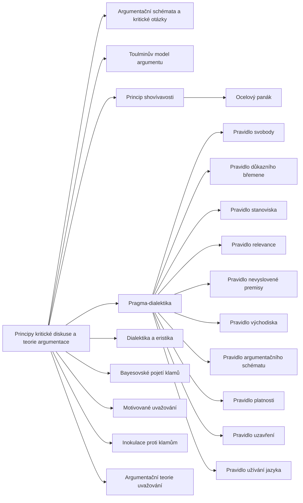

+++
title = "Principy kritické diskuse a teorie argumentace"
description = "Normativní rámec katalogu: deset pravidel kritické diskuse, argumentační schémata, princip shovívavosti a výzkum uvažování, podle nichž se fauly rozpoznávají."
weight = 9
sort_by = "weight"
template = "kompendium/section.html"
page_template = "kompendium/page.html"
insert_anchor_links = "right"

[extra]
tags = ["fauly", "fauly-teorie-argumentace"]
categories = ["academic"]
toc = true
lang = "cs"
keywords = ["Principy kritické diskuse a teorie argumentace", "Rules of critical discussion and argumentation theory", "Argumentační fauly"]
schema_type = "DefinedTermSet"
catalog = "fauly"
catalog_schema = 1
catalog_export = "data/fauly-katalog.json"
catalog_family = "teorie-argumentace"
catalog_code = "09"
catalog_en = "Rules of critical discussion and argumentation theory"
catalog_size = 20
catalog_members = ["pravidlo-svobody", "pravidlo-dukazniho-bremene", "pravidlo-stanoviska", "pravidlo-relevance", "pravidlo-nevyslovene-premisy", "pravidlo-vychodiska", "pravidlo-argumentacniho-schematu", "pravidlo-platnosti", "pravidlo-uzavreni", "pravidlo-uzivani-jazyka", "argumentacni-schemata", "toulminuv-model", "princip-shovivavosti", "ocelovy-panak", "pragma-dialektika", "dialektika-a-eristika", "bayesovske-pojeti-klamu", "motivovane-uvazovani", "inokulace-proti-klamum", "argumentacni-teorie-uvazovani"]
catalog_types = ["concept"]
catalog_sources = ["govier-2010", "hahn-oaksford-2007", "hamblin-1970", "kunda-1990", "mercier-sperber-2011", "roozenbeek-2022", "toulmin-1958", "walton-1995", "walton-reed-macagno-2008", "eemeren-grootendorst-1992", "eemeren-grootendorst-2004"]
+++

# Principy kritické diskuse a teorie argumentace

## Co rodina zahrnuje

Tato rodina se od ostatních rodin katalogu liší tím, že nepopisuje jednotlivé fauly, ale měřítka,
podle nichž se fauly rozpoznávají. Každá výtka „to je klam“ předpokládá představu o tom, jak by
rozumná výměna argumentů měla vypadat. Tradiční výklad klamů tuto představu nechával nevyslovenou
a předkládal klamy jako seznam, jehož položky spojovalo jen to, že „vypadají jako dobré argumenty,
ale nejsou“. Kritika tohoto standardního výkladu ukázala, že seznam je nesourodý a že bez modelu
dialogu nelze vysvětlit, proč je [útok na osobu](@/kompendium/argumentacni-fauly/relevance/ad-hominem.md), hrozba nebo otázka s ukrytým předpokladem chybou
(Hamblin 1970). Teorie argumentace druhé poloviny dvacátého století proto začala klamy vymezovat
vůči výslovným normám rozumného rozhovoru. Rodina shromažďuje nejvlivnější z těchto norem a
pojmy, které s nimi pracují, aby čtenář u každého faulu katalogu věděl, jaké pravidlo porušuje a
podle čeho lze porušení posoudit.

Rodina má dvě části. První tvoří deset pravidel kritické diskuse, jak je formulovala
pragma-dialektická škola: každému pravidlu je věnována samostatná stránka, která popisuje jeho
obsah, fauly, které ho porušují, a způsob, jak porušení rozpoznat a jak na ně odpovědět (van
Eemeren a Grootendorst 1992). Druhou část tvoří pojmy a přístupy, které tento rámec doplňují,
rozšiřují nebo zpochybňují: argumentační schémata s kritickými otázkami, Toulminův model, princip
shovívavosti a jeho silnější podoba, rozlišení dialektiky a eristiky, bayesovský přístup ke klamům
a psychologický výzkum motivovaného uvažování, inokulace a argumentační funkce rozumu.

## Kritická diskuse jako normativní model

Pragma-dialektika vychází z představy, že argumentace slouží k řešení rozdílu názorů podle jeho
věcné stránky. Tento účel popisuje ideálním modelem kritické diskuse, v němž jedna strana předkládá
stanovisko a hájí ho, druhá o něm pochybuje a zkoumá obhajobu, a obě se řídí pravidly, která
zaručují, že výsledek bude odpovídat síle argumentů, a ne moci, vytrvalosti nebo obratnosti
stran (van Eemeren a Grootendorst 2004). Model rozlišuje čtyři fáze. Ve fázi konfrontace se
formuluje rozdíl názorů. Ve fázi zahájení se strany dohodnou na rolích a na společných
východiscích. Ve fázi argumentace obhájce předkládá důvody a oponent je zkoumá. Ve fázi uzavření
strany zjišťují, k čemu dospěly. Model není popisem skutečných rozhovorů, které jsou mnohem
neuspořádanější. Je měřítkem: umožňuje u každého tahu ve skutečném rozhovoru zeptat se, zda
přispívá k řešení sporu, nebo ho maří.

Z této perspektivy je faul tahem, který porušuje některé z pravidel modelu, a tím ohrožuje
řešení rozdílu názorů (van Eemeren a Grootendorst 1992). Takové vymezení má dvě důležité
vlastnosti. Za prvé sjednocuje nesourodý tradiční seznam: útok na osobu, kruhový argument i
ekvivokace jsou fauly ze stejného důvodu, protože každý porušuje některé pravidlo, i když každý
jiné. Za druhé vymezení nečiní žádný druh argumentu vadným předem. Odvolání na autoritu, emoční
apel nebo poukaz na zájem mluvčího jsou fauly jen tehdy, pokud v dané situaci pravidlo skutečně
porušují. Tím se pragma-dialektika blíží dialogické teorii klamů, podle níž je klam zneužitím
argumentačního tahu, který může být v jiném kontextu zcela v pořádku (Walton 1995).

## Deset pravidel

Pravidla lze číst jako průchod fázemi diskuse. Ve fázi konfrontace platí
[pravidlo svobody](@/kompendium/argumentacni-fauly/teorie-argumentace/pravidlo-svobody.md), podle
něhož nikdo nesmí druhému bránit předložit stanovisko nebo o něm pochybovat; porušují ho útoky na
osobu, hrozby a prohlašování stanovisek za nedotknutelná. Ve fázi zahájení platí
[pravidlo důkazního břemene](@/kompendium/argumentacni-fauly/teorie-argumentace/pravidlo-dukazniho-bremene.md),
podle něhož kdo předloží stanovisko, musí ho na žádost obhájit; porušuje ho únik před břemenem a
jeho přesun na pochybujícího. Ve fázi argumentace platí šest pravidel.
[Pravidlo stanoviska](@/kompendium/argumentacni-fauly/teorie-argumentace/pravidlo-stanoviska.md)
požaduje, aby kritika mířila na skutečně předložené stanovisko, a porušuje ho [slaměný panák](@/kompendium/argumentacni-fauly/relevance/slameny-panak.md).
[Pravidlo relevance](@/kompendium/argumentacni-fauly/teorie-argumentace/pravidlo-relevance.md)
požaduje, aby obhajoba předkládala důvody, které se ke stanovisku vztahují, a porušuje ho
irelevantní argumentace i působení na emoce místo důvodů.
[Pravidlo nevyslovené premisy](@/kompendium/argumentacni-fauly/teorie-argumentace/pravidlo-nevyslovene-premisy.md)
zakazuje přisoudit druhému zveličenou implicitní premisu i popřít vlastní.
[Pravidlo východiska](@/kompendium/argumentacni-fauly/teorie-argumentace/pravidlo-vychodiska.md)
zakazuje vydávat sporné tvrzení za přijatý výchozí bod i popírat přijaté body; porušuje ho kruhový
argument a otázka s ukrytým předpokladem.
[Pravidlo argumentačního schématu](@/kompendium/argumentacni-fauly/teorie-argumentace/pravidlo-argumentacniho-schematu.md)
požaduje vhodné a správně použité spojení mezi důvodem a stanoviskem, a porušuje ho nepatřičná
autorita, [ukvapené zobecnění](@/kompendium/argumentacni-fauly/predpoklady-argumentu/ukvapene-zobecneni.md) nebo [kluzký svah](@/kompendium/argumentacni-fauly/predpoklady-argumentu/kluzky-svah.md).
[Pravidlo platnosti](@/kompendium/argumentacni-fauly/teorie-argumentace/pravidlo-platnosti.md)
požaduje logicky platný úsudek po doplnění nevyslovených premis, a porušují ho formální klamy.
Ve fázi uzavření platí [pravidlo uzavření](@/kompendium/argumentacni-fauly/teorie-argumentace/pravidlo-uzavreni.md),
podle něhož neúspěšná obhajoba vede ke stažení stanoviska a úspěšná ke stažení pochybnosti.
Napříč všemi fázemi platí [pravidlo užívání jazyka](@/kompendium/argumentacni-fauly/teorie-argumentace/pravidlo-uzivani-jazyka.md),
které zakazuje nejasné a matoucím způsobem dvojznačné formulace a ukládá pečlivý výklad formulací
druhého (van Eemeren a Grootendorst 2004).

## Doplňující pojmy a přístupy

Pravidla kritické diskuse říkají, co je v rozhovoru přípustné, ale samy nedávají nástroj k tomu,
jak posoudit jednotlivý argument. Tento nástroj nabízí teorie argumentačních schémat, která ke
každému typu argumentu, od argumentu autoritou po argument analogií, přiřazuje sadu kritických
otázek; stránka [argumentační schémata a kritické otázky](@/kompendium/argumentacni-fauly/teorie-argumentace/argumentacni-schemata.md)
je podrobně rozebírá (Walton, Reed a Macagno 2008). Starší a v praxi velmi rozšířený nástroj
analýzy představuje [Toulminův model argumentu](@/kompendium/argumentacni-fauly/teorie-argumentace/toulminuv-model.md),
který v argumentu rozlišuje údaje, závěr, oprávnění, jeho opory, výhrady a míru jistoty (Toulmin
1958). Interpretační stránku pravidel stanoviska, nevyslovené premisy a užívání jazyka rozvádějí
hesla [princip shovívavosti](@/kompendium/argumentacni-fauly/teorie-argumentace/princip-shovivavosti.md)
a [ocelový panák](@/kompendium/argumentacni-fauly/teorie-argumentace/ocelovy-panak.md), která
popisují, jak cizí argument rekonstruovat v nejvěrnější, případně nejsilnější podobě (Govier 2010).
Souhrnný výklad celé školy podává heslo
[pragma-dialektika](@/kompendium/argumentacni-fauly/teorie-argumentace/pragma-dialektika.md) a
historické rozlišení mezi rozhovorem, který hledá pravdu, a sporem, který hledá vítězství, heslo
[dialektika a eristika](@/kompendium/argumentacni-fauly/teorie-argumentace/dialektika-a-eristika.md).

Druhá skupina doplňujících hesel se týká empirického a pravděpodobnostního pohledu na klamy.
[Bayesovské pojetí klamů](@/kompendium/argumentacni-fauly/teorie-argumentace/bayesovske-pojeti-klamu.md)
ukazuje, že síla mnoha argumentů, které tradice označuje za klamy, závisí na pravděpodobnostech, a
že tatáž forma může být jednou silná a jindy slabá (Hahn a Oaksford 2007).
[Motivované uvažování](@/kompendium/argumentacni-fauly/teorie-argumentace/motivovane-uvazovani.md)
popisuje, jak cíle a přání ovlivňují, které argumenty lidé hledají a jak přísně je posuzují (Kunda
1990). [Argumentační teorie uvažování](@/kompendium/argumentacni-fauly/teorie-argumentace/argumentacni-teorie-uvazovani.md)
tvrdí, že lidský rozum se vyvinul především k tvorbě a hodnocení argumentů v dialogu, a vysvětluje
tím, proč jsou lidé kritičtější k cizím argumentům než ke svým (Mercier a Sperber 2011). Heslo
[inokulace proti klamům](@/kompendium/argumentacni-fauly/teorie-argumentace/inokulace-proti-klamum.md)
shrnuje výzkum, podle něhož předchozí seznámení se strukturou manipulativních technik zlepšuje
schopnost je rozpoznat (Roozenbeek a kol. 2022).

## Jak rodinu číst

Čtenář, který přichází od konkrétního faulu, může v této rodině najít odpověď na otázku, proč je
daný tah chybou a podle čeho se pozná, kdy chybou není. Stránky pravidel proto u každého pravidla
uvádějí fauly, které ho porušují, a odkazují na jejich hesla v ostatních rodinách katalogu, od
[klamů relevance](@/kompendium/argumentacni-fauly/relevance/_index.md) po
[formální klamy](@/kompendium/argumentacni-fauly/formalni/_index.md). Zároveň u každého pravidla
popisují, kde se jeho uplatnění láme: kdy je omezení diskuse oprávněné, kdy je odvolání na autoritu
v pořádku a kdy je nejasnost poctivým přiznáním nejistoty. Toto odlišení je pro obranný rámec
kompendia podstatné. Kdo zná jen seznam klamů, snadno ho začne používat jako zbraň a každý
nepohodlný argument označí za klam; kdo zná pravidla, ví, že výtka faulu je sama tahem v diskusi,
který musí být zdůvodněn.

Pravidla mají i omezení, která je třeba mít na paměti. Jsou formulována pro kritickou diskusi,
tedy pro rozhovor, jehož účelem je řešit rozdíl názorů. Ve vyjednávání, ve vyšetřování, v
poradenství nebo v terapeutickém rozhovoru platí jiné účely, a tah, který by v kritické diskusi byl
faulem, tam může být legitimní (Walton 1995). Pravidla také nezaručují pravdu: diskuse vedená
bezvadně může skončit nepravdivým závěrem, pokud strany sdílejí nepravdivé východisko. A konečně
pravidla předpokládají strany, které chtějí spor řešit. Pokud jedna ze stran o řešení nestojí,
pravidla jí nemohou zabránit v porušování; mohou jen pomoci druhé straně a pozorovatelům porušení
rozpoznat, pojmenovat a odmítnout přijmout jeho výsledek. Právě v tom spočívá jejich hodnota pro
klinickou, forenzní a výzkumnou praxi, které kompendium slouží.

<!-- kompendium:katalog-vazby:begin (scripts/catalogs.py; neupravovat ručně) -->

## Hesla rodiny

| Kód | Heslo | Anglicky | Druh | Užití | Riziko |
|-----|-------|----------|------|-------|--------|
| `AF-09.01` | [Pravidlo svobody](@/kompendium/argumentacni-fauly/teorie-argumentace/pravidlo-svobody.md) | Freedom rule | pojem a princip | výkladový pojem | střední |
| `AF-09.02` | [Pravidlo důkazního břemene](@/kompendium/argumentacni-fauly/teorie-argumentace/pravidlo-dukazniho-bremene.md) | Burden-of-proof rule | pojem a princip | výkladový pojem | střední |
| `AF-09.03` | [Pravidlo stanoviska](@/kompendium/argumentacni-fauly/teorie-argumentace/pravidlo-stanoviska.md) | Standpoint rule | pojem a princip | výkladový pojem | nízké |
| `AF-09.04` | [Pravidlo relevance](@/kompendium/argumentacni-fauly/teorie-argumentace/pravidlo-relevance.md) | Relevance rule | pojem a princip | výkladový pojem | nízké |
| `AF-09.05` | [Pravidlo nevyslovené premisy](@/kompendium/argumentacni-fauly/teorie-argumentace/pravidlo-nevyslovene-premisy.md) | Unexpressed-premise rule | pojem a princip | výkladový pojem | nízké |
| `AF-09.06` | [Pravidlo východiska](@/kompendium/argumentacni-fauly/teorie-argumentace/pravidlo-vychodiska.md) | Starting-point rule | pojem a princip | výkladový pojem | střední |
| `AF-09.07` | [Pravidlo argumentačního schématu](@/kompendium/argumentacni-fauly/teorie-argumentace/pravidlo-argumentacniho-schematu.md) | Argument-scheme rule | pojem a princip | výkladový pojem | nízké |
| `AF-09.08` | [Pravidlo platnosti](@/kompendium/argumentacni-fauly/teorie-argumentace/pravidlo-platnosti.md) | Validity rule | pojem a princip | výkladový pojem | nízké |
| `AF-09.09` | [Pravidlo uzavření](@/kompendium/argumentacni-fauly/teorie-argumentace/pravidlo-uzavreni.md) | Closure rule | pojem a princip | výkladový pojem | střední |
| `AF-09.10` | [Pravidlo užívání jazyka](@/kompendium/argumentacni-fauly/teorie-argumentace/pravidlo-uzivani-jazyka.md) | Usage rule | pojem a princip | výkladový pojem | střední |
| `AF-09.11` | [Argumentační schémata a kritické otázky](@/kompendium/argumentacni-fauly/teorie-argumentace/argumentacni-schemata.md) | Argumentation schemes | pojem a princip | výkladový pojem | nízké |
| `AF-09.12` | [Toulminův model argumentu](@/kompendium/argumentacni-fauly/teorie-argumentace/toulminuv-model.md) | Toulmin model | pojem a princip | výkladový pojem | nízké |
| `AF-09.13` | [Princip shovívavosti](@/kompendium/argumentacni-fauly/teorie-argumentace/princip-shovivavosti.md) | Principle of charity | pojem a princip | výkladový pojem | nízké |
| `AF-09.14` | [Ocelový panák](@/kompendium/argumentacni-fauly/teorie-argumentace/ocelovy-panak.md) | Steelmanning | pojem a princip | výkladový pojem | nízké |
| `AF-09.15` | [Pragma-dialektika](@/kompendium/argumentacni-fauly/teorie-argumentace/pragma-dialektika.md) | Pragma-dialectics | pojem a princip | výkladový pojem | nízké |
| `AF-09.16` | [Dialektika a eristika](@/kompendium/argumentacni-fauly/teorie-argumentace/dialektika-a-eristika.md) | Dialectic and eristic | pojem a princip | výkladový pojem | střední |
| `AF-09.17` | [Bayesovské pojetí klamů](@/kompendium/argumentacni-fauly/teorie-argumentace/bayesovske-pojeti-klamu.md) | Bayesian account of fallacies | pojem a princip | výkladový pojem | nízké |
| `AF-09.18` | [Motivované uvažování](@/kompendium/argumentacni-fauly/teorie-argumentace/motivovane-uvazovani.md) | Motivated reasoning | pojem a princip | převážně chyba uvažování | střední |
| `AF-09.19` | [Inokulace proti klamům](@/kompendium/argumentacni-fauly/teorie-argumentace/inokulace-proti-klamum.md) | Inoculation against fallacies | pojem a princip | výkladový pojem | nízké |
| `AF-09.20` | [Argumentační teorie uvažování](@/kompendium/argumentacni-fauly/teorie-argumentace/argumentacni-teorie-uvazovani.md) | Argumentative theory of reasoning | pojem a princip | výkladový pojem | nízké |

## Mapa rodiny

Mapu odvozuje engine katalogů z vazeb „obecnější heslo“; uzel otevře heslo.

## Literatura

- Govier, T. (2010). *A Practical Study of Argument* (7. vyd.). Belmont: Wadsworth.
- Hahn, U., & Oaksford, M. (2007). The rationality of informal argumentation: A Bayesian approach to reasoning fallacies. *Psychological Review*, 114(3), 704–732.
- Hamblin, C. L. (1970). *Fallacies*. London: Methuen.
- Kunda, Z. (1990). The case for motivated reasoning. *Psychological Bulletin*, 108(3), 480–498.
- Mercier, H., & Sperber, D. (2011). Why do humans reason? Arguments for an argumentative theory. *Behavioral and Brain Sciences*, 34(2), 57–74.
- Roozenbeek, J., van der Linden, S., Goldberg, B., Rathje, S., & Lewandowsky, S. (2022). Psychological inoculation improves resilience against misinformation on social media. *Science Advances*, 8(34), eabo6254.
- Toulmin, S. E. (1958). *The Uses of Argument*. Cambridge: Cambridge University Press.
- Walton, D. N. (1995). *A Pragmatic Theory of Fallacy*. Tuscaloosa: University of Alabama Press.
- Walton, D., Reed, C., & Macagno, F. (2008). *Argumentation Schemes*. Cambridge: Cambridge University Press.
- van Eemeren, F. H., & Grootendorst, R. (1992). *Argumentation, Communication, and Fallacies: A Pragma-Dialectical Perspective*. Hillsdale: Lawrence Erlbaum.
- van Eemeren, F. H., & Grootendorst, R. (2004). *A Systematic Theory of Argumentation: The Pragma-Dialectical Approach*. Cambridge: Cambridge University Press.

## Související

- [Argumentační fauly](@/kompendium/argumentacni-fauly/_index.md) – celý katalog a jeho rodiny
- [Klamy hodnot, přírody a vědy](@/kompendium/argumentacni-fauly/hodnoty-a-veda/_index.md) – předchozí rodina katalogu
- [Trenér rozpoznávání](@/kompendium/trener.md) – procvičení rozpoznání hesel této rodiny

<!-- kompendium:katalog-vazby:end -->
