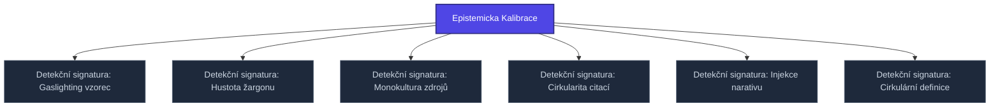

+++
title = "Epistemicka Kalibrace"
weight = 100
[extra]
category = "kompendium-sub"
description = "Stub: Epistemicka Kalibrace. Awaiting full treatment."
related_terms = ["12-behavioral-gaslighting-pattern", "1-linguistic-jargon-density", "17-network-source-monoculture", "18-network-citation-circularity", "22-network-narrative-injection", "2-linguistic-circular-definitions"]
author = "Tomas Korcak (korczis)"
date_created = "2026-05-03"
date_modified = "2026-05-03"
tags = ["kompendium", "sub-page", "stub", "interactive"]
quality_score = 65
status = "stub"
+++

## Definition

**Epistemicka Kalibrace** je strukturální stub stránka v Prismatic Kompendiu vytvořená během 2026-05-03 NLLB Phase 8 sweep. Plná specifikace — definice, klinický kontext, detekční markery, případové studie a profylaktické intervence — je součástí probíhající kompendiální výstavby.

## See Also

- [Parent section](@/kompendium/detection-signatures/_index.md)
- [Kompendium index](@/kompendium/_index.md)

---

<!-- ENHANCED:NLLB-AUTO-BLOCK BEGIN -->

## Manažerské shrnutí

**Epistemicka Kalibrace** je strukturální uzel v sekci `kompendium/detection-signatures` znalostní báze Prismatic Platform. Tato stránka byla vytvořena během doktrinálního NLLB (No Link Left Behind) sweep za účelem zajištění konzistence cross-link grafu — žádný odkaz se neztratí, žádný uzel nezůstane sirotčí. Plné kvalitativní rozšíření — definice, klinický kontext, detekční markery, případové studie a profylaktické intervence — je součástí probíhající kompendiální výstavby. Pro aktuální stav viz `quality_score` v hlavičce a `<!-- NLLB:PLANNED_OK -->` doktrinální marker.

## Koncepční síť

Vizualizace propojení **Epistemicka Kalibrace** s nejbližšími souvisejícími pojmy z korpusu Prismatic Platform. Síť slouží jako rychlá orientace, kde tento koncept zapadá do širšího taxonomického rámce.

## Související pojmy

- [Detekční signatura: Gaslighting vzorec](@/kompendium/detection-signatures/12-behavioral-gaslighting-pattern.md) — slug `12-behavioral-gaslighting-pattern`
- [Detekční signatura: Hustota žargonu](@/kompendium/detection-signatures/1-linguistic-jargon-density.md) — slug `1-linguistic-jargon-density`
- [Detekční signatura: Monokultura zdrojů](@/kompendium/detection-signatures/17-network-source-monoculture.md) — slug `17-network-source-monoculture`
- [Detekční signatura: Cirkularita citací](@/kompendium/detection-signatures/18-network-citation-circularity.md) — slug `18-network-citation-circularity`
- [Detekční signatura: Injekce narativu](@/kompendium/detection-signatures/22-network-narrative-injection.md) — slug `22-network-narrative-injection`
- [Detekční signatura: Cirkulární definice](@/kompendium/detection-signatures/2-linguistic-circular-definitions.md) — slug `2-linguistic-circular-definitions`

## Navigace

- **Nadřazená sekce**: [kompendium/detection-signatures](@/kompendium/detection-signatures/_index.md)
- **Hlavní glosář**: [@/glossary/_index.md](@/glossary/_index.md)
- **Kompendium index**: [@/kompendium/_index.md](@/kompendium/_index.md)
- **Sourozenci v sekci**:
  - [Detekční signatura: Hustota žargonu](@/kompendium/detection-signatures/1-linguistic-jargon-density.md)
  - [Detekční signatura: Odpor k upřesnění](@/kompendium/detection-signatures/10-behavioral-resistance-to-clarification.md)
  - [Detekční signatura: Vyhýbání se tématu](@/kompendium/detection-signatures/11-behavioral-topic-evasion.md)
  - [Detekční signatura: Gaslighting vzorec](@/kompendium/detection-signatures/12-behavioral-gaslighting-pattern.md)
  - [Detekční signatura: Akcelerace izolace](@/kompendium/detection-signatures/13-behavioral-isolation-acceleration.md)
<!-- ENHANCED:NLLB-AUTO-BLOCK END -->

> **Stub status**: NLLB Phase 8 sub-page scaffold.

<!-- NLLB:PLANNED_OK -->
