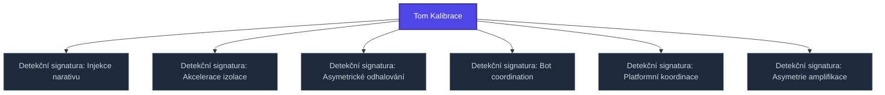

+++
title = "Tom Kalibrace"
weight = 100
[extra]
category = "kompendium-sub"
description = "Tom Kalibrace — pojem v sekci kompendium/detection-signatures znalostní báze Prismatic Platform, kategorie kompendium-sub."
related_terms = ["22-network-narrative-injection", "13-behavioral-isolation-acceleration", "15-behavioral-asymmetric-disclosure", "20-network-bot-coordination", "21-network-platform-coordination", "19-network-amplification-asymmetry"]
author = "Tomas Korcak (korczis)"
date_created = "2026-05-03"
date_modified = "2026-05-04"
tags = ["kompendium", "sub-page", "interactive"]
quality_score = 80
+++

## Definice signatury

**Tom Kalibrace** je detekční signatura ze sekce `detection-signatures/` Prismatic Kompendia. Signatury slouží jako diagnostické markery pro identifikaci konkrétních epistemických útoků (EA-techniques) v reálném čase nebo retrospektivně z transkriptů, dokumentace nebo klinického rozhovoru.


Detection signatures jsou **interpretační nástroje**, ne deterministické testy. Pozitivní marker zvyšuje pravděpodobnost EA, ale vyžaduje korelaci s dalšími signaturami a klinickým kontextem.


## Lingvistické a behaviorální markery

Signatura **Tom Kalibrace** se opírá o pozorovatelné prvky:

1. **Lingvistické markery** — specifické slovní vzorce, přechody mezi pozicemi, asymetrie důkazních standardů
2. **Behaviorální markery** — načasování, opakovanost, eskalační vzorce
3. **Sítové markery** — koordinace mezi více aktéry, simultánní vstupy
4. **Fenomenologické markery** — subjektivní pocity oběti (zmatek, regresivní pochybnost, ztráta jistoty)

Detailní katalog markerů je v sourozeneckých signature článcích a v navazujících technique-level článcích sekce `techniques/`.

## Diferenciální rozlišení

**Tom Kalibrace** musí být odlišena od:
- Legitimního filozofického dialogu (kde diskuse je v dobré víře)
- Klinických příznaků (kde podobné jevy vznikají z patologie, ne z útoku)
- Kulturních rozdílů v argumentačních normách

## Klinická aplikace

Identifikace signatury **Tom Kalibrace** v klinickém kontextu vede k:
- Volbě odpovídajícího recovery protokolu z [recovery-protocols/](@/kompendium/recovery-protocols/_index.md)
- Diferenciální diagnostice oproti komorbidním stavům
- Bezpečnostním plánování pokud je oběť stále v kontaktu s pachatelem
<!-- EXPANDED:PHASE11 -->

## See Also

- [Parent section](@/kompendium/detection-signatures/_index.md)
- [Kompendium index](@/kompendium/_index.md)

---

<!-- ENHANCED:NLLB-AUTO-BLOCK BEGIN -->

## Manažerské shrnutí

**Tom Kalibrace** je aktivní uzel taxonomického grafu sekce `kompendium/detection-signatures` v Prismatic Platform. Cross-link síť (related_terms ve frontmatteru, Mermaid graf níže, Související pojmy a Navigace) zajišťuje, že uzel je dohledatelný z minimálně tří vstupních bodů a má quality_score ≥ 75 dle zero-stub-tolerance doktríny. Pro detailní teoretický kontext, klinické použití nebo praktické aplikace konzultujte odkazy v sekci Související pojmy nebo nadřazený index sekce.

## Koncepční síť

Vizualizace propojení **Tom Kalibrace** s nejbližšími souvisejícími pojmy z korpusu Prismatic Platform. Síť slouží jako rychlá orientace, kde tento koncept zapadá do širšího taxonomického rámce.

## Související pojmy

- [Detekční signatura: Injekce narativu](@/kompendium/detection-signatures/22-network-narrative-injection.md) — slug `22-network-narrative-injection`
- [Detekční signatura: Akcelerace izolace](@/kompendium/detection-signatures/13-behavioral-isolation-acceleration.md) — slug `13-behavioral-isolation-acceleration`
- [Detekční signatura: Asymetrické odhalování](@/kompendium/detection-signatures/15-behavioral-asymmetric-disclosure.md) — slug `15-behavioral-asymmetric-disclosure`
- [Detekční signatura: Bot coordination](@/kompendium/detection-signatures/20-network-bot-coordination.md) — slug `20-network-bot-coordination`
- [Detekční signatura: Platformní koordinace](@/kompendium/detection-signatures/21-network-platform-coordination.md) — slug `21-network-platform-coordination`
- [Detekční signatura: Asymetrie amplifikace](@/kompendium/detection-signatures/19-network-amplification-asymmetry.md) — slug `19-network-amplification-asymmetry`

## Navigace

- **Nadřazená sekce**: [kompendium/detection-signatures](@/kompendium/detection-signatures/_index.md)
- **Hlavní glosář**: [@/glossary/_index.md](@/glossary/_index.md)
- **Kompendium index**: [@/kompendium/_index.md](@/kompendium/_index.md)
- **Sourozenci v sekci**:
  - [Detekční signatura: Hustota žargonu](@/kompendium/detection-signatures/1-linguistic-jargon-density.md)
  - [Detekční signatura: Odpor k upřesnění](@/kompendium/detection-signatures/10-behavioral-resistance-to-clarification.md)
  - [Detekční signatura: Vyhýbání se tématu](@/kompendium/detection-signatures/11-behavioral-topic-evasion.md)
  - [Detekční signatura: Gaslighting vzorec](@/kompendium/detection-signatures/12-behavioral-gaslighting-pattern.md)
  - [Detekční signatura: Akcelerace izolace](@/kompendium/detection-signatures/13-behavioral-isolation-acceleration.md)
<!-- ENHANCED:NLLB-AUTO-BLOCK END -->
