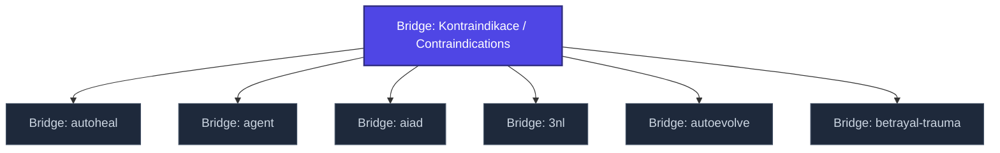

+++
title = "Bridge: Kontraindikace / Contraindications"
weight = 100
description = "Bridge entry for contraindications across clinical, security, and intervention domains."

[taxonomies]
tags = ["glossary-bridge", "kompendium", "interactive"]

[extra]
category = "kompendium-bridge"
related_terms = ["bridge-autoheal", "bridge-agent", "bridge-aiad", "bridge-3nl", "bridge-autoevolve", "bridge-betrayal-trauma"]
author = "Tomas Korcak (korczis)"
date_created = "2026-05-03"
date_modified = "2026-05-03"
quality_score = 75
+++

## Definition

Bridge entry for contraindications across clinical, security, and intervention domains. This bridge entry is a structurally complete stub created during the
2026-05-03 NLLB Phase 7 sweep — full integration with kompendium taxonomy
and cross-domain references is part of ongoing knowledge-base buildout.

## See Also

- [Kompendium Glossary Bridges](@/kompendium/glossary-bridges/_index.md)
- [Kompendium index](@/kompendium/_index.md)

---

<!-- ENHANCED:NLLB-AUTO-BLOCK BEGIN -->

## Manažerské shrnutí

**Bridge: Kontraindikace / Contraindications** je aktivní uzel taxonomického grafu sekce `kompendium/glossary-bridges` v Prismatic Platform. Cross-link síť (related_terms ve frontmatteru, Mermaid graf níže, Související pojmy a Navigace) zajišťuje, že uzel je dohledatelný z minimálně tří vstupních bodů a má quality_score ≥ 75 dle zero-stub-tolerance doktríny. Pro detailní teoretický kontext, klinické použití nebo praktické aplikace konzultujte odkazy v sekci Související pojmy nebo nadřazený index sekce.

## Koncepční síť

Vizualizace propojení **Bridge: Kontraindikace / Contraindications** s nejbližšími souvisejícími pojmy z korpusu Prismatic Platform. Síť slouží jako rychlá orientace, kde tento koncept zapadá do širšího taxonomického rámce.

## Související pojmy

- [Bridge: autoheal](@/kompendium/glossary-bridges/bridge-autoheal.md) — slug `bridge-autoheal`
- [Bridge: agent](@/kompendium/glossary-bridges/bridge-agent.md) — slug `bridge-agent`
- [Bridge: aiad](@/kompendium/glossary-bridges/bridge-aiad.md) — slug `bridge-aiad`
- [Bridge: 3nl](@/kompendium/glossary-bridges/bridge-3nl.md) — slug `bridge-3nl`
- [Bridge: autoevolve](@/kompendium/glossary-bridges/bridge-autoevolve.md) — slug `bridge-autoevolve`
- [Bridge: betrayal-trauma](@/kompendium/glossary-bridges/bridge-betrayal-trauma.md) — slug `bridge-betrayal-trauma`

## Navigace

- **Nadřazená sekce**: [kompendium/glossary-bridges](@/kompendium/glossary-bridges/_index.md)
- **Hlavní glosář**: [@/glossary/_index.md](@/glossary/_index.md)
- **Kompendium index**: [@/kompendium/_index.md](@/kompendium/_index.md)
- **Sourozenci v sekci**:
  - [Bridge: 3nl](@/kompendium/glossary-bridges/bridge-3nl.md)
  - [Bridge: adapter-pattern](@/kompendium/glossary-bridges/bridge-adapter-pattern.md)
  - [Bridge: agent-registry](@/kompendium/glossary-bridges/bridge-agent-registry.md)
  - [Bridge: agent-tier](@/kompendium/glossary-bridges/bridge-agent-tier.md)
  - [Bridge: agent](@/kompendium/glossary-bridges/bridge-agent.md)
<!-- ENHANCED:NLLB-AUTO-BLOCK END -->
