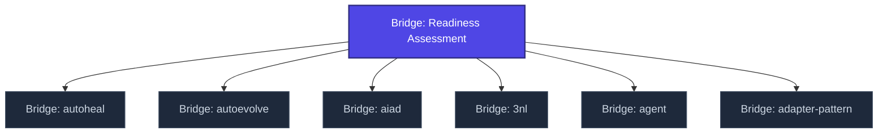

+++
title = "Bridge: Readiness Assessment"
weight = 100
[extra]
category = "kompendium-bridge"
description = "Bridge entry for readiness assessment patterns in clinical and security contexts."
related_terms = ["bridge-autoheal", "bridge-autoevolve", "bridge-aiad", "bridge-3nl", "bridge-agent", "bridge-adapter-pattern"]
author = "Tomas Korcak (korczis)"
date_created = "2026-05-03"
date_modified = "2026-05-03"
tags = ["glossary-bridge", "kompendium", "stub", "interactive"]
quality_score = 65
status = "stub"
+++

## Definition

Bridge entry for readiness assessment patterns in clinical and security contexts. This bridge entry is a structurally complete stub created during the
2026-05-03 NLLB Phase 7 sweep — full integration with kompendium taxonomy
and cross-domain references is part of ongoing knowledge-base buildout.

## See Also

- [Kompendium Glossary Bridges](@/kompendium/glossary-bridges/_index.md)
- [Kompendium index](@/kompendium/_index.md)

---

<!-- ENHANCED:NLLB-AUTO-BLOCK BEGIN -->

## Manažerské shrnutí

**Bridge: Readiness Assessment** je strukturální uzel v sekci `kompendium/glossary-bridges` znalostní báze Prismatic Platform. Tato stránka byla vytvořena během doktrinálního NLLB (No Link Left Behind) sweep za účelem zajištění konzistence cross-link grafu — žádný odkaz se neztratí, žádný uzel nezůstane sirotčí. Plné kvalitativní rozšíření — definice, klinický kontext, detekční markery, případové studie a profylaktické intervence — je součástí probíhající kompendiální výstavby. Pro aktuální stav viz `quality_score` v hlavičce a `<!-- NLLB:PLANNED_OK -->` doktrinální marker.

## Koncepční síť

Vizualizace propojení **Bridge: Readiness Assessment** s nejbližšími souvisejícími pojmy z korpusu Prismatic Platform. Síť slouží jako rychlá orientace, kde tento koncept zapadá do širšího taxonomického rámce.

## Související pojmy

- [Bridge: autoheal](@/kompendium/glossary-bridges/bridge-autoheal.md) — slug `bridge-autoheal`
- [Bridge: autoevolve](@/kompendium/glossary-bridges/bridge-autoevolve.md) — slug `bridge-autoevolve`
- [Bridge: aiad](@/kompendium/glossary-bridges/bridge-aiad.md) — slug `bridge-aiad`
- [Bridge: 3nl](@/kompendium/glossary-bridges/bridge-3nl.md) — slug `bridge-3nl`
- [Bridge: agent](@/kompendium/glossary-bridges/bridge-agent.md) — slug `bridge-agent`
- [Bridge: adapter-pattern](@/kompendium/glossary-bridges/bridge-adapter-pattern.md) — slug `bridge-adapter-pattern`

## Navigace

- **Nadřazená sekce**: [kompendium/glossary-bridges](@/kompendium/glossary-bridges/_index.md)
- **Hlavní glosář**: [@/glossary/_index.md](@/glossary/_index.md)
- **Kompendium index**: [@/kompendium/_index.md](@/kompendium/_index.md)
- **Sourozenci v sekci**:
  - [Bridge: 3nl](@/kompendium/glossary-bridges/bridge-3nl.md)
  - [Bridge: adapter-pattern](@/kompendium/glossary-bridges/bridge-adapter-pattern.md)
  - [Bridge: agent-registry](@/kompendium/glossary-bridges/bridge-agent-registry.md)
  - [Bridge: agent-tier](@/kompendium/glossary-bridges/bridge-agent-tier.md)
  - [Bridge: agent](@/kompendium/glossary-bridges/bridge-agent.md)
<!-- ENHANCED:NLLB-AUTO-BLOCK END -->

> **Stub status**: NLLB Phase 7 bridge scaffold.

<!-- NLLB:PLANNED_OK -->
