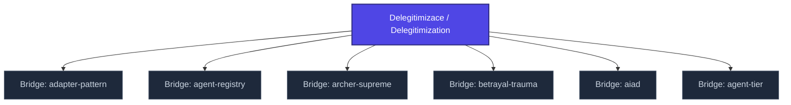

+++
title = "Delegitimizace / Delegitimization"
weight = 50
description = "Systematic undermining of credibility, authority, or epistemic standing of an individual, institution, or claim."

[taxonomies]
tags = ["glossary-bridge", "psychology", "interactive"]

[extra]
category = "psychology"
related_terms = [
  "bridge-nclb",
  "gaslighting",
  "epistemicke-trauma",
  "konceptualni-anihilace",
]
author = "Tomas Korcak (korczis)"
date_created = "2026-05-03"
date_modified = "2026-05-03"
quality_score = 75
+++

## Definition

Delegitimizace je systematické podkopávání důvěryhodnosti, autority nebo epistemického postavení jednotlivce, instituce, nebo nárokovaného tvrzení. Operuje skrze ad hominem útoky, smear campaigns, projektivní inverzi obvinění (DARVO) a strategické zpochybňování zkušeností. V Prismatic Kompendiu klasifikováno jako EA-1-3 a EA-2-x manipulační vzorce. Charakteristická pro coercive-control vztahy, totalitarian dynamiky, a digitální echo-chamber prostředí.

## See Also

- [Kompendium Glossary Bridges Index](@/kompendium/glossary-bridges/_index.md)
- [Bridge Nclb](@/kompendium/glossary-bridges/bridge-nclb/_index.md)
- [Gaslighting](@/kompendium/glossary-bridges/gaslighting.md)
- [Epistemicke Trauma](@/kompendium/glossary-bridges/epistemicke-trauma.md)
- [Konceptualni Anihilace](@/glossary/konceptualni-anihilace.md)

---

<!-- ENHANCED:NLLB-AUTO-BLOCK BEGIN -->

## Manažerské shrnutí

**Delegitimizace / Delegitimization** je aktivní uzel taxonomického grafu sekce `kompendium/glossary-bridges` v Prismatic Platform. Cross-link síť (related_terms ve frontmatteru, Mermaid graf níže, Související pojmy a Navigace) zajišťuje, že uzel je dohledatelný z minimálně tří vstupních bodů a má quality_score ≥ 75 dle zero-stub-tolerance doktríny. Pro detailní teoretický kontext, klinické použití nebo praktické aplikace konzultujte odkazy v sekci Související pojmy nebo nadřazený index sekce.

## Koncepční síť

Vizualizace propojení **Delegitimizace / Delegitimization** s nejbližšími souvisejícími pojmy z korpusu Prismatic Platform. Síť slouží jako rychlá orientace, kde tento koncept zapadá do širšího taxonomického rámce.

## Související pojmy

- [Bridge: adapter-pattern](@/kompendium/glossary-bridges/bridge-adapter-pattern.md) — slug `bridge-adapter-pattern`
- [Bridge: agent-registry](@/kompendium/glossary-bridges/bridge-agent-registry.md) — slug `bridge-agent-registry`
- [Bridge: archer-supreme](@/kompendium/glossary-bridges/bridge-archer-supreme.md) — slug `bridge-archer-supreme`
- [Bridge: betrayal-trauma](@/kompendium/glossary-bridges/bridge-betrayal-trauma.md) — slug `bridge-betrayal-trauma`
- [Bridge: aiad](@/kompendium/glossary-bridges/bridge-aiad.md) — slug `bridge-aiad`
- [Bridge: agent-tier](@/kompendium/glossary-bridges/bridge-agent-tier.md) — slug `bridge-agent-tier`

## Navigace

- **Nadřazená sekce**: [kompendium/glossary-bridges](@/kompendium/glossary-bridges/_index.md)
- **Hlavní glosář**: [@/glossary/_index.md](@/glossary/_index.md)
- **Kompendium index**: [@/kompendium/_index.md](@/kompendium/_index.md)
- **Sourozenci v sekci**:
  - [Bridge: 3nl](@/kompendium/glossary-bridges/bridge-3nl.md)
  - [Bridge: adapter-pattern](@/kompendium/glossary-bridges/bridge-adapter-pattern.md)
  - [Bridge: agent-registry](@/kompendium/glossary-bridges/bridge-agent-registry.md)
  - [Bridge: agent-tier](@/kompendium/glossary-bridges/bridge-agent-tier.md)
  - [Bridge: agent](@/kompendium/glossary-bridges/bridge-agent.md)
<!-- ENHANCED:NLLB-AUTO-BLOCK END -->
