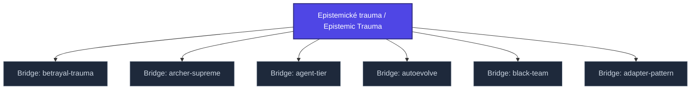

+++
title = "Epistemické trauma / Epistemic Trauma"
weight = 50
description = "Damage to knowledge-acquisition systems, belief formation, and reality-testing mechanisms."

[taxonomies]
tags = ["glossary-bridge", "philosophy", "interactive"]

[extra]
category = "philosophy"
related_terms = [
  "bridge-nclb",
  "bridge-nabla",
  "konceptualni-anihilace",
  "epistemicka-singularita",
]
author = "Tomas Korcak (korczis)"
date_created = "2026-05-03"
date_modified = "2026-05-03"
quality_score = 75
+++

## Definition

Epistemické trauma je psychologické poškození systémů získávání poznání, formace přesvědčení a reality-testing mechanismů. Vzniká dlouhodobou expozicí gaslightingu, hermeneutickému outsourcingu nebo institucionální delegitimizaci. Manifestuje se jako ztráta epistemické autonomie, hypervigilance vůči novým informacím, a obtíže v běžných epistemických aktech (rozhodování, hodnocení důkazů). V Prismatic frameworku spojeno s [NABLA Infinity](@/glossary/nabla-infinity.md) axiomatickým narušením a [signal plurality](@/glossary/signal-plurality.md) anti-patternem.

## See Also

- [Kompendium Glossary Bridges Index](@/kompendium/glossary-bridges/_index.md)
- [Bridge Nclb](@/kompendium/glossary-bridges/bridge-nclb/_index.md)
- [Bridge Nabla](@/kompendium/glossary-bridges/bridge-nabla-infinity.md)
- [Konceptualni Anihilace](@/glossary/konceptualni-anihilace.md)
- [Epistemicka Singularita](@/glossary/epistemicka-singularita.md)

---

<!-- ENHANCED:NLLB-AUTO-BLOCK BEGIN -->

## Manažerské shrnutí

**Epistemické trauma / Epistemic Trauma** je aktivní uzel taxonomického grafu sekce `kompendium/glossary-bridges` v Prismatic Platform. Cross-link síť (related_terms ve frontmatteru, Mermaid graf níže, Související pojmy a Navigace) zajišťuje, že uzel je dohledatelný z minimálně tří vstupních bodů a má quality_score ≥ 75 dle zero-stub-tolerance doktríny. Pro detailní teoretický kontext, klinické použití nebo praktické aplikace konzultujte odkazy v sekci Související pojmy nebo nadřazený index sekce.

## Koncepční síť

Vizualizace propojení **Epistemické trauma / Epistemic Trauma** s nejbližšími souvisejícími pojmy z korpusu Prismatic Platform. Síť slouží jako rychlá orientace, kde tento koncept zapadá do širšího taxonomického rámce.

## Související pojmy

- [Bridge: betrayal-trauma](@/kompendium/glossary-bridges/bridge-betrayal-trauma.md) — slug `bridge-betrayal-trauma`
- [Bridge: archer-supreme](@/kompendium/glossary-bridges/bridge-archer-supreme.md) — slug `bridge-archer-supreme`
- [Bridge: agent-tier](@/kompendium/glossary-bridges/bridge-agent-tier.md) — slug `bridge-agent-tier`
- [Bridge: autoevolve](@/kompendium/glossary-bridges/bridge-autoevolve.md) — slug `bridge-autoevolve`
- [Bridge: black-team](@/kompendium/glossary-bridges/bridge-black-team.md) — slug `bridge-black-team`
- [Bridge: adapter-pattern](@/kompendium/glossary-bridges/bridge-adapter-pattern.md) — slug `bridge-adapter-pattern`

## Navigace

- **Nadřazená sekce**: [kompendium/glossary-bridges](@/kompendium/glossary-bridges/_index.md)
- **Hlavní glosář**: [@/glossary/_index.md](@/glossary/_index.md)
- **Kompendium index**: [@/kompendium/_index.md](@/kompendium/_index.md)
- **Sourozenci v sekci**:
  - [Bridge: 3nl](@/kompendium/glossary-bridges/bridge-3nl.md)
  - [Bridge: adapter-pattern](@/kompendium/glossary-bridges/bridge-adapter-pattern.md)
  - [Bridge: agent-registry](@/kompendium/glossary-bridges/bridge-agent-registry.md)
  - [Bridge: agent-tier](@/kompendium/glossary-bridges/bridge-agent-tier.md)
  - [Bridge: agent](@/kompendium/glossary-bridges/bridge-agent.md)
<!-- ENHANCED:NLLB-AUTO-BLOCK END -->
