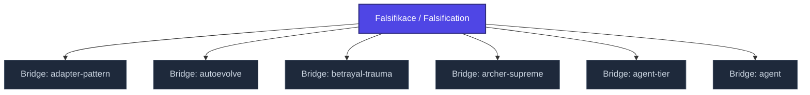

+++
title = "Falsifikace / Falsification"
weight = 50
[extra]
category = "philosophy"
description = "Popperian methodology for testing claims via attempted refutation rather than verification."
related_terms = [
  "lakatos",
  "predictive-processing",
  "epistemic-pipeline",
  "bridge-nabla",
]
author = "Tomas Korcak (korczis)"
date_created = "2026-05-03"
date_modified = "2026-05-03"
tags = ["glossary-bridge", "philosophy", "interactive"]
quality_score = 75
status = "stub"
+++

## Definition

Falsifikace (Karl Popper) je metodologický princip — vědecká tvrzení musí být *falzifikovatelná*, tj. logicky možná vyvrátit empirickým důkazem. Distinguish from verifikace (která je pro univerzální tvrzení nemožná). Klíčové kritérium demarkace mezi vědou a pseudo-vědou. Lakatos později rozšířil na [research programmes](@/glossary/lakatos.md) s hard core / protective belt strukturou. V Prismatic Kompendiu slouží jako teoretický základ pro [epistemic pipeline](@/glossary/epistemic-pipeline.md) gating — každý analytický nárok musí být prezentován ve falzifikovatelné formě.

## See Also

- [Kompendium Glossary Bridges Index](@/kompendium/glossary-bridges/_index.md)
- [Lakatos](@/glossary/lakatos.md)
- [Predictive Processing](@/glossary/predictive-processing.md)
- [Epistemic Pipeline](@/glossary/epistemic-pipeline.md)
- [Bridge Nabla](@/kompendium/glossary-bridges/bridge-nabla-infinity.md)

---

<!-- ENHANCED:NLLB-AUTO-BLOCK BEGIN -->

## Manažerské shrnutí

**Falsifikace / Falsification** je strukturální uzel v sekci `kompendium/glossary-bridges` znalostní báze Prismatic Platform. Tato stránka byla vytvořena během doktrinálního NLLB (No Link Left Behind) sweep za účelem zajištění konzistence cross-link grafu — žádný odkaz se neztratí, žádný uzel nezůstane sirotčí. Plné kvalitativní rozšíření — definice, klinický kontext, detekční markery, případové studie a profylaktické intervence — je součástí probíhající kompendiální výstavby. Pro aktuální stav viz `quality_score` v hlavičce a `<!-- NLLB:PLANNED_OK -->` doktrinální marker.

## Koncepční síť

Vizualizace propojení **Falsifikace / Falsification** s nejbližšími souvisejícími pojmy z korpusu Prismatic Platform. Síť slouží jako rychlá orientace, kde tento koncept zapadá do širšího taxonomického rámce.

## Související pojmy

- [Bridge: adapter-pattern](@/kompendium/glossary-bridges/bridge-adapter-pattern.md) — slug `bridge-adapter-pattern`
- [Bridge: autoevolve](@/kompendium/glossary-bridges/bridge-autoevolve.md) — slug `bridge-autoevolve`
- [Bridge: betrayal-trauma](@/kompendium/glossary-bridges/bridge-betrayal-trauma.md) — slug `bridge-betrayal-trauma`
- [Bridge: archer-supreme](@/kompendium/glossary-bridges/bridge-archer-supreme.md) — slug `bridge-archer-supreme`
- [Bridge: agent-tier](@/kompendium/glossary-bridges/bridge-agent-tier.md) — slug `bridge-agent-tier`
- [Bridge: agent](@/kompendium/glossary-bridges/bridge-agent.md) — slug `bridge-agent`

## Navigace

- **Nadřazená sekce**: [kompendium/glossary-bridges](@/kompendium/glossary-bridges/_index.md)
- **Hlavní glosář**: [@/glossary/_index.md](@/glossary/_index.md)
- **Kompendium index**: [@/kompendium/_index.md](@/kompendium/_index.md)
- **Sourozenci v sekci**:
  - [Bridge: 3nl](@/kompendium/glossary-bridges/bridge-3nl.md)
  - [Bridge: adapter-pattern](@/kompendium/glossary-bridges/bridge-adapter-pattern.md)
  - [Bridge: agent-registry](@/kompendium/glossary-bridges/bridge-agent-registry.md)
  - [Bridge: agent-tier](@/kompendium/glossary-bridges/bridge-agent-tier.md)
  - [Bridge: agent](@/kompendium/glossary-bridges/bridge-agent.md)
<!-- ENHANCED:NLLB-AUTO-BLOCK END -->

> **Stub status**: This entry is a structurally complete bridge stub created
> during the 2026-05-03 NLLB content-completion sweep. Full treatment with
> worked examples, cross-domain references, and integration with the EA
> taxonomy is part of the ongoing kompendium buildout.

<!-- NLLB:PLANNED_OK -->
