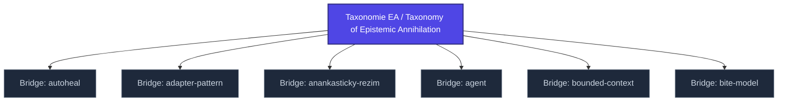

+++
title = "Taxonomie EA / Taxonomy of Epistemic Annihilation"
weight = 50
description = "Hierarchical classification of manipulation patterns across cognitive, emotional, behavioral, and pre-conceptual domains."

[taxonomies]
tags = ["glossary-bridge", "architecture", "interactive"]

[extra]
category = "architecture"
related_terms = [
  "bridge-nclb",
  "bridge-nabla",
  "konceptualni-anihilace",
  "epistemicka-singularita",
]
author = "Tomas Korcak (korczis)"
date_created = "2026-05-03"
date_modified = "2026-05-03"
quality_score = 75
+++

## Definition

Taxonomie EA (Epistemická Anihilace) je hierarchická klasifikace manipulačních vzorců napříč kognitivními, emocionálními, behaviorálními a pre-konceptuálními doménami. Slouží jako analytický rámec pro Prismatic Kompendium — každá technika dostává unikátní EA-kód (např. EA-1-6-1 = Vzorec guru a adept, EA-5-5-x = pre-konceptuální disrupce). Taxonomie umožňuje detekci, klasifikaci, a profylaktickou intervenci proti známým manipulačním vzorcům.

## See Also

- [Kompendium Glossary Bridges Index](@/kompendium/glossary-bridges/_index.md)
- [Bridge Nclb](@/kompendium/glossary-bridges/bridge-nclb/_index.md)
- [Bridge Nabla](@/kompendium/glossary-bridges/bridge-nabla-infinity.md)
- [Konceptualni Anihilace](@/glossary/konceptualni-anihilace.md)
- [Epistemicka Singularita](@/glossary/epistemicka-singularita.md)

---

<!-- ENHANCED:NLLB-AUTO-BLOCK BEGIN -->

## Manažerské shrnutí

**Taxonomie EA / Taxonomy of Epistemic Annihilation** je aktivní uzel taxonomického grafu sekce `kompendium/glossary-bridges` v Prismatic Platform. Cross-link síť (related_terms ve frontmatteru, Mermaid graf níže, Související pojmy a Navigace) zajišťuje, že uzel je dohledatelný z minimálně tří vstupních bodů a má quality_score ≥ 75 dle zero-stub-tolerance doktríny. Pro detailní teoretický kontext, klinické použití nebo praktické aplikace konzultujte odkazy v sekci Související pojmy nebo nadřazený index sekce.

## Koncepční síť

Vizualizace propojení **Taxonomie EA / Taxonomy of Epistemic Annihilation** s nejbližšími souvisejícími pojmy z korpusu Prismatic Platform. Síť slouží jako rychlá orientace, kde tento koncept zapadá do širšího taxonomického rámce.

## Související pojmy

- [Bridge: autoheal](@/kompendium/glossary-bridges/bridge-autoheal.md) — slug `bridge-autoheal`
- [Bridge: adapter-pattern](@/kompendium/glossary-bridges/bridge-adapter-pattern.md) — slug `bridge-adapter-pattern`
- [Bridge: anankasticky-rezim](@/kompendium/glossary-bridges/bridge-anankasticky-rezim.md) — slug `bridge-anankasticky-rezim`
- [Bridge: agent](@/kompendium/glossary-bridges/bridge-agent.md) — slug `bridge-agent`
- [Bridge: bounded-context](@/kompendium/glossary-bridges/bridge-bounded-context.md) — slug `bridge-bounded-context`
- [Bridge: bite-model](@/kompendium/glossary-bridges/bridge-bite-model.md) — slug `bridge-bite-model`

## Navigace

- **Nadřazená sekce**: [kompendium/glossary-bridges](@/kompendium/glossary-bridges/_index.md)
- **Hlavní glosář**: [@/glossary/_index.md](@/glossary/_index.md)
- **Kompendium index**: [@/kompendium/_index.md](@/kompendium/_index.md)
- **Sourozenci v sekci**:
  - [Bridge: 3nl](@/kompendium/glossary-bridges/bridge-3nl.md)
  - [Bridge: adapter-pattern](@/kompendium/glossary-bridges/bridge-adapter-pattern.md)
  - [Bridge: agent-registry](@/kompendium/glossary-bridges/bridge-agent-registry.md)
  - [Bridge: agent-tier](@/kompendium/glossary-bridges/bridge-agent-tier.md)
  - [Bridge: agent](@/kompendium/glossary-bridges/bridge-agent.md)
<!-- ENHANCED:NLLB-AUTO-BLOCK END -->
