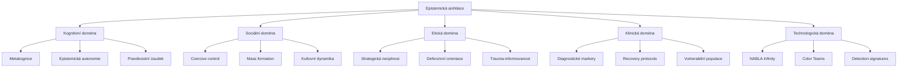
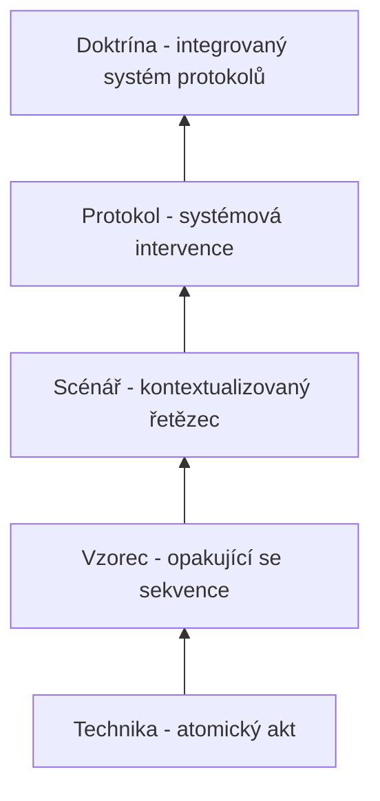
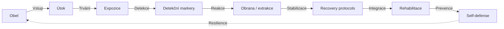

+++
title = "Konceptuální mapa epistemické anihilace"
description = "Vizuální navigační síť klíčových pojmů, vztahů a doménových přechodů v doktríně epistemické anihilace. Most mezi atomickým slovníkem (Glossary, 1290+ termínů) a strukturní taxonomií kompendia (sekce 01–08)."
weight = 99
sort_by = "weight"
template = "section.html"
insert_anchor_links = "right"

[extra]
draft = false
stub = false
tags = ["kompendium", "konceptualni-mapa", "navigace", "glossary", "vztahy", "ontologie"]
categories = ["academic", "navigation"]
section_icon = "🗺️"
toc = true
parent = "kompendium"
access_level = "L1"
status = "publikovano"
+++

# Konceptuální mapa epistemické anihilace

Tato sekce slouží jako **pojmová mapa kompendia** — síťový pohled, který doplňuje hierarchickou strukturu sekcí 01–08 a abecední strukturu [Glossary](@/glossary/_index.md). Cílem je umožnit čtenáři **navigovat mezi pojmy**, ne pouze uvnitř jedné kapitoly nebo definice.

## Jak mapu číst

Konceptuální mapa není jediný diagram, ale **soubor pohledů**, které z různých úhlů zobrazují stejnou pojmovou síť:

1. **Doménový pohled** — Pojmy seskupené podle disciplinární domény (kognice, sociologie, etika, klinika, technologie).
2. **Taxonomický pohled** — Pojmy uspořádané podle úrovně abstrakce (technika → vzorec → scénář → protokol → doktrína).
3. **Funkční pohled** — Pojmy seskupené podle funkce v procesu (útok, detekce, obrana, rekonstrukce).
4. **Etiologický pohled** — Pojmy seřazené podle příčinného vztahu.
5. **Mostový pohled** — Most-pojmy, které propojují různé domény, jsou katalogizované v [Glossary bridges](@/kompendium/glossary-bridges/_index.md).

## Doménový pohled

Detailní per-pojmové články najdete v [Glossary](@/glossary/_index.md). Most-pojmy (např. [bridge-aiad](@/kompendium/glossary-bridges/bridge-aiad.md), [bridge-3nl](@/kompendium/glossary-bridges/bridge-3nl.md)) propojují kompendium s technickou platformou Prismatic.

## Taxonomický pohled

Pět úrovní abstrakce, na nichž epistemická anihilace operuje:

| Úroveň | Příklad | Sekce kompendia |
|--------|---------|-----------------|
| **Technika** | Gaslighting, DARVO, sealioning | [03 Základní kategorie](@/kompendium/03-zakladni-kategorie/_index.md), [Techniques](@/kompendium/techniques/_index.md) |
| **Vzorec** | Coercive control, mobbing, dezinformační kaskáda | [03 Manipulační vzorce](@/kompendium/03-manipulacni-vzorce/_index.md) |
| **Scénář** | Politická kampaň, akademická delegitimizační kampaň | [03 Základní kategorie](@/kompendium/03-zakladni-kategorie/_index.md) |
| **Protokol** | Kultovní indoktrinace, terminální protokol | [04 Terminální protokoly](@/kompendium/04-terminalni-protokoly/_index.md), [05 Ultramari techniky](@/kompendium/05-ultramari-techniky/_index.md) |
| **Doktrína** | Totalitní indoktrinace, BITE model | [02 Doktrinální rámec](@/kompendium/02-doktrinalni-ramec/_index.md) |

## Funkční pohled

Pojmy seřazené podle funkce v životním cyklu epistemické manipulace:

Klíčové uzly v této síti najdete v sekcích:

- **Útok** → [03 Základní kategorie](@/kompendium/03-zakladni-kategorie/_index.md), [04 Terminální protokoly](@/kompendium/04-terminalni-protokoly/_index.md)
- **Detekce** → [Detection signatures](@/kompendium/detection-signatures/_index.md), [Quick reference](@/kompendium/quick-reference/_index.md)
- **Obrana** → [06 Intervence a obrana](@/kompendium/06-intervence-a-obrana/_index.md), [Self-defense guides](@/kompendium/self-defense-guides/_index.md)
- **Recovery** → [Recovery protocols](@/kompendium/recovery-protocols/_index.md), [06 Klinické aplikace](@/kompendium/06-klinicke-aplikace/_index.md)
- **Prevence** → [Prevention & resilience](@/kompendium/prevention-resilience/_index.md), [Educational scenarios](@/kompendium/educational-scenarios/_index.md)

## Most-pojmy mezi doménami

Most-pojmy (bridge concepts) jsou termíny, které leží na rozhraní dvou nebo více domén a slouží jako „překladače". Jejich katalog vede [Glossary bridges](@/kompendium/glossary-bridges/_index.md):

| Most-pojem | Domény, které propojuje |
|------------|--------------------------|
| [Bridge: AIAD](@/kompendium/glossary-bridges/bridge-aiad.md) | Klinika ↔ technologie (AI-augmented detekce) |
| [Bridge: 3NL](@/kompendium/glossary-bridges/bridge-3nl.md) | Architektura ↔ epistemologie |
| [Bridge: NM-ND](@/kompendium/glossary-bridges/bridge-nm-nd.md) | Doktrína ↔ klinická praxe |
| [Bridge: NCLB](@/kompendium/glossary-bridges/bridge-nclb/_index.md) | Quality enforcement ↔ klinická evidence |
| [Bridge: Agent](@/kompendium/glossary-bridges/bridge-agent.md) | Sociologie ↔ multi-agent systémy |
| [Bridge: Adapter pattern](@/kompendium/glossary-bridges/bridge-adapter-pattern.md) | Technická architektura ↔ klinická intervenční logika |

## Sekční mosty

Vedle pojmových mostů existují i **sekční mosty** — texty, které explicitně přechází mezi dvěma sekcemi kompendia:

| Most | Z → Do |
|------|--------|
| [Bridge 01→02](@/kompendium/section-bridges/bridge-01-to-02-predmluva-uvod.md) | Předmluva → Úvod |
| [Bridge 02→03](@/kompendium/section-bridges/bridge-02-to-03-uvod-zakladni-kategorie.md) | Úvod → Základní kategorie |
| [Bridge 03→04](@/kompendium/section-bridges/bridge-03-to-04-zakladni-terminalni.md) | Základní → Terminální |
| [Bridge 03→06](@/kompendium/section-bridges/bridge-03-to-06-techniky-klinika.md) | Techniky → Klinika |
| [Bridge 02→07](@/kompendium/section-bridges/bridge-02-to-07-uvod-teoreticke.md) | Úvod → Teoretické reflexe |

Plný seznam vede [section-bridges/_index.md](@/kompendium/section-bridges/_index.md).

## Statistická charakteristika sítě

Konceptuální síť kompendia má následující charakteristiky (k 2026-05-04):

| Metrika | Hodnota |
|---------|---------|
| **Glossary terms** | 1 290+ |
| **Cross-references** | 18 700+ |
| **Section bridges** | 9 |
| **Glossary bridges** | 60+ |
| **Per-technique articles** | 200+ |
| **Recovery protocols** | 30+ |
| **Validační pokrytí** | 100% (žádný stub marker v glossary) |

## Doporučené čtenářské cesty

| Role | Cesta |
|------|-------|
| **Nový čtenář** | [01 Základy manipulace](@/kompendium/01-zaklady-manipulace/_index.md) → [02 Úvod](@/kompendium/02-uvod/_index.md) → [03 Základní kategorie](@/kompendium/03-zakladni-kategorie/_index.md) |
| **Klinik** | [06 Klinické aplikace](@/kompendium/06-klinicke-aplikace/_index.md) → [Recovery protocols](@/kompendium/recovery-protocols/_index.md) → [06.5 Vulnerabilní populace](@/kompendium/06-klinicke-aplikace/vulnerabilni-populace.md) |
| **Výzkumník** | [07 Teoretické reflexe](@/kompendium/07-teoreticke-reflexe/_index.md) → [Research methodology](@/kompendium/research-methodology/_index.md) → [Critical perspectives](@/kompendium/critical-perspectives/_index.md) |
| **Bezpečnostní analytik** | [04 Terminální protokoly](@/kompendium/04-terminalni-protokoly/_index.md) → [Detection signatures](@/kompendium/detection-signatures/_index.md) → [Forensic & legal](@/kompendium/forensic-legal/_index.md) |
| **Občan / self-defense** | [Self-defense guides](@/kompendium/self-defense-guides/_index.md) → [Quick reference](@/kompendium/quick-reference/_index.md) → [Prevention & resilience](@/kompendium/prevention-resilience/_index.md) |

## Související

- [Hub kompendia](@/kompendium/_index.md) — návrat na úvodní stranu
- [Glossary](@/glossary/_index.md) — kompletní pojmový aparát
- [Glossary bridges](@/kompendium/glossary-bridges/_index.md) — mezi-doménové mosty
- [Section bridges](@/kompendium/section-bridges/_index.md) — mezi-sekční mosty
- [Visualizations](@/kompendium/visualizations/_index.md) — další vizualizace pojmové sítě
