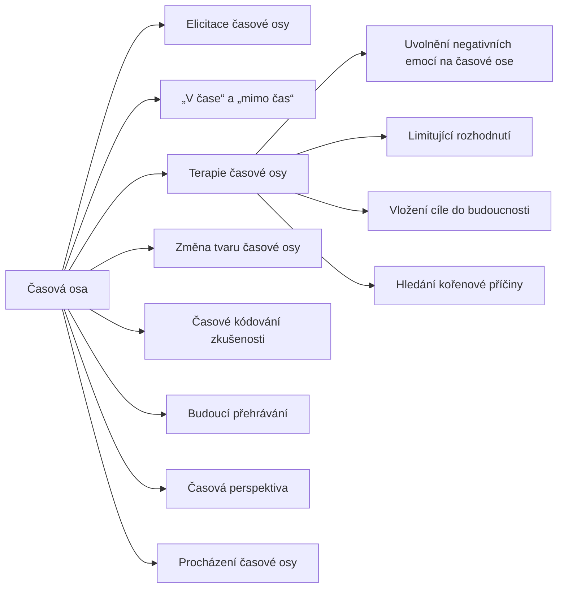

+++
title = "Časová osa"
description = "Rodina NLP vzorců pracujících s prostorovou představou času: elicitace a typy časové osy, terapie časové osy, práce s budoucností a riziko nepravých vzpomínek."
weight = 12
sort_by = "weight"
template = "kompendium/section.html"
page_template = "kompendium/page.html"
insert_anchor_links = "right"

[extra]
tags = ["nlp", "nlp-casova-osa"]
categories = ["academic"]
toc = true
lang = "cs"
keywords = ["Časová osa", "Timeline patterns", "NLP vzorce"]
schema_type = "DefinedTermSet"
catalog = "nlp"
catalog_schema = 1
catalog_export = "data/nlp-katalog.json"
catalog_family = "casova-osa"
catalog_code = "12"
catalog_en = "Timeline patterns"
catalog_size = 12
catalog_members = ["elicitace-casove-osy", "v-case-a-mimo-cas", "terapie-casove-osy", "uvolneni-negativnich-emoci", "limitujici-rozhodnuti", "vlozeni-budouciho-cile", "korenova-pricina", "zmena-tvaru-casove-osy", "casove-kodovani", "budouci-prehravani", "casova-perspektiva", "pruchod-casovou-osou"]
catalog_types = ["concept", "pattern"]
catalog_sources = ["andreas-andreas-1987", "bandler-1985", "bandler-grinder-1979", "cialdini-2009", "dilts-1990", "herman-1992", "james-woodsmall-1988", "kirsch-lynn-1995", "lakoff-johnson-1980", "lifton-1961", "lilienfeld-2015", "loftus-palmer-1974", "norcross-2006", "singer-lalich-1995", "sturt-2012", "tversky-kahneman-1974", "witkowski-2010"]
+++

# Časová osa

## Co rodina zahrnuje

Rodina Časová osa sdružuje vzorce, pojmy a postupy neurolingvistického programování, které pracují s představou, že člověk si čas vnitřně uspořádává v prostoru. Minulost, přítomnost a budoucnost mají podle tohoto výkladu v představě své místo, směr a vlastnosti, a s tímto uspořádáním lze pracovat (Andreas a Andreas 1987; James a Woodsmall 1988). Rodina má tři části. První část je popisná: [elicitace časové osy](@/kompendium/nlp-vzorce/casova-osa/elicitace-casove-osy.md) zjišťuje, jak si člověk čas představuje, rozlišení [„v čase“ a „mimo čas“](@/kompendium/nlp-vzorce/casova-osa/v-case-a-mimo-cas.md) z toho vyvozuje typy a pojem [časového kódování zkušenosti](@/kompendium/nlp-vzorce/casova-osa/casove-kodovani.md) vysvětluje, jak představy nesou časovou značku. Druhá část je intervenční a týká se minulosti: [terapie časové osy](@/kompendium/nlp-vzorce/casova-osa/terapie-casove-osy.md) a její složky, tedy [uvolnění negativních emocí](@/kompendium/nlp-vzorce/casova-osa/uvolneni-negativnich-emoci.md), [limitující rozhodnutí](@/kompendium/nlp-vzorce/casova-osa/limitujici-rozhodnuti.md) a [hledání kořenové příčiny](@/kompendium/nlp-vzorce/casova-osa/korenova-pricina.md), spolu se [změnou tvaru časové osy](@/kompendium/nlp-vzorce/casova-osa/zmena-tvaru-casove-osy.md) a s [procházením časové osy](@/kompendium/nlp-vzorce/casova-osa/pruchod-casovou-osou.md) v prostoru místnosti. Třetí část se týká budoucnosti: [vložení cíle do budoucnosti](@/kompendium/nlp-vzorce/casova-osa/vlozeni-budouciho-cile.md) a [budoucí přehrávání](@/kompendium/nlp-vzorce/casova-osa/budouci-prehravani.md). Jako srovnávací měřítko rodina obsahuje psychologický pojem [časové perspektivy](@/kompendium/nlp-vzorce/casova-osa/casova-perspektiva.md), který na rozdíl od pojmů NLP prošel psychometrickým ověřováním. Obecný pojem časové osy je popsán mezi [základními pojmy](@/kompendium/nlp-vzorce/zakladni-pojmy/casova-osa-pojem.md).

## Původ

Představa, že čas myslíme v prostoru, je starší než NLP a má solidní oporu v lingvistice. Lakoff a Johnson ukázali, že časové pojmy jsou strukturovány prostorovými metaforami: budoucnost je „před námi“, minulost „za námi“, termíny se „blíží“ (Lakoff a Johnson 1980). NLP tento obecný rys převedlo na individuální rovinu. V polovině osmdesátých let Bandler rozpracoval práci se submodalitami, tedy s jemnými vlastnostmi vnitřních představ, a ukázal, jak jejich změna mění intenzitu prožitku (Bandler 1985). Andreasovi tuto práci rozšířili na časové kódování a popsali, jak se lidé liší v tom, kde a jak si představují minulost a budoucnost (Andreas a Andreas 1987). Robert Dilts spojil časovou osu s prací na přesvědčeních a s návratem k formativním zkušenostem a rozložil ji do prostoru místnosti (Dilts 1990). Tad James a Wyatt Woodsmall z těchto linií sestavili terapii časové osy, ucelený přístup spojený s výkladem osobnosti, hodnot a metaprogramů (James a Woodsmall 1988). Směr se šířil hlavně komerčními výcviky a certifikacemi, mimo univerzitní psychologii a mimo klinický výzkum. Práce s budoucností má navíc kořeny v ericksonovské hypnoterapii a v raných seminářích Bandlera a Grindera, kde se objevuje požadavek ověřit změnu v budoucích situacích (Bandler a Grinder 1979).

## Proč je rodina riziková

Většina vzorců rodiny je sama o sobě převážně neškodná. Ptát se člověka, kde si představuje příští rok, nebo mu nabídnout prostorovou pomůcku k plánování, nikoho neohrožuje. Rodina jako celek však patří k nejrizikovějším v katalogu, protože její intervenční část pracuje s pamětí v sugestivním rámci. Typický postup terapie časové osy vede člověka v uvolněném stavu k „návratu“ do minulosti s očekáváním, že tam najde první událost, z níž pochází jeho dnešní obtíž (James a Woodsmall 1988). Pokud si žádnou nepamatuje, je ujišťován, že jeho nevědomí ji zná a že cokoli se vybaví, je smysluplné. Tato kombinace, tedy [presupozice existence](@/kompendium/nlp-vzorce/presupozice/existencni-presupozice.md) události, sugestivní stav, očekávání průvodce a ujištění o pravdivosti vybaveného obsahu, je ve výzkumu paměti dobře doloženou cestou ke vzniku nepravých vzpomínek (Lilienfeld, Lynn a Lohr 2015).

Základní poznatek pochází z experimentu, v němž lidé viděli film dopravní nehody a poté odpovídali na otázku o rychlosti aut. Pouhá volba slovesa v otázce změnila odhad rychlosti, a o týden později si více lidí v té skupině, jejíž otázka použila silnější sloveso, „pamatovalo“ rozbité sklo, které ve filmu nebylo (Loftus a Palmer 1974). Paměť tedy není záznam, který se přehrává, ale rekonstrukce, která se skládá při každém vybavení a je citlivá na podněty, které vybavení provázejí. Přehledy výzkumu sugestivních terapeutických postupů ukazují, že hledání zapomenutých událostí, zvláště v hypnóze nebo v podobných stavech, může vést k vytvoření vzpomínek na události, které se nestaly, a že člověk si takovými vzpomínkami bývá jistý (Lilienfeld, Lynn a Lohr 2015). Prožitky v sugestivních stavech přitom silně závisejí na očekáváních, která situace vytváří (Kirsch a Lynn 1995). Hledání kořenové příčiny a regresivní procházení časové osy tak strukturálně opakují postupy, jejichž rizika jsou známa z diskuse o takzvaných obnovených vzpomínkách v devadesátých letech.

## Jak rodinu číst defenzivně

Pro pozorovatele je nejdůležitější rozlišovat tři věci, které vzorce rodiny často slévají. První je představa: obraz minulosti nebo budoucnosti, který člověk vytváří v rozhovoru. Druhá je vzpomínka: obsah, který si člověk pamatuje nezávisle na tom, co se v rozhovoru děje. Třetí je výklad: příběh, který představě nebo vzpomínce dává smysl a příčinu. Rizikové užití vzorců rodiny se pozná podle toho, že tyto tři roviny zaměňuje. Představa vybavená v sugestivním stavu se vydává za vzpomínku, výklad se vydává za objev a z obou se vyvozují závěry o skutečných událostech a skutečných lidech. Právě tuto záměnu představy za vzpomínku, k níž člověk navíc získává jistotu, popisují přehledy výzkumu sugestivních terapeutických postupů (Lilienfeld, Lynn a Lohr 2015).

Druhým klíčem je směr práce s budoucností. Představa budoucnosti, kterou si člověk vytváří sám, aby si ujasnil cíl a naplánoval cestu k němu, je legitimní. Představa budoucnosti, kterou mu vytváří druhá strana a bezprostředně ji spojí s rozhodnutím, které má udělat hned, je nástrojem vlivu. Lidé odhadují pravděpodobnost událostí podle toho, jak snadno si je představí (Tversky a Kahneman 1974), a závazek učiněný v emočně silném okamžiku vytváří tlak na konzistentní jednání (Cialdini 2009). [Budoucí přehrávání v prodeji](@/kompendium/nlp-vzorce/vliv-a-zneuziti/budouci-prehravani-v-prodeji.md) a vize budoucnosti na motivačních seminářích stojí právě na těchto mechanismech. Třetím klíčem je kontext. Uzavřené skupiny přepisují minulost člena tak, aby jeho život před vstupem vypadal jako řada zranění, a vymezují budoucnost výhradně uvnitř skupiny (Singer a Lalich 1995). Lifton popsal, jak totalitní prostředí podřizuje osobní minulost doktríně (Lifton 1961). Vzorce časové osy se v takovém prostředí stávají nástrojem přepisu biografie, který kompendium popisuje u [mnemonické rekonfigurace](@/kompendium/techniques/ea-5-3-8-mnemonicka-rekonfigurace.md) a [biografické rekontextualizace](@/kompendium/techniques/ea-4-4-4-biographical-recontextualization.md).

## Stav důkazů

Prostorové myšlení o čase je jako jev dobře doloženo v kognitivní lingvistice (Lakoff a Johnson 1980). Pro specifická tvrzení rodiny takové doklady chybějí. Neexistuje validovaný nástroj, který by určoval individuální typ časové osy, ani studie, které by prokazovaly jeho souvislost s povahou. Pro terapii časové osy a její složky chybějí kontrolované studie s randomizací a nezávislým hodnocením výsledků. Systematický přehled účinků NLP na zdravotní výsledky nenašel dostatek kvalitních dat, která by jeho používání podporovala (Sturt a kol. 2012). Witkowski po analýze [databáze výzkumu NLP](@/kompendium/nlp-vzorce/kriticke-hodnoceni/databaze-vyzkumu-nlp.md) dospěl k závěru, že naprostá většina kontrolovaných studií tvrzení oboru nepodporuje (Witkowski 2010). V Delfské studii odborníků bylo NLP pro léčbu duševních a behaviorálních obtíží zařazeno mezi zdiskreditované přístupy (Norcross, Koocher a Garofalo 2006). Rozdíl mezi chybějícím dokladem účinku a doloženým rizikem je pro hodnocení rodiny rozhodující: přínos terapie časové osy prokázán není, riziko sugestivní práce s pamětí prokázáno je. Psychologie časové perspektivy přitom nabízí ověřené pojmy pro to, jak lidé vztahují minulost a budoucnost ke svému jednání, a je vhodnějším východiskem než typologie NLP.

## Obrana

Základní obranou je rozlišovat představu od vzpomínky. Obsah, který se vybaví v uvolněném stavu pod vedením průvodce, je představa, dokud ho nepotvrdí nezávislé zdroje, a nemá být podkladem pro závěry o minulých událostech ani o jiných lidech. Nevybavení není překážka, kterou je třeba překonat, ale informace. Druhou obranou je oddělit představu budoucnosti od rozhodnutí: po živé vizi budoucího prožitku nerozhodovat hned, vyžádat si podmínky písemně a srovnat je s jinými možnostmi. Třetí obranou je posoudit rámec. Práce s bolestnými obdobími života patří do vztahu s odborníkem, který pracuje s ověřenými metodami a je k dispozici i po skončení sezení; víkendový seminář ani certifikát z NLP takový rámec nenahradí. Herman zdůrazňuje, že u lidí s traumatickou zkušeností musí práci se vzpomínkami předcházet nastolení bezpečí a že kontrola nad tempem a obsahem má zůstat v rukou člověka, o jehož život jde (Herman 1992). Lidé, kteří prošli sugestivním hledáním příčin a vytvořili si nové přesvědčení o své minulosti, potřebují citlivou podporu, v níž mohou rozlišit, co si pamatují, od toho, co vzniklo v sugestivní situaci, a postupně obnovit vztahy, které nový výklad narušil. Kompendium se k tomuto tématu vrací na stránce o [traumatu a falešných vzpomínkách](@/kompendium/nlp-vzorce/disociace-a-trauma/trauma-a-falesne-vzpominky.md) a v kapitole o [terapeutických přístupech](@/kompendium/06-klinicke-aplikace/terapeuticke-pristupy.md).

<!-- kompendium:katalog-vazby:begin (scripts/catalogs.py; neupravovat ručně) -->

## Hesla rodiny

| Kód | Heslo | Anglicky | Druh | Užití | Riziko |
|-----|-------|----------|------|-------|--------|
| `NLP-12.01` | [Elicitace časové osy](@/kompendium/nlp-vzorce/casova-osa/elicitace-casove-osy.md) | Eliciting the timeline | vzorec | terapeutické i vlivové | nízké |
| `NLP-12.02` | [„V čase“ a „mimo čas“](@/kompendium/nlp-vzorce/casova-osa/v-case-a-mimo-cas.md) | In time and through time | pojem | terapeutické i vlivové | nízké |
| `NLP-12.03` | [Terapie časové osy](@/kompendium/nlp-vzorce/casova-osa/terapie-casove-osy.md) | Time Line Therapy | vzorec | převážně terapeutické | vysoké |
| `NLP-12.04` | [Uvolnění negativních emocí na časové ose](@/kompendium/nlp-vzorce/casova-osa/uvolneni-negativnich-emoci.md) | Releasing negative emotions on the timeline | vzorec | převážně terapeutické | střední |
| `NLP-12.05` | [Limitující rozhodnutí](@/kompendium/nlp-vzorce/casova-osa/limitujici-rozhodnuti.md) | Limiting decisions | vzorec | převážně terapeutické | střední |
| `NLP-12.06` | [Vložení cíle do budoucnosti](@/kompendium/nlp-vzorce/casova-osa/vlozeni-budouciho-cile.md) | Placing a goal in the future | vzorec | terapeutické i vlivové | střední |
| `NLP-12.07` | [Hledání kořenové příčiny](@/kompendium/nlp-vzorce/casova-osa/korenova-pricina.md) | Root cause | vzorec | terapeutické i vlivové | vysoké |
| `NLP-12.08` | [Změna tvaru časové osy](@/kompendium/nlp-vzorce/casova-osa/zmena-tvaru-casove-osy.md) | Changing the shape of the timeline | vzorec | převážně terapeutické | nízké |
| `NLP-12.09` | [Časové kódování zkušenosti](@/kompendium/nlp-vzorce/casova-osa/casove-kodovani.md) | Temporal coding of experience | pojem | výkladový pojem | nízké |
| `NLP-12.10` | [Budoucí přehrávání](@/kompendium/nlp-vzorce/casova-osa/budouci-prehravani.md) | Future pacing | vzorec | terapeutické i vlivové | střední |
| `NLP-12.11` | [Časová perspektiva](@/kompendium/nlp-vzorce/casova-osa/casova-perspektiva.md) | Time perspective | pojem | výkladový pojem | nízké |
| `NLP-12.12` | [Procházení časové osy](@/kompendium/nlp-vzorce/casova-osa/pruchod-casovou-osou.md) | Timeline walk | vzorec | převážně terapeutické | střední |

## Mapa rodiny

Mapu odvozuje engine katalogů z vazeb „obecnější heslo“; uzel otevře heslo.

<!-- kompendium:katalog-vazby:end -->

## Literatura

- Andreas, S., & Andreas, C. (1987). *Change Your Mind—and Keep the Change: Advanced NLP Submodalities Interventions*. Moab: Real People Press.
- Bandler, R. (1985). *Using Your Brain—for a Change*. Moab: Real People Press.
- Bandler, R., & Grinder, J. (1979). *Frogs into Princes: Neuro Linguistic Programming*. Moab: Real People Press.
- Cialdini, R. B. (2009). *Influence: Science and Practice* (5. vyd.). Boston: Pearson.
- Dilts, R. (1990). *Changing Belief Systems with NLP*. Cupertino: Meta Publications.
- Herman, J. L. (1992). *Trauma and Recovery*. New York: Basic Books.
- James, T., & Woodsmall, W. (1988). *Time Line Therapy and the Basis of Personality*. Cupertino: Meta Publications.
- Kirsch, I., & Lynn, S. J. (1995). The altered state of hypnosis: Changes in the theoretical landscape. *American Psychologist*, 50(10), 846–858.
- Lakoff, G., & Johnson, M. (1980). *Metaphors We Live By*. Chicago: University of Chicago Press.
- Lifton, R. J. (1961). *Thought Reform and the Psychology of Totalism: A Study of „Brainwashing“ in China*. New York: W. W. Norton.
- Lilienfeld, S. O., Lynn, S. J., & Lohr, J. M. (Eds.) (2015). *Science and Pseudoscience in Clinical Psychology* (2. vyd.). New York: Guilford Press.
- Loftus, E. F., & Palmer, J. C. (1974). Reconstruction of automobile destruction: An example of the interaction between language and memory. *Journal of Verbal Learning and Verbal Behavior*, 13(5), 585–589.
- Norcross, J. C., Koocher, G. P., & Garofalo, A. (2006). Discredited psychological treatments and tests: A Delphi poll. *Professional Psychology: Research and Practice*, 37(5), 515–522.
- Singer, M. T., & Lalich, J. (1995). *Cults in Our Midst*. San Francisco: Jossey-Bass.
- Sturt, J., Ali, S., Robertson, W., Metcalfe, D., Grove, A., Bourne, C., & Bridle, C. (2012). Neurolinguistic programming: A systematic review of the effects on health outcomes. *British Journal of General Practice*, 62(604), e757–e764.
- Tversky, A., & Kahneman, D. (1974). Judgment under uncertainty: Heuristics and biases. *Science*, 185(4157), 1124–1131.
- Witkowski, T. (2010). Thirty-five years of research on neuro-linguistic programming. NLP research data base. State of the art or pseudoscientific decoration? *Polish Psychological Bulletin*, 41(2), 58–66.

<!-- kompendium:katalog-vazby:begin (scripts/catalogs.py; neupravovat ručně) -->

## Související

- [NLP vzorce](@/kompendium/nlp-vzorce/_index.md) – celý katalog a jeho rodiny
- [Disociace, fobie a trauma](@/kompendium/nlp-vzorce/disociace-a-trauma/_index.md) – předchozí rodina katalogu
- [Logické úrovně a percepční pozice](@/kompendium/nlp-vzorce/urovne-a-pozice/_index.md) – další rodina katalogu

<!-- kompendium:katalog-vazby:end -->
