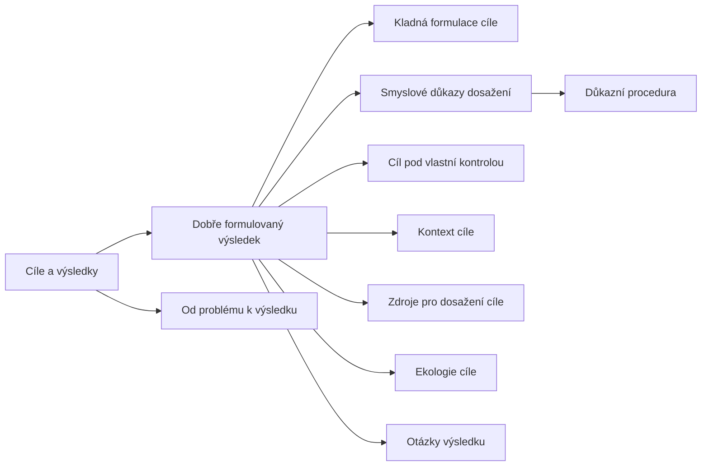

+++
title = "Cíle a výsledky"
description = "Rodina NLP vzorců o formulaci cílů: podmínky dobře formulovaného výsledku, důkazní procedura, otázky výsledku a přesun od problému k cíli."
weight = 19
sort_by = "weight"
template = "kompendium/section.html"
page_template = "kompendium/page.html"
insert_anchor_links = "right"

[extra]
tags = ["nlp", "nlp-cile-a-vysledky"]
categories = ["academic"]
toc = true
lang = "cs"
keywords = ["Cíle a výsledky", "Outcomes", "NLP vzorce"]
schema_type = "DefinedTermSet"
catalog = "nlp"
catalog_schema = 1
catalog_export = "data/nlp-katalog.json"
catalog_family = "cile-a-vysledky"
catalog_code = "19"
catalog_en = "Outcomes"
catalog_size = 10
catalog_members = ["dobre-formulovany-vysledek", "pozitivni-formulace-cile", "smyslove-dukazy-cile", "cil-pod-vlastni-kontrolou", "kontext-cile", "zdroje-cile", "ekologie-cile", "dukazni-procedura", "otazky-vysledku", "od-problemu-k-vysledku"]
catalog_types = ["concept", "pattern"]
catalog_sources = ["bandler-grinder-1975", "cialdini-2009", "dilts-delozier-2000", "festinger-1957", "freedman-fraser-1966", "haley-1973", "hassan-1988", "herman-1992", "lifton-1961", "loftus-palmer-1974", "mcguire-1964", "miller-galanter-pribram-1960", "miller-rollnick-2013", "oconnor-seymour-1990", "passmore-rowson-2019", "singer-lalich-1995", "stark-2007", "sturt-2012", "watzlawick-1974", "witkowski-2010"]
+++

# Cíle a výsledky

## Co rodina zahrnuje

Rodina Cíle a výsledky shromažďuje pojmy a vzorce, jimiž neurolingvistické programování
popisuje, jak se má formulovat cíl změny a jak se o něm má v rozhovoru mluvit. Jejím středem
je [dobře formulovaný
výsledek](@/kompendium/nlp-vzorce/cile-a-vysledky/dobre-formulovany-vysledek.md), soubor
podmínek, které má splňovat popis žádaného stavu, aby se s ním dalo v terapii, koučinku nebo
vyjednávání pracovat. Úvodní učebnice oboru tyto podmínky uvádějí jako jeden z nejpraktičtějších
nástrojů NLP a předkládají je jako postup, který má praktik zvládnout dřív než většinu technik
(O'Connor a Seymour 1990). Katalog věnuje každé podmínce samostatnou stránku, protože každá z
nich má vlastní legitimní smysl a vlastní typ zneužití.

Rodinu lze pro přehled rozdělit do tří okruhů. První okruh tvoří samotné podmínky: [kladná
formulace cíle](@/kompendium/nlp-vzorce/cile-a-vysledky/pozitivni-formulace-cile.md),
[smyslové důkazy dosažení](@/kompendium/nlp-vzorce/cile-a-vysledky/smyslove-dukazy-cile.md),
[cíl pod vlastní kontrolou](@/kompendium/nlp-vzorce/cile-a-vysledky/cil-pod-vlastni-kontrolou.md),
[kontext cíle](@/kompendium/nlp-vzorce/cile-a-vysledky/kontext-cile.md), [zdroje pro dosažení
cíle](@/kompendium/nlp-vzorce/cile-a-vysledky/zdroje-cile.md) a [ekologie
cíle](@/kompendium/nlp-vzorce/cile-a-vysledky/ekologie-cile.md). Druhý okruh tvoří pojem, který
podmínku smyslových důkazů rozvádí na jednotlivá měřítka a hodnoty: [důkazní
procedura](@/kompendium/nlp-vzorce/cile-a-vysledky/dukazni-procedura.md), tedy test, podle
něhož člověk pozná, že je určité kritérium splněno. Třetí okruh tvoří vzorce rozhovoru, v nichž
se podmínky uplatňují: [otázky výsledku](@/kompendium/nlp-vzorce/cile-a-vysledky/otazky-vysledku.md)
a [přesun od problému k
výsledku](@/kompendium/nlp-vzorce/cile-a-vysledky/od-problemu-k-vysledku.md). Úplný přehled
položek rodiny s jejich kódy podává tabulka na konci této stránky.

Rodina má blízké sousedy v jiných částech katalogu. [Rámec výsledku](@/kompendium/nlp-vzorce/reframing/ramec-vysledku.md) a [rámec ekologie](@/kompendium/nlp-vzorce/reframing/ramec-ekologie.md) patří mezi
rámce a přerámcování, [ekologická kontrola](@/kompendium/nlp-vzorce/zakladni-pojmy/ekologicka-kontrola.md) mezi základní pojmy, orientace [k cíli a od problému](@/kompendium/nlp-vzorce/metaprogramy/k-cili-a-od-problemu.md)
mezi metaprogramy a vkládání cíle do budoucnosti do práce s časovou osou. Tyto vazby uvádí
oddíl Související na každé stránce.

## Původ

Rodina má tři kořeny. Prvním je kybernetický obraz jednání, který Miller, Galanter a Pribram
shrnuli do jednotky testu, činnosti, nového testu a ukončení: organismus srovnává současný
stav s cílovým, jedná a znovu srovnává, dokud rozdíl nezmizí (Miller, Galanter a Pribram
1960). V tomto obrazu musí být cíl popsán tak, aby šlo poznat, kdy je dosažen, a z toho
pochází požadavek smyslových důkazů i pojem důkazní procedury. Druhým kořenem je jazyková
práce zakladatelů NLP. Bandler a Grinder si z transformační gramatiky vypůjčili pojem dobré
formovanosti a mluvili o podmínkách, za nichž je klientův popis vhodný pro terapeutickou
práci (Bandler a Grinder 1975); pozdější autoři tento požadavek přenesli z popisu problému na
popis cíle. Třetím kořenem je krátká terapie. Haley popsal Ericksonovo zaměření na změnu v
přítomnosti a budoucnosti (Haley 1973) a výzkumné centrum v Palo Altu zdůrazňovalo konkrétní a
malý cíl a varovalo před cíli tak velkými, že samy plodí nové problémy (Watzlawick, Weakland a
Fisch 1974).

Z těchto zdrojů vznikl v NLP soubor podmínek, který se v různých učebnicích a výcvikových
školách liší počtem položek i jejich formulací. Systemická encyklopedie oboru je shrnuje jako
obecný nástroj plánování změny (Dilts a DeLozier 2000). Odtud se podmínky rozšířily do
koučinku, manažerského vzdělávání a prodeje, často bez odkazu na NLP a v podobě, která se
podobá běžným manažerským zkratkám pro formulaci cílů. Toto rozšíření je důležité pro čtenáře
kompendia: s vzorci této rodiny se setká spíše v koučovacím rozhovoru, na firemním školení
nebo v prodejní schůzce než v terapii, a zpravidla aniž by je někdo nazval jejich jménem.

## Jak rodinu číst defenzivně

Vzorce této rodiny nejsou ze své podstaty manipulativní. Ujasněný, ověřitelný a dosažitelný
cíl je v terapii i v práci užitečný a mnoho ověřených přístupů s ním pracuje bez nálepky NLP.
Motivační rozhovory například staví na rozdílu mezi současným stavem a tím, co člověk sám
pokládá za důležité, ale cíl i tempo změny výslovně ponechávají klientovi (Miller a Rollnick
2013). Riziko vzorců spočívá jinde: v tom, že kdo pomáhá druhému cíl formulovat, získává moc
nad jeho výkladem. Pro defenzivní čtení se proto u každého vzorce vyplatí sledovat čtyři
otázky.

První otázka zní, kdo cíl formuloval a kdo rozhodl, že je formulován dobře. Pokud o cíli,
jeho kontextu a jeho ekologii rozhoduje praktik, lektor nebo vedoucí skupiny, mění se
podmínky z nástroje klienta v nástroj autority. Druhá otázka zní, zda mezi cílem a nabízeným
prostředkem zůstává prostor pro samostatné posouzení. Ujasněný cíl funguje jako vyslovený
závazek a psychologie vlivu dobře dokládá, že lidé mají sklon jednat v souladu s tím, k čemu
se veřejně nebo písemně přihlásili (Cialdini 2009); kdo k vyslovenému cíli připojí vlastní
nabídku, může z cíle udělat páku. Třetí otázka zní, kam se při uplatňování podmínek přesouvá
odpovědnost. Podmínka vlastní kontroly, kladné formulace a přesun od problému k výsledku mohou
nenápadně přesunout odpovědnost za cizí jednání na toho, komu se škodí. Čtvrtá otázka zní, zda
podmínky mohou ukázat i neúspěch. Kritéria pokroku nastavená tak, že každý vývoj potvrzuje
správnost metody, jsou znakem nevyvratitelného systému.

Kontrolující skupiny a vztahy využívají právě tyto čtyři slabiny. Singerová a Lalichová
popisují velké skupinové výcviky, v nichž účastníci pod tlakem skupiny přijímají veřejné
závazky a jsou vedeni k navazujícím programům (Singer a Lalich 1995). Stark popisuje
kontrolující vztahy, v nichž jeden partner stanovuje drobná pravidla a měřítka, podle nichž
se posuzuje láska a poslušnost druhého (Stark 2007). Lifton popsal v prostředích myšlenkové
reformy jazyk ustálených frází, jimiž se ukončuje přemýšlení o nepohodlných tématech (Lifton
1961); věty o „negativitě“ nebo o „ulpívání na problému“ mohou plnit stejnou funkci.

## Stav důkazů

Pro podmínky dobře formulovaného výsledku v podobě, v jaké je uvádí literatura NLP,
katalogu nejsou známy kontrolované studie, které by testovaly jejich zvláštní účinek.
Obecnější myšlenky, na nichž stojí, tedy že konkrétní a ověřitelný cíl usnadňuje změnu a že
na formulaci záleží, mají oporu v psychologii motivace, v organizační psychologii a v
behaviorální a kognitivní terapii; tato podpora se však týká obecných principů, ne podoby,
kterou jim dalo NLP. Pro NLP jako celek jsou výsledky výzkumu slabé. Systematický přehled
účinků na zdravotní výsledky nenašel dostatek kvalitních studií k závěru o účinnosti
(Sturt a kol. 2012). Rozbor databáze výzkumů NLP dospěl k závěru, že převážná většina
kontrolovaných studií tvrzení oboru nepodporuje (Witkowski 2010). Kritický přehled pro
oblast koučinku, kde se vzorce této rodiny uplatňují nejčastěji, konstatuje, že nástroje NLP
se v praxi rozšířily bez odpovídajícího výzkumného ověření (Passmore a Rowson 2019).

Naopak dobře doloženy jsou vlivové účinky, na nichž stojí manipulativní užití: síla
vysloveného závazku, postupné stupňování souhlasu, vliv formulace otázky na to, co si lidé
vybavují, a sklon hodnotit rozhodnutí příznivěji poté, co bylo učiněno (Cialdini 2009;
Freedman a Fraser 1966; Loftus a Palmer 1974; Festinger 1957). Pro čtenáře kompendia z toho
plyne nepříjemná asymetrie: terapeutický přínos specifických vzorců NLP je nedoložený,
kdežto mechanismy, kterými lze tytéž vzorce zneužít, jsou doloženy dobře.

## Obrana

Obrana proti zneužití vzorců této rodiny stojí na několika jednoduchých zásadách. Cíl patří
tomu, kdo ho formuloval, a lze jej kdykoli přeformulovat nebo opustit, aniž by to bylo
selhání. Vlastní cíl je třeba oddělit od nabízeného prostředku a nabídku posoudit samostatně,
s odstupem v čase a s lidmi, kteří na výsledku nemají zájem. Kritéria pokroku je rozumné
stanovit si sám, zapsat si je a zahrnout mezi ně i náklady a škody. Hranice cíle, tedy kde,
kdy a vůči komu platí, je třeba vymezit výslovně a chránit oblasti života, na které se cíl
vztahovat nemá. Obavy blízkých a vlastní váhání jsou informací o důsledcích, ne překážkou. A
popis problému, zejména popis křivdy nebo násilí, je legitimní a má být vysloven celý dřív,
než se rozhovor obrátí k budoucnosti.

Výzkum odolnosti vůči přesvědčování ukazuje, že kdo předem pozná strukturu tlaku a promyslí
protiargumenty, snáze mu odolá (McGuire 1964). Právě k tomu slouží stránky této rodiny: popisují
strukturu, podle níž lze rozpoznat, kdy rozhovor o cíli slouží člověku, a kdy tomu, kdo se
ptá. U lidí, kteří prošli prostředím, v němž se jejich cíle staly nástrojem kontroly, se
zotavení opírá o rozlišení vlastních a převzatých cílů, o obnovu vlastních měřítek úspěchu a
o vztahy mimo toto prostředí (Hassan 1988; Herman 1992). Odborník, který s podmínkami pracuje,
by je měl uplatňovat i na sebe: zda je jeho vlastní cíl ve vztahu s klientem vyslovený,
ověřitelný a slučitelný se zájmem klienta.

<!-- kompendium:katalog-vazby:begin (scripts/catalogs.py; neupravovat ručně) -->

## Hesla rodiny

| Kód | Heslo | Anglicky | Druh | Užití | Riziko |
|-----|-------|----------|------|-------|--------|
| `NLP-19.01` | [Dobře formulovaný výsledek](@/kompendium/nlp-vzorce/cile-a-vysledky/dobre-formulovany-vysledek.md) | Well-formed outcome | vzorec | terapeutické i vlivové | střední |
| `NLP-19.02` | [Kladná formulace cíle](@/kompendium/nlp-vzorce/cile-a-vysledky/pozitivni-formulace-cile.md) | Stated in the positive | pojem | terapeutické i vlivové | střední |
| `NLP-19.03` | [Smyslové důkazy dosažení](@/kompendium/nlp-vzorce/cile-a-vysledky/smyslove-dukazy-cile.md) | Sensory-based evidence | pojem | terapeutické i vlivové | střední |
| `NLP-19.04` | [Cíl pod vlastní kontrolou](@/kompendium/nlp-vzorce/cile-a-vysledky/cil-pod-vlastni-kontrolou.md) | Self-initiated and self-maintained | pojem | terapeutické i vlivové | vysoké |
| `NLP-19.05` | [Kontext cíle](@/kompendium/nlp-vzorce/cile-a-vysledky/kontext-cile.md) | Context of the outcome | pojem | terapeutické i vlivové | střední |
| `NLP-19.06` | [Zdroje pro dosažení cíle](@/kompendium/nlp-vzorce/cile-a-vysledky/zdroje-cile.md) | Resources for the outcome | pojem | terapeutické i vlivové | střední |
| `NLP-19.07` | [Ekologie cíle](@/kompendium/nlp-vzorce/cile-a-vysledky/ekologie-cile.md) | Ecology of the outcome | pojem | terapeutické i vlivové | střední |
| `NLP-19.08` | [Důkazní procedura](@/kompendium/nlp-vzorce/cile-a-vysledky/dukazni-procedura.md) | Evidence procedure | vzorec | terapeutické i vlivové | vysoké |
| `NLP-19.09` | [Otázky výsledku](@/kompendium/nlp-vzorce/cile-a-vysledky/otazky-vysledku.md) | Outcome questions | vzorec | terapeutické i vlivové | střední |
| `NLP-19.10` | [Od problému k výsledku](@/kompendium/nlp-vzorce/cile-a-vysledky/od-problemu-k-vysledku.md) | Problem to outcome | vzorec | terapeutické i vlivové | střední |

## Mapa rodiny

Mapu odvozuje engine katalogů z vazeb „obecnější heslo“; uzel otevře heslo.

## Literatura

- Bandler, R., & Grinder, J. (1975). *The Structure of Magic I: A Book about Language and Therapy*. Palo Alto: Science and Behavior Books.
- Cialdini, R. B. (2009). *Influence: Science and Practice* (5. vyd.). Boston: Pearson.
- Dilts, R., & DeLozier, J. (2000). *Encyclopedia of Systemic Neuro-Linguistic Programming and NLP New Coding*. Scotts Valley: NLP University Press.
- Festinger, L. (1957). *A Theory of Cognitive Dissonance*. Stanford: Stanford University Press.
- Freedman, J. L., & Fraser, S. C. (1966). Compliance without pressure: The foot-in-the-door technique. *Journal of Personality and Social Psychology*, 4(2), 195–202.
- Haley, J. (1973). *Uncommon Therapy: The Psychiatric Techniques of Milton H. Erickson, M.D.* New York: W. W. Norton.
- Hassan, S. (1988). *Combatting Cult Mind Control*. Rochester: Park Street Press.
- Herman, J. L. (1992). *Trauma and Recovery*. New York: Basic Books.
- Lifton, R. J. (1961). *Thought Reform and the Psychology of Totalism: A Study of „Brainwashing“ in China*. New York: W. W. Norton.
- Loftus, E. F., & Palmer, J. C. (1974). Reconstruction of automobile destruction: An example of the interaction between language and memory. *Journal of Verbal Learning and Verbal Behavior*, 13(5), 585–589.
- McGuire, W. J. (1964). Inducing resistance to persuasion: Some contemporary approaches. In L. Berkowitz (Ed.), *Advances in Experimental Social Psychology* (Vol. 1, pp. 191–229). New York: Academic Press.
- Miller, G. A., Galanter, E., & Pribram, K. H. (1960). *Plans and the Structure of Behavior*. New York: Holt, Rinehart and Winston.
- Miller, W. R., & Rollnick, S. (2013). *Motivational Interviewing: Helping People Change* (3. vyd.). New York: Guilford Press.
- O'Connor, J., & Seymour, J. (1990). *Introducing Neuro-Linguistic Programming: Psychological Skills for Understanding and Influencing People*. London: Thorsons.
- Passmore, J., & Rowson, T. S. (2019). Neuro-linguistic programming: A critical review of NLP research and the application of NLP in coaching. *International Coaching Psychology Review*, 14(1), 57–69.
- Singer, M. T., & Lalich, J. (1995). *Cults in Our Midst*. San Francisco: Jossey-Bass.
- Stark, E. (2007). *Coercive Control: How Men Entrap Women in Personal Life*. New York: Oxford University Press.
- Sturt, J., Ali, S., Robertson, W., Metcalfe, D., Grove, A., Bourne, C., & Bridle, C. (2012). Neurolinguistic programming: A systematic review of the effects on health outcomes. *British Journal of General Practice*, 62(604), e757–e764.
- Watzlawick, P., Weakland, J. H., & Fisch, R. (1974). *Change: Principles of Problem Formation and Problem Resolution*. New York: W. W. Norton.
- Witkowski, T. (2010). Thirty-five years of research on neuro-linguistic programming. NLP research data base. State of the art or pseudoscientific decoration? *Polish Psychological Bulletin*, 41(2), 58–66.

## Související

- [NLP vzorce](@/kompendium/nlp-vzorce/_index.md) – celý katalog a jeho rodiny
- [Raport a kalibrace](@/kompendium/nlp-vzorce/raport-a-kalibrace/_index.md) – předchozí rodina katalogu
- [Jazykové vzorce](@/kompendium/nlp-vzorce/jazykove-vzorce/_index.md) – další rodina katalogu
- [Trenér rozpoznávání](@/kompendium/trener.md) – procvičení rozpoznání hesel této rodiny

<!-- kompendium:katalog-vazby:end -->
