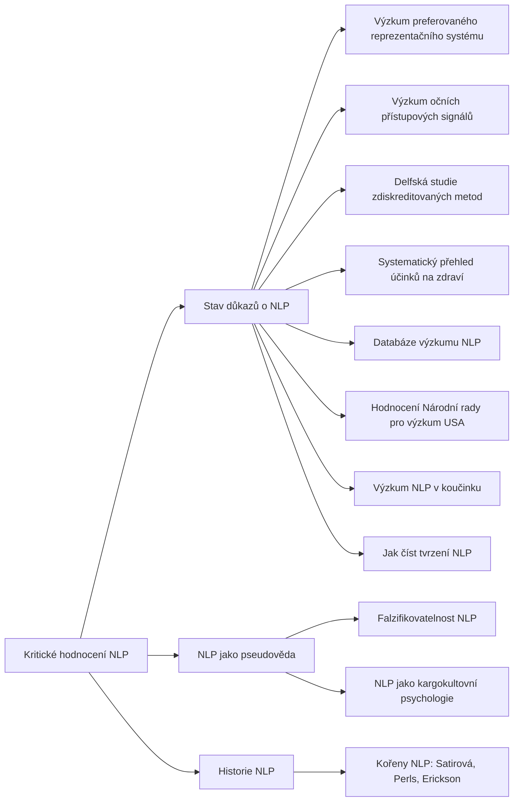

+++
title = "Kritické hodnocení NLP"
description = "Rodina pojmů, které shrnují vědecké hodnocení NLP: testy jeho tvrzení, přehledy výzkumu, posudky, expertní konsenzus a kritéria pseudovědy."
weight = 22
sort_by = "weight"
template = "kompendium/section.html"
page_template = "kompendium/page.html"
insert_anchor_links = "right"

[extra]
tags = ["nlp", "nlp-kriticke-hodnoceni"]
categories = ["academic"]
toc = true
lang = "cs"
keywords = ["Kritické hodnocení NLP", "Critical appraisal of NLP", "NLP vzorce"]
schema_type = "DefinedTermSet"
catalog = "nlp"
catalog_schema = 1
catalog_export = "data/nlp-katalog.json"
catalog_family = "kriticke-hodnoceni"
catalog_code = "22"
catalog_en = "Critical appraisal of NLP"
catalog_size = 14
catalog_members = ["stav-dukazu-nlp", "vyzkum-preferovaneho-systemu", "vyzkum-ocnich-signalu", "nlp-jako-pseudoveda", "delfska-studie", "systematicky-prehled-zdravi", "databaze-vyzkumu-nlp", "hodnoceni-narodni-rady-pro-vyzkum", "nlp-v-koucinku-vyzkum", "falzifikovatelnost-nlp", "historie-nlp", "koreny-nlp", "kargokultovni-psychologie", "jak-cist-tvrzeni-nlp"]
catalog_types = ["concept"]
catalog_sources = ["bandler-grinder-1975", "bandler-grinder-1979", "druckman-swets-1988", "heap-1988", "lilienfeld-2015", "mcguire-1964", "norcross-2006", "passmore-rowson-2019", "sharpley-1984", "sharpley-1987", "sturt-2012", "tosey-mathison-2009", "wiseman-2012", "witkowski-2010", "van-der-linden-2023"]
+++

# Kritické hodnocení NLP

## Co rodina zahrnuje

Rodina kritického hodnocení se od ostatních rodin katalogu liší tím, že nepopisuje vzorce, které
NLP učí, ale to, co o nich zjistil výzkum a jak je hodnotí metodologie psychologie. Ostatní
rodiny popisují strukturu jazykových vzorců, technik a pojmů a v oddílu o stavu důkazů se k
výzkumu vždy jen krátce vracejí. Tato rodina dává výzkumu vlastní prostor: popisuje jednotlivé
linie hodnocení, jejich metody, výsledky a meze, aby se na ně ostatní stránky mohly odvolávat a
aby čtenář mohl posoudit, jakou váhu má který argument.

Rodinu tvoří několik okruhů. Souhrnný okruh představuje stránka [stav důkazů o
NLP](@/kompendium/nlp-vzorce/kriticke-hodnoceni/stav-dukazu-nlp.md), která podává celkový obraz a
rozlišuje mezi testovatelnými hypotézami, tvrzeními o účinnosti a pracovními předpoklady.
Okruh testů konkrétních tvrzení zahrnuje [výzkum preferovaného reprezentačního
systému](@/kompendium/nlp-vzorce/kriticke-hodnoceni/vyzkum-preferovaneho-systemu.md) a [výzkum
očních přístupových
signálů](@/kompendium/nlp-vzorce/kriticke-hodnoceni/vyzkum-ocnich-signalu.md), tedy dvou
tvrzení, která byla formulována dost přesně na to, aby se dala experimentálně ověřit. Okruh
souhrnných hodnocení zahrnuje [delfskou studii zdiskreditovaných
metod](@/kompendium/nlp-vzorce/kriticke-hodnoceni/delfska-studie.md), [systematický přehled
účinků na zdraví](@/kompendium/nlp-vzorce/kriticke-hodnoceni/systematicky-prehled-zdravi.md) a
rozbor [databáze výzkumu NLP](@/kompendium/nlp-vzorce/kriticke-hodnoceni/databaze-vyzkumu-nlp.md),
spolu s posudkem Národní rady pro výzkum USA a přehledem výzkumu v koučinku. Metodologický okruh
tvoří stránka [NLP jako pseudověda](@/kompendium/nlp-vzorce/kriticke-hodnoceni/nlp-jako-pseudoveda.md)
a položky o falzifikovatelnosti a o přirovnání NLP ke kargokultu. Historický okruh popisuje
vznik NLP a jeho kořeny v díle terapeutů, které zakladatelé modelovali. Rodinu uzavírá položka o
tom, jak tvrzení NLP číst. Úplný přehled položek s jejich kódy podává tabulka na konci stránky.

## Původ

Kritické hodnocení NLP je téměř stejně staré jako NLP samo. Zakladatelé v polovině sedmdesátých
let představili soubor modelů odvozených z jazyka a chování úspěšných terapeutů (Bandler a
Grinder 1975) a o několik let později je zpřístupnili širokému publiku ve formě, která obsahovala
konkrétní tvrzení o smyslových systémech, predikátech a pohybech očí (Bandler a Grinder 1979).
Poradenská psychologie na tato tvrzení reagovala řadou studií, které se je pokusily ověřit.
Výsledky souhrnně zhodnotil Sharpley a dospěl k závěru, že tvrzení NLP nebyla podpořena (Sharpley
1984). Ve druhém přehledu otevřel otázku, zda NLP není v podobě, v jaké ho formulují jeho
zastánci, netestovatelné (Sharpley 1987). Ve stejném období vznikl britský přehled s „průběžným
verdiktem“ (Heap 1988) a posudek odborné komise, která hodnotila techniky zvyšování výkonu pro
americkou armádu (Druckman a Swets 1988).

Po těchto hodnoceních se akademický zájem o testování NLP výrazně zmenšil, zatímco komerční šíření
pokračovalo. Druhá vlna hodnocení po roce 2000 se proto zaměřila spíše na souhrnné otázky: jak
odborníci hodnotí NLP jako léčebnou metodu (Norcross, Koocher a Garofalo 2006), co obsahuje
výzkumná databáze sestavená samotným prostředím NLP (Witkowski 2010), zda NLP zlepšuje zdravotní
výsledky (Sturt a kol. 2012) a jak se má k NLP stavět koučovací psychologie (Passmore a Rowson
2019). Vedle těchto prací stojí hodnocení, která k NLP přistupují vstřícněji a studují ho jako
kulturní a profesní jev, aniž přijímají jeho nároky na účinnost (Tosey a Mathison 2009).

## Jak rodinu číst defenzivně

Pro účely kompendia je tato rodina nástrojem epistemické obrany. Mnoho manipulativních užití NLP
se opírá o autoritu: o pověst metody, o certifikáty, o slovo „vědecký“, o seznam studií nebo o
jména slavných uživatelů. Znalost toho, co výzkum skutečně zjistil, tuto autoritu odbourává a
vrací rozhodování tomu, kdo se rozhoduje. Při čtení rodiny se vyplatí sledovat tři rozlišení.

Prvním rozlišením je druh důkazu. Experimentální test konkrétního tvrzení, přehled studií,
systematický přehled, posudek komise a expertní konsenzus mají různou váhu a různé meze.
Kdo argumentuje stavem důkazů, ať pro NLP, nebo proti němu, by měl říci, o jaký druh důkazu se
opírá. Druhým rozlišením je předmět hodnocení. Něco jiného je testovatelná hypotéza o
mechanismu, něco jiného tvrzení o účinnosti techniky a něco jiného pracovní předpoklad, který
se testovat nedá. Kritika, která tato tři patra směšuje, je stejně nepřesná jako propagace,
která je směšuje opačným směrem. Třetím rozlišením je původ prvku. Řada postupů, které NLP
vyučuje, pochází z jiných škol, a pokud fungují, nevypovídá to o NLP, ale o jejich zdroji.
Tvrzení, která jsou pro NLP specifická, jsou zároveň ta, která výzkum nepodpořil (Witkowski
2010).

Rodina zároveň chrání před opačným zneužitím. Označení „NLP“ se v konfliktech někdy používá jako
nálepka, která má diskreditovat člověka bez posouzení toho, co říká nebo dělá. I to je
epistemicky nepoctivé. Spravedlivé hodnocení se týká konkrétních tvrzení a konkrétních postupů, a
proto je rodina strukturována podle nich, ne podle obecného soudu o NLP jako celku. Kompendium
tuto zásadu uplatňuje i na sebe: stránka [kritických
perspektiv](@/kompendium/critical-perspectives/_index.md) popisuje meze jeho vlastního rámce.

## Vztah k ostatním rodinám katalogu

Každá stránka katalogu má oddíl o stavu důkazů a většina z nich se odvolává na práce, které tato
rodina popisuje podrobně. Vztah je proto oboustranný. Stránky jednotlivých vzorců říkají, co
výzkum zjistil o konkrétní technice nebo o konkrétním pojmu, například o [očních přístupových
signálech](@/kompendium/nlp-vzorce/zakladni-pojmy/ocni-pristupove-signaly.md) nebo o [shodě
predikátů](@/kompendium/nlp-vzorce/raport-a-kalibrace/shoda-predikatu.md). Tato rodina naopak
říká, jak byly jednotlivé studie a přehledy provedeny, co přesně měřily a proč mají takovou
váhu, jakou jim katalog přisuzuje. Čtenář, který narazí na odkaz na Sharpleyho přehledy,
Witkowského rozbor nebo delfský průzkum, zde najde jejich metodu i meze. Kde ostatní stránky
uvádějí, že výzkum chybí, platí rozlišení, které rodina vysvětluje: chybějící důkaz o účinku
není totéž co důkaz o neúčinnosti, ale ani jedno neopravňuje nabízet techniku jako ověřenou
léčbu (Sturt a kol. 2012).

## Stav důkazů

Souhrnný obraz, který rodina podává, je konzistentní. Testovatelná tvrzení o preferovaném
reprezentačním systému a o očních signálech byla opakovaně zkoumána a nepotvrdila se (Sharpley
1984; Sharpley 1987; Heap 1988). Populární tvrzení, že směr pohledu prozrazuje lež, bylo
experimentálně vyvráceno (Wiseman a kol. 2012). Odborná komise nenašla oporu pro předpoklady ani
účinnost NLP (Druckman a Swets 1988). Expertní panel zařadil NLP mezi zdiskreditované léčebné
metody (Norcross, Koocher a Garofalo 2006). Rozbor výzkumné databáze ukázal převahu nepodpůrných
výsledků (Witkowski 2010) a systematický přehled nenašel dostatek kvalitních studií o zdravotních
účincích (Sturt a kol. 2012).

Stejně důležité je říci, kde výzkum chybí. O většině jednotlivých technik, které katalog popisuje,
neexistuje žádná kontrolovaná studie. Jejich účinek tedy není potvrzen, ale ani vyvrácen; je
neznámý. Metodologie klinické psychologie v takové situaci ukládá důkazní břemeno tomu, kdo
metodu nabízí jako léčbu, a varuje před nahrazováním výzkumu svědectvími (Lilienfeld, Lynn a Lohr
2015). Proto katalog u každé položky uvádí, co bylo zkoumáno a s jakým výsledkem, a kde výzkum
chybí, říká to otevřeně.

## Obrana

Obranou, kterou rodina nabízí, je soubor otázek, jež může položit každý čtenář: jaké konkrétní
tvrzení se dělá, jaký druh důkazu ho podporuje, co o něm říkají souhrnné přehledy, jak obor
zareagoval na negativní výsledky a kdo má z přijetí tvrzení prospěch. Kdo tyto otázky klade
soustavně, je méně zranitelný vůči autoritě certifikátů, vůči dlouhým seznamům literatury i vůči
síle svědectví. Výzkum psychologické odolnosti ukazuje, že předem získaná znalost typických
přesvědčovacích postupů zvyšuje schopnost jim odolat (McGuire 1964; van der Linden 2023).

Pro klinika, terapeuta, kouče nebo vyšetřovatele, kteří se s NLP setkali ve výcviku, je rodina
podkladem k revizi vlastní praxe: co z naučeného je převzato z ověřených přístupů a lze to
zachovat, co je specifickým tvrzením NLP bez opory a mělo by se opustit, a co nebylo nikdy
zkoumáno a mělo by se používat jen s výslovnou výhradou. Pro klienty a pacienty je rodina
podkladem k informovanému rozhodnutí a pro ty, kdo byli autoritou NLP vedeni k rozhodnutím proti
vlastnímu zájmu, oporou při obnově důvěry ve vlastní úsudek. Obecné principy posuzování
empirické literatury, které rodina uplatňuje, popisuje stránka o [empirické výzkumné
bázi](@/kompendium/techniques/ea-8-3-4-empirical-research-base.md).

<!-- kompendium:katalog-vazby:begin (scripts/catalogs.py; neupravovat ručně) -->

## Hesla rodiny

| Kód | Heslo | Anglicky | Druh | Užití | Riziko |
|-----|-------|----------|------|-------|--------|
| `NLP-22.01` | [Stav důkazů o NLP](@/kompendium/nlp-vzorce/kriticke-hodnoceni/stav-dukazu-nlp.md) | State of the evidence on NLP | pojem | výkladový pojem | střední |
| `NLP-22.02` | [Výzkum preferovaného reprezentačního systému](@/kompendium/nlp-vzorce/kriticke-hodnoceni/vyzkum-preferovaneho-systemu.md) | Research on the preferred representational system | pojem | výkladový pojem | nízké |
| `NLP-22.03` | [Výzkum očních přístupových signálů](@/kompendium/nlp-vzorce/kriticke-hodnoceni/vyzkum-ocnich-signalu.md) | Research on eye accessing cues | pojem | výkladový pojem | střední |
| `NLP-22.04` | [NLP jako pseudověda](@/kompendium/nlp-vzorce/kriticke-hodnoceni/nlp-jako-pseudoveda.md) | NLP as pseudoscience | pojem | výkladový pojem | střední |
| `NLP-22.05` | [Delfská studie zdiskreditovaných metod](@/kompendium/nlp-vzorce/kriticke-hodnoceni/delfska-studie.md) | Delphi poll of discredited methods | pojem | výkladový pojem | nízké |
| `NLP-22.06` | [Systematický přehled účinků na zdraví](@/kompendium/nlp-vzorce/kriticke-hodnoceni/systematicky-prehled-zdravi.md) | Systematic review of health outcomes | pojem | výkladový pojem | střední |
| `NLP-22.07` | [Databáze výzkumu NLP](@/kompendium/nlp-vzorce/kriticke-hodnoceni/databaze-vyzkumu-nlp.md) | NLP research database | pojem | výkladový pojem | nízké |
| `NLP-22.08` | [Hodnocení Národní rady pro výzkum USA](@/kompendium/nlp-vzorce/kriticke-hodnoceni/hodnoceni-narodni-rady-pro-vyzkum.md) | US National Research Council appraisal | pojem | výkladový pojem | nízké |
| `NLP-22.09` | [Výzkum NLP v koučinku](@/kompendium/nlp-vzorce/kriticke-hodnoceni/nlp-v-koucinku-vyzkum.md) | Research on NLP in coaching | pojem | výkladový pojem | střední |
| `NLP-22.10` | [Falzifikovatelnost NLP](@/kompendium/nlp-vzorce/kriticke-hodnoceni/falzifikovatelnost-nlp.md) | Falsifiability of NLP | pojem | výkladový pojem | střední |
| `NLP-22.11` | [Historie NLP](@/kompendium/nlp-vzorce/kriticke-hodnoceni/historie-nlp.md) | History of NLP | pojem | výkladový pojem | nízké |
| `NLP-22.12` | [Kořeny NLP: Satirová, Perls, Erickson](@/kompendium/nlp-vzorce/kriticke-hodnoceni/koreny-nlp.md) | Roots of NLP: Satir, Perls, Erickson | pojem | výkladový pojem | nízké |
| `NLP-22.13` | [NLP jako kargokultovní psychologie](@/kompendium/nlp-vzorce/kriticke-hodnoceni/kargokultovni-psychologie.md) | NLP as cargo-cult psychology | pojem | výkladový pojem | střední |
| `NLP-22.14` | [Jak číst tvrzení NLP](@/kompendium/nlp-vzorce/kriticke-hodnoceni/jak-cist-tvrzeni-nlp.md) | How to read NLP claims | pojem | výkladový pojem | nízké |

## Mapa rodiny

Mapu odvozuje engine katalogů z vazeb „obecnější heslo“; uzel otevře heslo.

## Literatura

- Bandler, R., & Grinder, J. (1975). *The Structure of Magic I: A Book about Language and Therapy*. Palo Alto: Science and Behavior Books.
- Bandler, R., & Grinder, J. (1979). *Frogs into Princes: Neuro Linguistic Programming*. Moab: Real People Press.
- Druckman, D., & Swets, J. A. (Eds.) (1988). *Enhancing Human Performance: Issues, Theories, and Techniques*. Washington, DC: National Academy Press.
- Heap, M. (1988). Neurolinguistic programming: An interim verdict. In M. Heap (Ed.), *Hypnosis: Current Clinical, Experimental and Forensic Practices* (pp. 268–280). London: Croom Helm.
- Lilienfeld, S. O., Lynn, S. J., & Lohr, J. M. (Eds.) (2015). *Science and Pseudoscience in Clinical Psychology* (2. vyd.). New York: Guilford Press.
- McGuire, W. J. (1964). Inducing resistance to persuasion: Some contemporary approaches. In L. Berkowitz (Ed.), *Advances in Experimental Social Psychology* (Vol. 1, pp. 191–229). New York: Academic Press.
- Norcross, J. C., Koocher, G. P., & Garofalo, A. (2006). Discredited psychological treatments and tests: A Delphi poll. *Professional Psychology: Research and Practice*, 37(5), 515–522.
- Passmore, J., & Rowson, T. S. (2019). Neuro-linguistic programming: A critical review of NLP research and the application of NLP in coaching. *International Coaching Psychology Review*, 14(1), 57–69.
- Sharpley, C. F. (1984). Predicate matching in NLP: A review of research on the preferred representational system. *Journal of Counseling Psychology*, 31(2), 238–248.
- Sharpley, C. F. (1987). Research findings on neurolinguistic programming: Nonsupportive data or an untestable theory? *Journal of Counseling Psychology*, 34(1), 103–107.
- Sturt, J., Ali, S., Robertson, W., Metcalfe, D., Grove, A., Bourne, C., & Bridle, C. (2012). Neurolinguistic programming: A systematic review of the effects on health outcomes. *British Journal of General Practice*, 62(604), e757–e764.
- Tosey, P., & Mathison, J. (2009). *Neuro-Linguistic Programming: A Critical Appreciation for Managers and Developers*. Basingstoke: Palgrave Macmillan.
- Wiseman, R., Watt, C., ten Brinke, L., Porter, S., Couper, S.-L., & Rankin, C. (2012). The eyes don't have it: Lie detection and neuro-linguistic programming. *PLoS ONE*, 7(7), e40259.
- Witkowski, T. (2010). Thirty-five years of research on neuro-linguistic programming. NLP research data base. State of the art or pseudoscientific decoration? *Polish Psychological Bulletin*, 41(2), 58–66.
- van der Linden, S. (2023). *Foolproof: Why Misinformation Infects Our Minds and How to Build Immunity*. London: 4th Estate.

## Související

- [NLP vzorce](@/kompendium/nlp-vzorce/_index.md) – celý katalog a jeho rodiny
- [Vliv a zneužití NLP](@/kompendium/nlp-vzorce/vliv-a-zneuziti/_index.md) – předchozí rodina katalogu
- [Trenér rozpoznávání](@/kompendium/trener.md) – procvičení rozpoznání hesel této rodiny

<!-- kompendium:katalog-vazby:end -->
