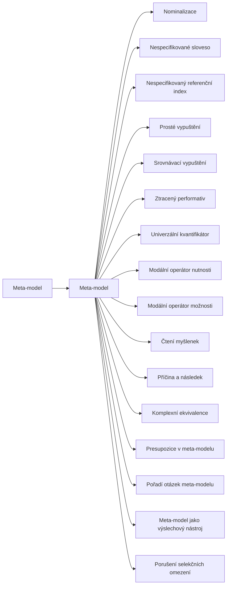

+++
title = "Meta-model"
description = "Rodina jazykových kategorií meta-modelu: vypouštění, zkreslování a zobecňování v řeči, jejich upřesňující otázky, kořeny v lingvistice a dvojí, terapeutické i nátlakové užití."
weight = 3
sort_by = "weight"
template = "kompendium/section.html"
page_template = "kompendium/page.html"
insert_anchor_links = "right"

[extra]
tags = ["nlp", "nlp-meta-model"]
categories = ["academic"]
toc = true
lang = "cs"
keywords = ["Meta-model", "Meta Model", "NLP vzorce"]
schema_type = "DefinedTermSet"
catalog = "nlp"
catalog_schema = 1
catalog_export = "data/nlp-katalog.json"
catalog_family = "meta-model"
catalog_code = "03"
catalog_en = "Meta Model"
catalog_size = 17
catalog_members = ["meta-model", "nominalizace", "nespecifikovane-sloveso", "nespecifikovany-referencni-index", "prosta-delece", "srovnavaci-delece", "ztraceny-performativ", "univerzalni-kvantifikator", "modalni-operator-nutnosti", "modalni-operator-moznosti", "cteni-myslenek", "pricina-a-nasledek", "komplexni-ekvivalence", "presupozice-v-meta-modelu", "hierarchie-otazek-meta-modelu", "meta-model-jako-vyslychaci-nastroj", "poruseni-selekcnich-omezeni-meta"]
catalog_types = ["concept", "pattern"]
catalog_sources = ["bandler-grinder-1975", "bandler-grinder-1975b", "beck-1976", "chomsky-1965", "druckman-swets-1988", "ellis-1962", "grice-1975", "heap-1988", "herman-1992", "korzybski-1933", "levinson-1983", "lifton-1961", "loftus-palmer-1974", "mcguire-1964", "oconnor-seymour-1990", "passmore-rowson-2019", "perls-1969", "petty-cacioppo-1986", "satir-1972", "sharpley-1987", "sturt-2012", "watzlawick-1967", "witkowski-2010", "van-der-linden-2023"]
+++

# Meta-model

## Co rodina zahrnuje

Rodina NLP-03 shromažďuje hesla meta-modelu, tedy první soustavy, kterou Richard Bandler a
John Grinder v polovině sedmdesátých let publikovali a ze které se neurolingvistické
programování dále rozvinulo (Bandler a Grinder 1975). Meta-model popisuje tvary vět, v nichž
podle svých autorů mluvčí ze své zkušenosti něco vypustil, zkreslil nebo zobecnil, a ke
každému tvaru přiřazuje typ upřesňující otázky. Úvodní heslo
[Meta-model](@/kompendium/nlp-vzorce/meta-model/meta-model.md) popisuje celek, jeho
předpoklady a jeho dvojí užití. Následující hesla rozebírají jednotlivé kategorie. Do skupiny
vypouštění patří [prosté vypuštění](@/kompendium/nlp-vzorce/meta-model/prosta-delece.md),
[srovnávací vypuštění](@/kompendium/nlp-vzorce/meta-model/srovnavaci-delece.md),
[nespecifikovaný referenční index](@/kompendium/nlp-vzorce/meta-model/nespecifikovany-referencni-index.md)
a [nespecifikované sloveso](@/kompendium/nlp-vzorce/meta-model/nespecifikovane-sloveso.md).
Do skupiny zkreslování patří [nominalizace](@/kompendium/nlp-vzorce/meta-model/nominalizace.md),
[ztracený performativ](@/kompendium/nlp-vzorce/meta-model/ztraceny-performativ.md),
[čtení myšlenek](@/kompendium/nlp-vzorce/meta-model/cteni-myslenek.md),
[příčina a následek](@/kompendium/nlp-vzorce/meta-model/pricina-a-nasledek.md) a
[komplexní ekvivalence](@/kompendium/nlp-vzorce/meta-model/komplexni-ekvivalence.md). Do skupiny
zobecňování patří [univerzální kvantifikátor](@/kompendium/nlp-vzorce/meta-model/univerzalni-kvantifikator.md),
[modální operátor nutnosti](@/kompendium/nlp-vzorce/meta-model/modalni-operator-nutnosti.md) a
[modální operátor možnosti](@/kompendium/nlp-vzorce/meta-model/modalni-operator-moznosti.md).
Rodinu doplňují hesla o presupozicích, o porušení selekčních omezení, o pořadí a tempu, v jakém se podle tradice NLP otázky kladou, a o meta-modelu použitém jako výslechový nástroj,
které je pro defenzivní čtení zvlášť důležité:
[Meta-model jako výslechový nástroj](@/kompendium/nlp-vzorce/meta-model/meta-model-jako-vyslychaci-nastroj.md).

Rozdělení na tři skupiny odpovídá tomu, jak meta-model podávají pozdější učebnice NLP (O'Connor
a Seymour 1990). Původní text byl více vázán na terminologii transformační gramatiky a
hranice mezi skupinami nejsou ostré: nominalizace je zkreslení, ale zároveň vypouští aktéry;
ztracený performativ je zkreslení, ale zároveň zobecňuje. Pro čtenáře je proto užitečnější
chápat skupiny jako tři pohledy na tutéž otázku, totiž co z popisu zkušenosti chybí, než jako
oddělené přihrádky.

Každé heslo rodiny má stejnou stavbu. Definice vymezuje kategorii a její jazykové prostředky,
původ ji zasazuje do [historie NLP](@/kompendium/nlp-vzorce/kriticke-hodnoceni/historie-nlp.md) a do příbuzných oborů, struktura popisuje, co ve větě chybí
a jaký účinek to má, detekční znaky ukazují, podle čeho se nátlaková podoba pozná v rozhovoru
a na člověku, na kterého působí, a závěrečné oddíly rozlišují legitimní a manipulativní užití,
shrnují stav důkazů a popisují obranu a zotavení. Hesla nepopisují postupy, jak kategorie
používat vůči druhým; popisují, jak je rozpoznat a jak se jim bránit. Tam, kde se hesla
odvolávají na terapeutické užití, jde o popis tvrzení a jejich opory, nikoli o návod.

## Původ

Meta-model vznikl z pozorování terapeutické práce Fritze Perlse a Virginie Satirové, jejichž
způsob kladení otázek chtěli Bandler a Grinder zachytit jako opakovatelný model (Perls 1969;
Satir 1972; Bandler a Grinder 1975). Teoretický rámec převzali z transformační gramatiky Noama
Chomského, která rozlišovala hloubkovou strukturu věty a povrchovou strukturu, k níž se od
hloubkové dospívá transformacemi, mimo jiné vypouštěním (Chomsky 1965). Z tohoto rozlišení
odvodili hlavní předpoklad meta-modelu: věta, kterou klient vyslovil, je ochuzenou verzí
bohatší reprezentace a vhodná otázka může chybějící části obnovit. Druhý zdroj představovala
obecná sémantika a teze, že jazyk není tím, co popisuje (Korzybski 1933), kterou v tomto
katalogu rozebírá heslo [Mapa není území](@/kompendium/nlp-vzorce/predpoklady/mapa-neni-uzemi.md).
Krátce po meta-modelu popsali autoři jeho zrcadlový protějšek, [Milton-model](@/kompendium/nlp-vzorce/milton-model/milton-model.md), odvozený z řeči
hypnoterapeuta Miltona Ericksona. V něm jsou tytéž jazykové tvary, které meta-model rozkrývá,
používány záměrně, protože neurčitost nechává posluchače doplnit význam vlastním obsahem
(Bandler a Grinder 1975b). Většina hesel této rodiny má proto v rodině
[Milton-model](@/kompendium/nlp-vzorce/milton-model/_index.md) svůj protějšek a obě rodiny je
vhodné číst spolu.

## Jak rodinu číst defenzivně

Pro kompendium je meta-model zajímavý ve dvou rolích, a každé heslo rodiny je napsáno tak,
aby obě role rozlišovalo. V první roli jsou kategorie meta-modelu detekčním slovníkem.
Manipulativní řeč často pracuje přesně s tím, co meta-model popisuje: zastírá původce soudu,
nahrazuje argument anonymní většinou, vydává přání za nutnost, srovnává bez měřítka a mění
jednání v nálepku. Kdo tyto tvary pozná, rozkládá sílu nátlakové věty na ověřitelné části. V
tomto smyslu se meta-model blíží tomu, co kompendium popisuje u
[pasti epistemické vágnosti](@/kompendium/techniques/ea-5-4-24-epistemic-vagueness-trap.md) a
u [terminologické mystifikace](@/kompendium/techniques/ea-1-1-3-terminologicka-mystifikace.md).
Lifton ve studii myšlenkové reformy popsal „[nabitý jazyk](@/kompendium/nlp-vzorce/jazykove-vzorce/slovni-baliky.md)“ uzavřených prostředí, v němž se
složité otázky stlačují do definitivně znějících frází, které myšlení ukončují (Lifton 1961);
řada kategorií meta-modelu popisuje gramatické prostředky takového stlačení.

Ve druhé roli je meta-model sám nástrojem nátlaku. Upřesňující otázky, kladené bez ohledu na
tempo a potřeby mluvčího, se snadno mění ve výslech, ve kterém druhý nemůže obstát, protože
každá jeho odpověď je „ještě nepřesná“. Asymetrie, kdy přesnost se vyžaduje jen od jedné
strany, je typickým znakem této podoby. Watzlawick a spolupracovníci upozorňují, že každé
sdělení má vedle obsahu i vztahovou rovinu (Watzlawick, Beavin a Jackson 1967); výslechový
způsob kladení otázek sděluje nadřazenost bez ohledu na to, na co se otázky ptají. Defenzivní
čtení proto u každé kategorie sleduje tři otázky. Kdo v rozhovoru vyžaduje přesnost a od koho?
Slouží upřesnění porozumění mluvčímu, nebo jeho umlčení? A je chybějící údaj skutečně nositelem
váhy tvrzení, nebo jen běžnou úsporností řeči?

Poslední otázka je důležitá i pro odborníky. Pragmatika ukazuje, že vypouštění je přirozenou
vlastností dorozumívání: mluvčí říká tolik, kolik je pro účel rozhovoru potřeba, a posluchač
zbytek dovozuje z kontextu (Grice 1975; Levinson 1983). Ne každá vágní věta je známkou
manipulace nebo patologie. Hesla rodiny proto u každé kategorie uvádějí i benigní příklady, ve
kterých vypuštění, zobecnění nebo neurčitost nikomu neškodí, a trenér rozpoznávání je obsahuje
jako kontrastní položky.

## Stav důkazů

Meta-model jako metoda byl empiricky zkoumán mnohem méně než jiné části NLP. Přehledy výzkumu
z osmdesátých let se soustředily na [preferovaný reprezentační systém](@/kompendium/nlp-vzorce/zakladni-pojmy/preferovany-reprezentacni-system.md) a na přizpůsobování
predikátů a jejich výsledky byly převážně negativní (Sharpley 1987; Heap 1988). Hodnocení
amerického Národního výzkumného výboru nenašlo dostatečnou oporu pro tvrzení NLP o ovlivňování
výkonu (Druckman a Swets 1988). Pozdější přehledy dospěly k podobnému obrazu: systematický
přehled zdravotních účinků NLP konstatoval nedostatek kvalitních studií (Sturt a kol. 2012),
[databáze výzkumu NLP](@/kompendium/nlp-vzorce/kriticke-hodnoceni/databaze-vyzkumu-nlp.md) podle Witkowského neposkytuje oporu pro hlavní tvrzení oboru (Witkowski
2010) a kritický přehled pro oblast koučinku doporučuje opatrnost (Passmore a Rowson 2019).
Kontrolované studie, které by izolovaly účinek samotného meta-modelu, v těchto přehledech jako
samostatná skupina nefigurují.

Hodnota rodiny pro kompendium proto stojí jinde než na důkazech o NLP. Jednotlivé kategorie se
kryjí s jevy, které mají vlastní a lépe podloženou tradici: s referencí, presupozicí a
implikaturou v pragmatice (Levinson 1983), s přehnaným zobecňováním a rigidními pravidly v
kognitivní terapii (Beck 1976), s absolutistickými požadavky v racionálně emoční terapii (Ellis
1962) a s vlivem formulace otázky na svědeckou paměť (Loftus a Palmer 1974). Kde hesla rodiny
odkazují na tyto tradice, opírají se o ně, a ne o meta-model jako metodu. Teoretický základ
meta-modelu navíc zastaral, protože pojetí hloubkové struktury, ze kterého vycházel, generativní
lingvistika v pozdějších desetiletích opustila. Kategorie tedy čtenáři slouží jako popisný
slovník pro rozbor řeči, nikoli jako ověřená terapeutická technika.

## Obrana

Obranné využití rodiny je jednoduché ve své podstatě a náročné v praxi. Kategorie meta-modelu
mohou sloužit jako vnitřní kontrolní seznam posluchače: kdo to říká, podle čeho, ve srovnání s
čím, kdo konkrétně, co přesně se stalo a co by se doopravdy stalo, kdyby ne. Takové otázky si
člověk klade především sám pro sebe; nahlas je vyslovovat má smysl tam, kde je rozhovor
bezpečný a kde odpověď může něco změnit. Posouzení obsahu sdělení místo jeho tónu a sebejistoty
mluvčího odpovídá tomu, co výzkum přesvědčování popisuje jako centrální cestu zpracování (Petty a
Cacioppo 1986). Výzkum očkování proti přesvědčování ukazuje, že kdo rétorický vzorec zná předem,
je vůči němu odolnější (McGuire 1964; van der Linden 2023), a právě k tomu jsou hesla a trenér
rozpoznávání určeny.

Proti meta-modelu použitému jako výslech je obranou pojmenování asymetrie a návrat k vlastnímu
tempu: nárok na vyslyšení nezávisí na tom, zda člověk napoprvé najde dokonale přesná slova. V
zotavení po vztazích nebo skupinách, kde jazyk zastíral aktéry a vydával přání za pravidla,
pomáhá postupné vracení konkrétních událostí k nálepkám a pravidlům, která člověk převzal, a
obnova práva pojmenovat vlastní zkušenost. Herman zdůrazňuje, že takové zotavení probíhá ve
vztazích, které neopakují kontrolu, a ne v izolaci (Herman 1992). Širší rámec obrany a kalibrace
popisuje kapitola [Obrana a kalibrace](@/kompendium/06-obrana/_index.md).

<!-- kompendium:katalog-vazby:begin (scripts/catalogs.py; neupravovat ručně) -->

## Hesla rodiny

| Kód | Heslo | Anglicky | Druh | Užití | Riziko |
|-----|-------|----------|------|-------|--------|
| `NLP-03.01` | [Meta-model](@/kompendium/nlp-vzorce/meta-model/meta-model.md) | Meta Model | vzorec | terapeutické i vlivové | střední |
| `NLP-03.02` | [Nominalizace](@/kompendium/nlp-vzorce/meta-model/nominalizace.md) | Nominalisation | vzorec | terapeutické i vlivové | střední |
| `NLP-03.03` | [Nespecifikované sloveso](@/kompendium/nlp-vzorce/meta-model/nespecifikovane-sloveso.md) | Unspecified verb | vzorec | terapeutické i vlivové | střední |
| `NLP-03.04` | [Nespecifikovaný referenční index](@/kompendium/nlp-vzorce/meta-model/nespecifikovany-referencni-index.md) | Unspecified referential index | vzorec | terapeutické i vlivové | střední |
| `NLP-03.05` | [Prosté vypuštění](@/kompendium/nlp-vzorce/meta-model/prosta-delece.md) | Simple deletion | vzorec | terapeutické i vlivové | nízké |
| `NLP-03.06` | [Srovnávací vypuštění](@/kompendium/nlp-vzorce/meta-model/srovnavaci-delece.md) | Comparative deletion | vzorec | převážně vlivové | střední |
| `NLP-03.07` | [Ztracený performativ](@/kompendium/nlp-vzorce/meta-model/ztraceny-performativ.md) | Lost performative | vzorec | terapeutické i vlivové | vysoké |
| `NLP-03.08` | [Univerzální kvantifikátor](@/kompendium/nlp-vzorce/meta-model/univerzalni-kvantifikator.md) | Universal quantifier | vzorec | terapeutické i vlivové | střední |
| `NLP-03.09` | [Modální operátor nutnosti](@/kompendium/nlp-vzorce/meta-model/modalni-operator-nutnosti.md) | Modal operator of necessity | vzorec | terapeutické i vlivové | vysoké |
| `NLP-03.10` | [Modální operátor možnosti](@/kompendium/nlp-vzorce/meta-model/modalni-operator-moznosti.md) | Modal operator of possibility | vzorec | terapeutické i vlivové | střední |
| `NLP-03.11` | [Čtení myšlenek](@/kompendium/nlp-vzorce/meta-model/cteni-myslenek.md) | Mind reading | vzorec | terapeutické i vlivové | střední |
| `NLP-03.12` | [Příčina a následek](@/kompendium/nlp-vzorce/meta-model/pricina-a-nasledek.md) | Cause and effect | vzorec | terapeutické i vlivové | střední |
| `NLP-03.13` | [Komplexní ekvivalence](@/kompendium/nlp-vzorce/meta-model/komplexni-ekvivalence.md) | Complex equivalence | vzorec | terapeutické i vlivové | střední |
| `NLP-03.14` | [Presupozice v meta-modelu](@/kompendium/nlp-vzorce/meta-model/presupozice-v-meta-modelu.md) | Presuppositions (Meta Model) | vzorec | terapeutické i vlivové | vysoké |
| `NLP-03.15` | [Pořadí otázek meta-modelu](@/kompendium/nlp-vzorce/meta-model/hierarchie-otazek-meta-modelu.md) | Order of Meta Model challenges | pojem | terapeutické i vlivové | nízké |
| `NLP-03.16` | [Meta-model jako výslechový nástroj](@/kompendium/nlp-vzorce/meta-model/meta-model-jako-vyslychaci-nastroj.md) | Meta Model as an interrogation tool | pojem | terapeutické i vlivové | vysoké |
| `NLP-03.17` | [Porušení selekčních omezení](@/kompendium/nlp-vzorce/meta-model/poruseni-selekcnich-omezeni-meta.md) | Selectional restriction violation (Meta Model) | vzorec | terapeutické i vlivové | nízké |

## Mapa rodiny

Mapu odvozuje engine katalogů z vazeb „obecnější heslo“; uzel otevře heslo.

<!-- kompendium:katalog-vazby:end -->

## Literatura

- Bandler, R., & Grinder, J. (1975). *The Structure of Magic I: A Book about Language and Therapy*. Palo Alto: Science and Behavior Books.
- Bandler, R., & Grinder, J. (1975b). *Patterns of the Hypnotic Techniques of Milton H. Erickson, M.D., Volume 1*. Cupertino: Meta Publications.
- Beck, A. T. (1976). *Cognitive Therapy and the Emotional Disorders*. New York: International Universities Press.
- Chomsky, N. (1965). *Aspects of the Theory of Syntax*. Cambridge, MA: MIT Press.
- Druckman, D., & Swets, J. A. (Eds.) (1988). *Enhancing Human Performance: Issues, Theories, and Techniques*. Washington, DC: National Academy Press.
- Ellis, A. (1962). *Reason and Emotion in Psychotherapy*. New York: Lyle Stuart.
- Grice, H. P. (1975). Logic and conversation. In P. Cole & J. L. Morgan (Eds.), *Syntax and Semantics 3: Speech Acts* (pp. 41–58). New York: Academic Press.
- Heap, M. (1988). Neurolinguistic programming: An interim verdict. In M. Heap (Ed.), *Hypnosis: Current Clinical, Experimental and Forensic Practices* (pp. 268–280). London: Croom Helm.
- Herman, J. L. (1992). *Trauma and Recovery*. New York: Basic Books.
- Korzybski, A. (1933). *Science and Sanity: An Introduction to Non-Aristotelian Systems and General Semantics*. Lancaster: International Non-Aristotelian Library.
- Levinson, S. C. (1983). *Pragmatics*. Cambridge: Cambridge University Press.
- Lifton, R. J. (1961). *Thought Reform and the Psychology of Totalism: A Study of „Brainwashing“ in China*. New York: W. W. Norton.
- Loftus, E. F., & Palmer, J. C. (1974). Reconstruction of automobile destruction: An example of the interaction between language and memory. *Journal of Verbal Learning and Verbal Behavior*, 13(5), 585–589.
- McGuire, W. J. (1964). Inducing resistance to persuasion: Some contemporary approaches. In L. Berkowitz (Ed.), *Advances in Experimental Social Psychology* (Vol. 1, pp. 191–229). New York: Academic Press.
- O'Connor, J., & Seymour, J. (1990). *Introducing Neuro-Linguistic Programming: Psychological Skills for Understanding and Influencing People*. London: Thorsons.
- Passmore, J., & Rowson, T. S. (2019). Neuro-linguistic programming: A critical review of NLP research and the application of NLP in coaching. *International Coaching Psychology Review*, 14(1), 57–69.
- Perls, F. S. (1969). *Gestalt Therapy Verbatim*. Lafayette: Real People Press.
- Petty, R. E., & Cacioppo, J. T. (1986). *Communication and Persuasion: Central and Peripheral Routes to Attitude Change*. New York: Springer.
- Satir, V. (1972). *Peoplemaking*. Palo Alto: Science and Behavior Books.
- Sharpley, C. F. (1987). Research findings on neurolinguistic programming: Nonsupportive data or an untestable theory? *Journal of Counseling Psychology*, 34(1), 103–107.
- Sturt, J., Ali, S., Robertson, W., Metcalfe, D., Grove, A., Bourne, C., & Bridle, C. (2012). Neurolinguistic programming: A systematic review of the effects on health outcomes. *British Journal of General Practice*, 62(604), e757–e764.
- Watzlawick, P., Beavin, J. H., & Jackson, D. D. (1967). *Pragmatics of Human Communication*. New York: W. W. Norton.
- Witkowski, T. (2010). Thirty-five years of research on neuro-linguistic programming. NLP research data base. State of the art or pseudoscientific decoration? *Polish Psychological Bulletin*, 41(2), 58–66.
- van der Linden, S. (2023). *Foolproof: Why Misinformation Infects Our Minds and How to Build Immunity*. London: 4th Estate.

<!-- kompendium:katalog-vazby:begin (scripts/catalogs.py; neupravovat ručně) -->

## Související

- [NLP vzorce](@/kompendium/nlp-vzorce/_index.md) – celý katalog a jeho rodiny
- [Základní pojmy NLP](@/kompendium/nlp-vzorce/zakladni-pojmy/_index.md) – předchozí rodina katalogu
- [Milton-model](@/kompendium/nlp-vzorce/milton-model/_index.md) – další rodina katalogu
- [Trenér rozpoznávání](@/kompendium/trener.md) – procvičení rozpoznání hesel této rodiny

<!-- kompendium:katalog-vazby:end -->
