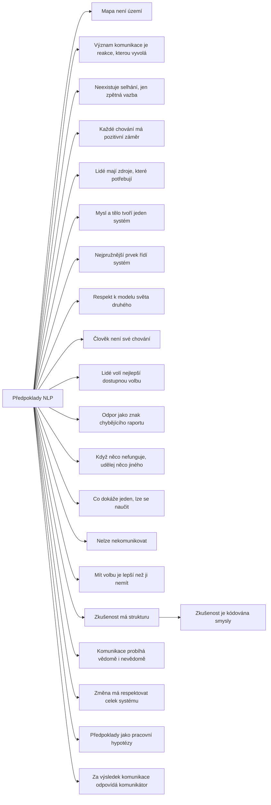

+++
title = "Předpoklady NLP"
description = "Rodina pracovních přesvědčení, na nichž NLP staví: odkud pocházejí, proč nejsou empirickými tvrzeními a jak rozpoznat jejich symetrické a asymetrické užití."
weight = 1
sort_by = "weight"
template = "kompendium/section.html"
page_template = "kompendium/page.html"
insert_anchor_links = "right"

[extra]
tags = ["nlp", "nlp-predpoklady"]
categories = ["academic"]
toc = true
lang = "cs"
keywords = ["Předpoklady NLP", "NLP presuppositions", "NLP vzorce"]
schema_type = "DefinedTermSet"
catalog = "nlp"
catalog_schema = 1
catalog_export = "data/nlp-katalog.json"
catalog_family = "predpoklady"
catalog_code = "01"
catalog_en = "NLP presuppositions"
catalog_size = 21
catalog_members = ["mapa-neni-uzemi", "vyznam-komunikace-je-reakce", "neni-selhani-jen-zpetna-vazba", "pozitivni-zamer-chovani", "lide-maji-potrebne-zdroje", "mysl-a-telo-jeden-system", "zakon-pozadovane-variety", "respekt-k-modelu-sveta", "clovek-neni-sve-chovani", "nejlepsi-dostupna-volba", "odpor-jako-nedostatek-raportu", "kdyz-to-nefunguje-udelej-neco-jineho", "modelovatelnost-excelence", "nelze-nekomunikovat", "volba-je-lepsi-nez-zadna-volba", "zkusenost-ma-strukturu", "zkusenost-je-kodovana-smysly", "komunikace-vedoma-a-nevedoma", "ekologie-zmeny", "predpoklady-jako-pracovni-hypotezy", "odpovednost-za-komunikaci"]
catalog_types = ["principle"]
catalog_sources = ["bandler-grinder-1975", "bateson-1972", "dilts-delozier-2000", "haley-1973", "herman-1992", "korzybski-1933", "lifton-1961", "lilienfeld-2015", "mcguire-1964", "oconnor-seymour-1990", "passmore-rowson-2019", "rogers-1951", "satir-1972", "sharpley-1987", "stark-2007", "sturt-2012", "tosey-mathison-2009", "watzlawick-1967", "witkowski-2010", "van-der-linden-2023"]
+++

# Předpoklady NLP

## Co rodina zahrnuje

Předpoklady NLP jsou souborem pracovních přesvědčení, se kterými má praktik vstupovat do
rozhovoru, do terapie, do koučinku nebo do jednání. Nejde o techniky v úzkém smyslu, ale o
východiska, z nichž se techniky odvozují a kterými se zdůvodňují. Úvodní učebnice oboru je
uvádějí jako seznam výroků, mezi nimiž nechybí například „mapa není území“, „význam komunikace
je reakce, kterou vyvolá“ nebo „každé chování má pozitivní záměr“, a výslovně je předkládají
jako užitečné postoje, nikoli jako prokázané pravdy (O'Connor a Seymour 1990). Seznamy se mezi
autory a výcvikovými školami liší počtem i formulacemi; katalog proto sleduje nejčastěji
uváděné položky a každé z nich věnuje samostatnou stránku.

Rodinu lze pro přehled rozdělit do několika okruhů. Epistemický okruh tvoří předpoklady o
vztahu mezi zkušeností a jejím popisem: [mapa není
území](@/kompendium/nlp-vzorce/predpoklady/mapa-neni-uzemi.md), [respekt k modelu světa
druhého](@/kompendium/nlp-vzorce/predpoklady/respekt-k-modelu-sveta.md) a předpoklad, že
zkušenost má strukturu. Komunikační okruh tvoří předpoklady o tom, jak se ustavuje význam a kdo
za něj odpovídá, především [význam komunikace je reakce, kterou
vyvolá](@/kompendium/nlp-vzorce/predpoklady/vyznam-komunikace-je-reakce.md) a nemožnost
nekomunikovat. Okruh změny a odpovědnosti zahrnuje předpoklady, které určují, jak se vykládá
neúspěch, škodlivé chování a odmítnutí: [neexistuje selhání, jen zpětná
vazba](@/kompendium/nlp-vzorce/predpoklady/neni-selhani-jen-zpetna-vazba.md), [každé chování má
pozitivní záměr](@/kompendium/nlp-vzorce/predpoklady/pozitivni-zamer-chovani.md), [lidé mají
zdroje, které potřebují](@/kompendium/nlp-vzorce/predpoklady/lide-maji-potrebne-zdroje.md),
[člověk není své chování](@/kompendium/nlp-vzorce/predpoklady/clovek-neni-sve-chovani.md),
[lidé volí nejlepší dostupnou
volbu](@/kompendium/nlp-vzorce/predpoklady/nejlepsi-dostupna-volba.md) a [odpor jako znak
chybějícího raportu](@/kompendium/nlp-vzorce/predpoklady/odpor-jako-nedostatek-raportu.md).
Systémový okruh konečně tvoří předpoklady převzaté z kybernetiky a systemického myšlení: [mysl
a tělo tvoří jeden systém](@/kompendium/nlp-vzorce/predpoklady/mysl-a-telo-jeden-system.md),
[nejpružnější prvek řídí
systém](@/kompendium/nlp-vzorce/predpoklady/zakon-pozadovane-variety.md) a požadavek, aby změna
respektovala celek systému. Úplný přehled položek rodiny s jejich kódy podává tabulka na konci
této stránky.

## Původ

Předpoklady nevznikly jako ucelená teorie. Jsou to zobecnění, která zakladatelé NLP a jejich
pokračovatelé vyvodili z autorů a terapeutů, jež v sedmdesátých letech modelovali. Korzybski
dodal rozlišení mezi jazykem a tím, co jazyk označuje, a kritiku ztotožňování člověka s jedním
jeho rysem (Korzybski 1933). Bateson dodal kybernetický slovník zpětných vazeb, úrovní učení a
systémů, ve kterých obíhá informace (Bateson 1972). Pragmatická teorie komunikace, která z jeho
okruhu vzešla, přinesla důraz na účinky sdělení a na vztahovou rovinu každé výměny (Watzlawick,
Beavin a Jackson 1967). Erickson, jak jeho práci popsal Haley, přinesl postoj, podle něhož se
vše, co klient přináší, včetně odporu a symptomu, má přijmout a využít (Haley 1973). Satirová
přinesla důraz na sebehodnotu člověka a na to, že obranná komunikace pramení z ohrožení, ne ze
zlé vůle (Satir 1972). Z humanistické psychoterapie pochází postoj přijetí a porozumění
klientovi z jeho vnitřního vztažného rámce (Rogers 1951).

Bandler a Grinder z těchto zdrojů odvodili výchozí obraz člověka, který jedná podle ochuzené
mapy světa, a ne proto, že by byl zlý nebo nemocný, a terapii pojali jako obohacování této mapy
(Bandler a Grinder 1975). Pozdější autoři předpoklady sepsali do seznamů, rozšířili je o další
položky a zasadili do systemického rámce (Dilts a DeLozier 2000). Při tomto zpracování se často
ztratila přesnost původních pojmů: kybernetický zákon o regulaci se změnil v tvrzení o tom, kdo
v rozhovoru vyhrává, a Batesonovy logické typy a úrovně učení v hierarchii úrovní prostředí,
chování, schopností, přesvědčení a identity, která v Batesonově díle v této podobě není. Kdo
předpoklady čte, by proto měl rozlišovat mezi jejich filozofickými a vědeckými kořeny, které
bývají solidní, a jejich podobou v NLP, která je volnou interpretací těchto kořenů.

## Jak rodinu číst defenzivně

Pro účely kompendia mají předpoklady zvláštní význam. Nepopisují konkrétní jazykový vzorec,
který by šlo v rozhovoru zachytit, ale určují rámec, ve kterém se rozhovor vykládá. Kdo
převezme předpoklad, převezme i výklad, který z něj plyne: co je neúspěch, kdo za něj odpovídá,
co znamená odmítnutí, co je „pravé já“ člověka. Proto se vyplatí sledovat tři mechanismy, které
se v rodině opakují.

Prvním je asymetrie. Téměř každý předpoklad má symetrickou podobu, ve které platí pro všechny
účastníky stejně, a asymetrickou podobu, ve které se uplatní jen na jednu stranu. Mapa druhého
je „jen mapa“, ale mapa mluvčího je území; neúspěch účastníka je zpětná vazba o účastníkovi,
ale neúspěch metody je také zpětná vazba o účastníkovi; respekt k modelu světa se žádá pro
skupinu, ale ne pro kritika. Asymetrie je nejspolehlivějším znakem manipulativního užití a dá
se zachytit jednoduchou otázkou: platí tento výrok i pro toho, kdo ho právě vyslovil?

Druhým mechanismem je přesun odpovědnosti. Předpoklady o zdrojích, o nejlepší dostupné volbě a
o pozitivním záměru přesouvají pozornost od vnějších podmínek k vnitřku jednotlivce. V terapii,
kde jde o klientovo vlastní chování, to může být užitečné. Ve vztazích s nerovnou mocí to
znamená, že odpovědnost za škodu se přenese na toho, kdo ji nese: oběť má hledat dobrý záměr
ubližujícího, má si uvědomit, že „zvolila“ zůstat, a má najít zdroje, které jí „už patří“.
Stark ukázal, že kontrolující chování v blízkých vztazích je cílené a systematicky omezuje
možnosti druhého (Stark 2007); výklady, které z omezených možností dělají svobodnou volbu,
tento vzorec zakrývají. Opačným směrem působí předpoklad o odporu, který odpovědnost přesouvá
na praktika tak, že z odmítnutí druhého dělá technický problém.

Třetím mechanismem je nevyvratitelnost. Předpoklady jsou formulovány tak, že je žádná zkušenost
nemůže vyvrátit: neúspěch je zpětná vazba, odmítnutí je nedostatek raportu, škodlivé chování má
skrytý dobrý záměr. Taková formulace je v pořádku, dokud jde o pracovní postoj, který si
praktik vědomě volí. Problém vzniká, když se předpoklad začne používat jako argument proti
kritice metody, vedoucího nebo skupiny. Lifton popsal, jak uzavřené systémy chrání svou
doktrínu tím, že ji činí nezpochybnitelnou a zkušenost jednotlivce, která s ní nesouhlasí,
vykládají jako jeho chybu (Lifton 1961).

## Stav důkazů

Předpoklady jako celek nejsou empirickými hypotézami a NLP je tak ani nepředkládá. Tosey a
Mathison upozorňují, že jde o užitečná přesvědčení, jejichž hodnota se má posuzovat podle
důsledků, a že jejich etický směr závisí na tom, kdo je používá (Tosey a Mathison 2009).
Některé z nich mají dobré zázemí v epistemologii nebo v teorii komunikace, například rozlišení
mapy a území nebo důraz na účinky sdělení. Jiné jsou definičně uzavřené a nelze je testovat,
například tvrzení, že lidé vždy volí nejlepší dostupnou možnost. Empiricky ověřitelné jsou až
techniky, které se na předpoklady odvolávají, a jejich výsledky jsou slabé. Přehledy výzkumu ze
sedmdesátých a osmdesátých let nenašly podporu pro klíčová tvrzení NLP a upozornily na
netestovatelnost řady jeho tvrzení (Sharpley 1987). Witkowski dospěl po rozboru databáze
výzkumů k závěru, že naprostá většina kontrolovaných studií tvrzení NLP nepodporuje (Witkowski
2010). Systematický přehled účinků na zdravotní výsledky nenašel dostatek dokladů pro používání
NLP ve zdravotnictví (Sturt a kol. 2012) a kritický přehled z oblasti koučinku doporučuje
opatrnost (Passmore a Rowson 2019). Lilienfeld, Lynn a Lohr řadí sklon chránit tvrzení
pomocnými hypotézami, které je činí nevyvratitelnými, mezi varovné znaky pseudovědy v klinické
psychologii (Lilienfeld, Lynn a Lohr 2015). Pro čtenáře z toho plyne rozlišení: přijmout
některé předpoklady jako rozumné postoje je možné, ale z jejich přijetí neplyne, že techniky
NLP, které se na ně odvolávají, mají prokázaný účinek.

## Obrana

Obrana proti zneužití předpokladů nevyžaduje znalost NLP, ale několik otázek, které lze položit
v jakémkoli rozhovoru. Platí výrok symetricky, tedy i pro toho, kdo ho vyslovuje, pro jeho
metodu a pro jeho skupinu? Komu výklad, který z předpokladu plyne, prospívá a kdo nese jeho
náklady? Existuje zkušenost, která by výrok mohla vyvrátit, a připouští mluvčí, že by ji uznal?
A vede předpoklad k rozšíření možností a ke svobodnému rozhodnutí, nebo k tomu, že člověk
ztrácí důvěru ve vlastní vnímání, odmítnutí a úsudek? Výzkum psychologického očkování ukazuje,
že předchozí seznámení se strukturou přesvědčovacích postupů zvyšuje odolnost vůči nim (McGuire
1964; van der Linden 2023); právě k tomu slouží jednotlivé stránky této rodiny.

Pro odborníky, kteří s předpoklady pracují, plyne z rodiny jednoduchá zásada: uplatňovat je i
na sebe. Praktik, který klientovi připomíná, že mapa není území, má s touto výhradou zacházet i
se svým výkladem klienta; kdo věří, že neexistuje selhání, má tuto zpětnou vazbu přijímat i o
své metodě. Pro lidi, kteří vyšli z prostředí, kde se předpoklady užívaly asymetricky, je
součástí zotavení obnova práva na vlastní popis zkušenosti, na odmítnutí a na závěr, že něco
nefungovalo. Herman zdůrazňuje, že zotavení po zkušenosti s nadvládou stojí na obnově autonomie
a vztahů, ve kterých má člověk znovu právo na vlastní úsudek (Herman 1992).

<!-- kompendium:katalog-vazby:begin (scripts/catalogs.py; neupravovat ručně) -->

## Hesla rodiny

| Kód | Heslo | Anglicky | Druh | Užití | Riziko |
|-----|-------|----------|------|-------|--------|
| `NLP-01.01` | [Mapa není území](@/kompendium/nlp-vzorce/predpoklady/mapa-neni-uzemi.md) | The map is not the territory | princip | terapeutické i vlivové | střední |
| `NLP-01.02` | [Význam komunikace je reakce, kterou vyvolá](@/kompendium/nlp-vzorce/predpoklady/vyznam-komunikace-je-reakce.md) | The meaning of communication is the response you get | princip | terapeutické i vlivové | střední |
| `NLP-01.03` | [Neexistuje selhání, jen zpětná vazba](@/kompendium/nlp-vzorce/predpoklady/neni-selhani-jen-zpetna-vazba.md) | There is no failure, only feedback | princip | terapeutické i vlivové | střední |
| `NLP-01.04` | [Každé chování má pozitivní záměr](@/kompendium/nlp-vzorce/predpoklady/pozitivni-zamer-chovani.md) | Every behaviour has a positive intention | princip | terapeutické i vlivové | vysoké |
| `NLP-01.05` | [Lidé mají zdroje, které potřebují](@/kompendium/nlp-vzorce/predpoklady/lide-maji-potrebne-zdroje.md) | People have the resources they need | princip | terapeutické i vlivové | střední |
| `NLP-01.06` | [Mysl a tělo tvoří jeden systém](@/kompendium/nlp-vzorce/predpoklady/mysl-a-telo-jeden-system.md) | Mind and body are one system | princip | terapeutické i vlivové | střední |
| `NLP-01.07` | [Nejpružnější prvek řídí systém](@/kompendium/nlp-vzorce/predpoklady/zakon-pozadovane-variety.md) | The law of requisite variety | princip | převážně vlivové | střední |
| `NLP-01.08` | [Respekt k modelu světa druhého](@/kompendium/nlp-vzorce/predpoklady/respekt-k-modelu-sveta.md) | Respect for the other person's model of the world | princip | terapeutické i vlivové | střední |
| `NLP-01.09` | [Člověk není své chování](@/kompendium/nlp-vzorce/predpoklady/clovek-neni-sve-chovani.md) | People are not their behaviour | princip | terapeutické i vlivové | střední |
| `NLP-01.10` | [Lidé volí nejlepší dostupnou volbu](@/kompendium/nlp-vzorce/predpoklady/nejlepsi-dostupna-volba.md) | People make the best choice available to them | princip | terapeutické i vlivové | střední |
| `NLP-01.11` | [Odpor jako znak chybějícího raportu](@/kompendium/nlp-vzorce/predpoklady/odpor-jako-nedostatek-raportu.md) | Resistance indicates a lack of rapport | princip | terapeutické i vlivové | vysoké |
| `NLP-01.12` | [Když něco nefunguje, udělej něco jiného](@/kompendium/nlp-vzorce/predpoklady/kdyz-to-nefunguje-udelej-neco-jineho.md) | If it is not working, do something else | princip | terapeutické i vlivové | střední |
| `NLP-01.13` | [Co dokáže jeden, lze se naučit](@/kompendium/nlp-vzorce/predpoklady/modelovatelnost-excelence.md) | Excellence can be modelled | princip | terapeutické i vlivové | střední |
| `NLP-01.14` | [Nelze nekomunikovat](@/kompendium/nlp-vzorce/predpoklady/nelze-nekomunikovat.md) | One cannot not communicate | princip | terapeutické i vlivové | střední |
| `NLP-01.15` | [Mít volbu je lepší než ji nemít](@/kompendium/nlp-vzorce/predpoklady/volba-je-lepsi-nez-zadna-volba.md) | Having a choice is better than having none | princip | terapeutické i vlivové | střední |
| `NLP-01.16` | [Zkušenost má strukturu](@/kompendium/nlp-vzorce/predpoklady/zkusenost-ma-strukturu.md) | Experience has a structure | princip | terapeutické i vlivové | střední |
| `NLP-01.17` | [Zkušenost je kódována smysly](@/kompendium/nlp-vzorce/predpoklady/zkusenost-je-kodovana-smysly.md) | Experience is coded in the senses | princip | terapeutické i vlivové | střední |
| `NLP-01.18` | [Komunikace probíhá vědomě i nevědomě](@/kompendium/nlp-vzorce/predpoklady/komunikace-vedoma-a-nevedoma.md) | Communication is both conscious and unconscious | princip | terapeutické i vlivové | vysoké |
| `NLP-01.19` | [Změna má respektovat celek systému](@/kompendium/nlp-vzorce/predpoklady/ekologie-zmeny.md) | Change must respect the whole system (ecology) | princip | terapeutické i vlivové | střední |
| `NLP-01.20` | [Předpoklady jako pracovní hypotézy](@/kompendium/nlp-vzorce/predpoklady/predpoklady-jako-pracovni-hypotezy.md) | Presuppositions as working assumptions | princip | výkladový pojem | střední |
| `NLP-01.21` | [Za výsledek komunikace odpovídá komunikátor](@/kompendium/nlp-vzorce/predpoklady/odpovednost-za-komunikaci.md) | The communicator is responsible for the communication | princip | terapeutické i vlivové | střední |

## Mapa rodiny

Mapu odvozuje engine katalogů z vazeb „obecnější heslo“; uzel otevře heslo.

<!-- kompendium:katalog-vazby:end -->

## Literatura

- Bandler, R., & Grinder, J. (1975). *The Structure of Magic I: A Book about Language and Therapy*. Palo Alto: Science and Behavior Books.
- Bateson, G. (1972). *Steps to an Ecology of Mind*. San Francisco: Chandler.
- Dilts, R., & DeLozier, J. (2000). *Encyclopedia of Systemic Neuro-Linguistic Programming and NLP New Coding*. Scotts Valley: NLP University Press.
- Haley, J. (1973). *Uncommon Therapy: The Psychiatric Techniques of Milton H. Erickson, M.D.* New York: W. W. Norton.
- Herman, J. L. (1992). *Trauma and Recovery*. New York: Basic Books.
- Korzybski, A. (1933). *Science and Sanity: An Introduction to Non-Aristotelian Systems and General Semantics*. Lancaster: International Non-Aristotelian Library.
- Lifton, R. J. (1961). *Thought Reform and the Psychology of Totalism: A Study of „Brainwashing“ in China*. New York: W. W. Norton.
- Lilienfeld, S. O., Lynn, S. J., & Lohr, J. M. (Eds.) (2015). *Science and Pseudoscience in Clinical Psychology* (2. vyd.). New York: Guilford Press.
- McGuire, W. J. (1964). Inducing resistance to persuasion: Some contemporary approaches. In L. Berkowitz (Ed.), *Advances in Experimental Social Psychology* (Vol. 1, pp. 191–229). New York: Academic Press.
- O'Connor, J., & Seymour, J. (1990). *Introducing Neuro-Linguistic Programming: Psychological Skills for Understanding and Influencing People*. London: Thorsons.
- Passmore, J., & Rowson, T. S. (2019). Neuro-linguistic programming: A critical review of NLP research and the application of NLP in coaching. *International Coaching Psychology Review*, 14(1), 57–69.
- Rogers, C. R. (1951). *Client-Centered Therapy*. Boston: Houghton Mifflin.
- Satir, V. (1972). *Peoplemaking*. Palo Alto: Science and Behavior Books.
- Sharpley, C. F. (1987). Research findings on neurolinguistic programming: Nonsupportive data or an untestable theory? *Journal of Counseling Psychology*, 34(1), 103–107.
- Stark, E. (2007). *Coercive Control: How Men Entrap Women in Personal Life*. New York: Oxford University Press.
- Sturt, J., Ali, S., Robertson, W., Metcalfe, D., Grove, A., Bourne, C., & Bridle, C. (2012). Neurolinguistic programming: A systematic review of the effects on health outcomes. *British Journal of General Practice*, 62(604), e757–e764.
- Tosey, P., & Mathison, J. (2009). *Neuro-Linguistic Programming: A Critical Appreciation for Managers and Developers*. Basingstoke: Palgrave Macmillan.
- Watzlawick, P., Beavin, J. H., & Jackson, D. D. (1967). *Pragmatics of Human Communication*. New York: W. W. Norton.
- Witkowski, T. (2010). Thirty-five years of research on neuro-linguistic programming. NLP research data base. State of the art or pseudoscientific decoration? *Polish Psychological Bulletin*, 41(2), 58–66.
- van der Linden, S. (2023). *Foolproof: Why Misinformation Infects Our Minds and How to Build Immunity*. London: 4th Estate.

<!-- kompendium:katalog-vazby:begin (scripts/catalogs.py; neupravovat ručně) -->

## Související

- [NLP vzorce](@/kompendium/nlp-vzorce/_index.md) – celý katalog a jeho rodiny
- [Základní pojmy NLP](@/kompendium/nlp-vzorce/zakladni-pojmy/_index.md) – další rodina katalogu
- [Trenér rozpoznávání](@/kompendium/trener.md) – procvičení rozpoznání hesel této rodiny

<!-- kompendium:katalog-vazby:end -->
