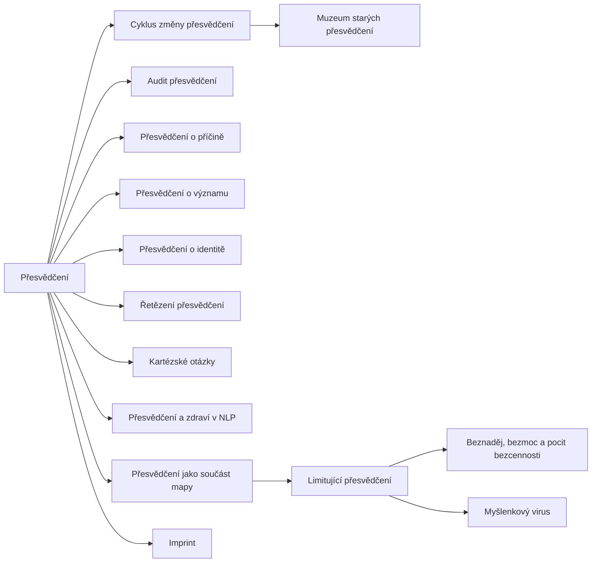

+++
title = "Přesvědčení"
description = "Rodina NLP vzorců a pojmů o přesvědčeních: typy přesvědčení, modely jejich změny a posuzování, jejich kořeny, stav důkazů a to, jak se práce s přesvědčeními mění v kontrolu nad úsudkem."
weight = 16
sort_by = "weight"
template = "kompendium/section.html"
page_template = "kompendium/page.html"
insert_anchor_links = "right"

[extra]
tags = ["nlp", "nlp-presvedceni"]
categories = ["academic"]
toc = true
lang = "cs"
keywords = ["Přesvědčení", "Belief patterns", "NLP vzorce"]
schema_type = "DefinedTermSet"
catalog = "nlp"
catalog_schema = 1
catalog_export = "data/nlp-katalog.json"
catalog_family = "presvedceni"
catalog_code = "16"
catalog_en = "Belief patterns"
catalog_size = 14
catalog_members = ["cyklus-zmeny-presvedceni", "muzeum-starych-presvedceni", "audit-presvedceni", "limitujici-presvedceni", "presvedceni-o-pricine", "presvedceni-o-vyznamu", "presvedceni-o-identite", "beznadej-bezmoc-nehodnost", "retezeni-presvedceni", "kartezske-otazky", "myslenkovy-virus", "presvedceni-a-zdravi", "presvedceni-jako-mapa", "imprint"]
catalog_types = ["concept", "pattern", "principle"]
catalog_sources = ["bandler-1985", "bandler-grinder-1975", "bateson-1972", "beck-1976", "dilts-1990", "dilts-1999", "dilts-hallbom-smith-1990", "ellis-1962", "festinger-1957", "hassan-1988", "herman-1992", "lifton-1961", "mcguire-1964", "norcross-2006", "passmore-rowson-2019", "petty-cacioppo-1986", "sharpley-1987", "singer-lalich-1995", "sturt-2012", "witkowski-2010", "van-der-linden-2023"]
+++

# Přesvědčení

## Co rodina zahrnuje

Rodina NLP-16 shromažďuje hesla, v nichž neurolingvistické programování popisuje
přesvědčení: co jsou, jak jsou uspořádána, jak se podle NLP mění a jak se dá posoudit, která
z nich člověku brání. Přesvědčení zaujímají v NLP zvláštní místo. Od sedmdesátých let obor
vychází z předpokladu, že lidé jednají podle svého modelu světa, a ne podle světa samého, a
přesvědčení jsou nejtrvalejší a nejvlivnější částí tohoto modelu (Bandler a Grinder 1975).
Robert Dilts, který tuto oblast od konce osmdesátých let soustavně rozpracovával, chápal
přesvědčení jako úroveň, jež organizuje schopnosti a chování a sama je ovlivňována tím, kým
se člověk cítí být (Dilts 1990).

Rodina má tři skupiny hesel. První tvoří pojmy, které přesvědčení třídí. Patří sem obecný
pojem [limitujícího přesvědčení](@/kompendium/nlp-vzorce/presvedceni/limitujici-presvedceni.md)
a trojice základních typů, které Dilts rozlišuje podle toho, na co přesvědčení odpovídá:
[přesvědčení o příčině](@/kompendium/nlp-vzorce/presvedceni/presvedceni-o-pricine.md),
[přesvědčení o významu](@/kompendium/nlp-vzorce/presvedceni/presvedceni-o-vyznamu.md) a
[přesvědčení o identitě](@/kompendium/nlp-vzorce/presvedceni/presvedceni-o-identite.md)
(Dilts 1999). Patří sem i hesla o trojici beznaděje, bezmoci a pocitu bezcennosti, o
přesvědčení jako součásti mapy, o takzvaném myšlenkovém viru a o imprintu, tedy o představě,
že některá přesvědčení vznikají v krátkých, emočně silných zkušenostech. Druhou skupinu
tvoří vzorce, které podle NLP popisují nebo podporují změnu:
[cyklus změny přesvědčení](@/kompendium/nlp-vzorce/presvedceni/cyklus-zmeny-presvedceni.md),
[muzeum starých přesvědčení](@/kompendium/nlp-vzorce/presvedceni/muzeum-starych-presvedceni.md)
a řetězení přesvědčení. Třetí skupinu tvoří nástroje posuzování, například
[audit přesvědčení](@/kompendium/nlp-vzorce/presvedceni/audit-presvedceni.md) a kartézské
otázky, a heslo o vztahu přesvědčení a zdraví, které shrnuje jedno z nejodvážnějších tvrzení
této části NLP.

Každé heslo rodiny má stejnou stavbu. Definice vymezuje pojem nebo vzorec, původ ho zasazuje
do [historie NLP](@/kompendium/nlp-vzorce/kriticke-hodnoceni/historie-nlp.md) a příbuzných oborů, struktura popisuje, z jakých prvků se skládá a co dělá
s člověkem, detekční znaky ukazují, podle čeho se pozná nátlaková podoba, a závěrečné oddíly
rozlišují legitimní a manipulativní užití, shrnují stav důkazů a popisují obranu a
zotavení. Hesla nepopisují postupy, jak měnit přesvědčení druhých lidí; popisují, jak takové
pokusy rozpoznat a jak se jim bránit.

## Původ

Práce s přesvědčeními se v NLP vyvinula ze dvou zdrojů. Prvním byl [meta-model](@/kompendium/nlp-vzorce/meta-model/meta-model.md), který si
všímal jazykových tvarů, jako jsou vztahy příčiny a následku, [komplexní ekvivalence](@/kompendium/nlp-vzorce/meta-model/komplexni-ekvivalence.md) nebo
modální operátory nemožnosti, a považoval je za projevy ochuzeného modelu světa (Bandler a
Grinder 1975). Druhým byla práce s vnitřními představami, podle níž je jistota přesvědčení
kódována v kvalitách prožitku a dá se měnit spolu s nimi (Bandler 1985). Dilts tyto proudy
spojil a doplnil je modelem logických úrovní, který podle něj vycházel z Batesonova pojetí
logických typů (Dilts 1990; Bateson 1972). S Hallbomem a Smithem pak přenesl práci s
přesvědčeními do oblasti zdraví a nemoci a popsal tři podoby omezujících přesvědčení,
které měly souviset s průběhem nemoci a uzdravování (Dilts, Hallbom a Smith 1990). Na konci
devadesátých let Dilts shrnul jazykovou stránku tématu v knize o vzorcích, jimiž se
přesvědčení v rozhovoru oslabují nebo posilují (Dilts 1999).

Témata této rodiny mají bohaté paralely mimo NLP, a to s lepším empirickým zázemím. Ellis a
Beck založili terapeutické směry, které přesvědčení pokládají za klíčový článek mezi událostí
a emoční reakcí a pracují s nimi jako s hypotézami, jež se ověřují (Ellis 1962; Beck 1976).
Teorie kognitivní disonance a výzkum přesvědčování popsaly, za jakých podmínek lidé mění své
postoje a kdy se jich naopak drží tím pevněji (Festinger 1957; Petty a Cacioppo 1986). Při
čtení hesel je proto užitečné ptát se, co NLP k těmto oborům přidává: obvykle slovník, sadu
metafor a postupů, nikoli nová zjištění.

## Jak rodinu číst defenzivně

Přesvědčení jsou místem, kde se rozhoduje o autonomii člověka. Kdo dokáže určit, která
přesvědčení jsou „limitující“, co co způsobuje, co co znamená a kým člověk je, získává
vliv na jeho úsudek, vztahy i rozhodnutí. Proto mají všechna hesla rodiny dvojí tvář. V
terapii a poradenství mohou pomoci člověku přezkoumat přesvědčení, která mu škodí, za
předpokladu, že cíl změny určuje on sám. V prodejních, motivačních a uzavřených skupinových
prostředích tytéž pojmy a modely slouží k tomu, aby se námitky, pochybnosti a vlastní
zkušenost člověka vyřadily z rozhovoru dřív, než se posoudí jejich obsah.

Lifton popsal u totalistických systémů požadavek, aby doktrína měla přednost před
zkušeností jednotlivce, a jazyk, který složité otázky shrnuje do frází ukončujících
přemýšlení (Lifton 1961). Slovník NLP o přesvědčeních se do takového prostředí hodí
nečekaně dobře: pochybnost se dá prohlásit za fázi cyklu, dřívější názory za exponáty
muzea, opatrnost za limitující přesvědčení a nesouhlas za projev falešné identity. Hassan
popsal, jak kontrolující skupiny vykládají pochybnosti členů jako vnitřní selhání, nikoli
jako informaci (Hassan 1988). Pro rozpoznání manipulativního užití slouží v celé rodině
několik opakujících se otázek. Kdo určuje cíl změny? Je dovoleno, aby přezkoumání skončilo
závěrem, že původní přesvědčení bylo správné? Uplatňuje mluvčí stejné pojmy na vlastní
přesvědčení? A má na výsledku finanční nebo mocenský zájem?

Druhým hlediskem je odlišení od klinických stavů. Přesvědčení, která NLP označuje za
omezující, se někdy kryjí s příznaky duševních poruch: trvalá beznaděj, pocit bezcennosti
nebo přesvědčení, že člověk je druhým jen přítěží, patří u deprese k jádrovým projevům a
kognitivní terapie je popisuje jako součást negativního pohledu na sebe, svět a budoucnost
(Beck 1976). Takové stavy nepatří do rukou kouče ani lektora semináře, ale do péče
kvalifikovaného odborníka. Kde prostředí vykládá tyto projevy jako pouhé „přesvědčení“,
které stačí přepsat, odvádí člověka od pomoci, kterou potřebuje, a v krajním případě ho
vystavuje riziku.

Třetím defenzivním hlediskem je nevyvratitelnost. Mnohá tvrzení této části NLP jsou
formulována tak, že každý výsledek je potvrzuje: pokud změna nastane, technika fungovala;
pokud nenastane, klient má další, hlubší přesvědčení, které je třeba odstranit. Tento obrat
kompendium obecně popisuje v hesle o
[imunizaci proti falsifikaci](@/kompendium/techniques/ea-1-3-1-imunizace-proti-falsifikaci.md).
V oblasti zdraví může být nebezpečný, protože přenáší odpovědnost za průběh nemoci na
„negativní přesvědčení“ nemocného.

## Stav důkazů

V literatuře, z níž kompendium vychází, nejsou pro vzorce této rodiny doloženy kontrolované
studie, které by prokázaly účinek specifický pro NLP. Obecné přehledy výzkumu NLP opakovaně konstatují, že klíčová tvrzení
oboru nejsou podporována a že teorie je v řadě bodů obtížně testovatelná (Sharpley 1987;
Witkowski 2010). Systematický přehled účinků NLP na zdravotní výsledky, tedy na oblast,
kterou Diltsova práce s přesvědčeními výslovně zahrnovala, nenašel dostatek kvalitních
studií pro jakýkoli závěr o účinnosti (Sturt a kol. 2012). Odborníci oslovení v delfské
studii zařadili NLP mezi metody léčby duševních poruch, které považují za pravděpodobně
zdiskreditované (Norcross, Koocher a Garofalo 2006). Hodnocení pro oblast koučinku dospělo
k závěru, že nedostatek kvalitního výzkumu vyžaduje opatrnost (Passmore a Rowson 2019).

To neznamená, že všechna pozorování rodiny jsou mylná. Že přesvědčení ovlivňují prožívání
a jednání, že se mění v čase a že některá omezují, je dobře doloženo v kognitivní
psychologii a terapii (Beck 1976; Festinger 1957). Neplyne z toho ale, že konkrétní
techniky NLP tato přesvědčení mění rychleji, spolehlivěji nebo hlouběji než ověřené
přístupy. Čtenář by měl rozlišovat mezi rozumným popisem jevu a nedoloženým tvrzením o
účinnosti postupu, který se na tento popis odvolává.

## Obrana

Obrana proti manipulativnímu užití vzorců této rodiny má společné jádro. Prvním prvkem je
trvat na obsahu: pochybnost, námitka nebo vlastní zkušenost se má posoudit podle toho, co
říká, ne podle toho, do jaké kategorie ji někdo zařadí. Druhým prvkem je symetrie: pojmy jako
limitující přesvědčení nebo staré přesvědčení se mají vztahovat i na přesvědčení toho, kdo
je používá. Třetím prvkem je čas a odstup: rozhodnutí o změně důležitého přesvědčení
nepatří do intenzivního prostředí semináře nebo skupiny, ale do situace, kde je možné mluvit
s lidmi mimo ni. Výzkum odolnosti vůči přesvědčování ukazuje, že seznámení se strukturou
nátlakových argumentů předem zvyšuje schopnost jim odolat (McGuire 1964; van der Linden 2023).

V klinické práci s lidmi, kteří prošli prostředím, jež soustavně přepisovalo jejich
přesvědčení, se neosvědčuje nahrazovat jeden soubor přesvědčení jiným. Cílem je obnova
vlastního úsudku, kontinuity životního příběhu a schopnosti ověřovat přesvědčení podle
dokladů (Herman 1992; Singer a Lalich 1995). Souvislosti s obnovou poznávací samostatnosti
rozebírá kapitola o
[epistemické rekonstrukci](@/kompendium/06-klinicke-aplikace/epistemicka-rekonstrukce.md) a
s pojetím přesvědčení jako sítě heslo o
[Quinově síti přesvědčení](@/kompendium/techniques/ea-7-2-7-quine-web-belief.md).

<!-- kompendium:katalog-vazby:begin (scripts/catalogs.py; neupravovat ručně) -->

## Hesla rodiny

| Kód | Heslo | Anglicky | Druh | Užití | Riziko |
|-----|-------|----------|------|-------|--------|
| `NLP-16.01` | [Cyklus změny přesvědčení](@/kompendium/nlp-vzorce/presvedceni/cyklus-zmeny-presvedceni.md) | Belief change cycle | vzorec | terapeutické i vlivové | střední |
| `NLP-16.02` | [Muzeum starých přesvědčení](@/kompendium/nlp-vzorce/presvedceni/muzeum-starych-presvedceni.md) | Museum of old beliefs | vzorec | převážně terapeutické | střední |
| `NLP-16.03` | [Audit přesvědčení](@/kompendium/nlp-vzorce/presvedceni/audit-presvedceni.md) | Belief audit | vzorec | terapeutické i vlivové | střední |
| `NLP-16.04` | [Limitující přesvědčení](@/kompendium/nlp-vzorce/presvedceni/limitujici-presvedceni.md) | Limiting beliefs | pojem | terapeutické i vlivové | vysoké |
| `NLP-16.05` | [Přesvědčení o příčině](@/kompendium/nlp-vzorce/presvedceni/presvedceni-o-pricine.md) | Beliefs about cause | pojem | výkladový pojem | střední |
| `NLP-16.06` | [Přesvědčení o významu](@/kompendium/nlp-vzorce/presvedceni/presvedceni-o-vyznamu.md) | Beliefs about meaning | pojem | výkladový pojem | střední |
| `NLP-16.07` | [Přesvědčení o identitě](@/kompendium/nlp-vzorce/presvedceni/presvedceni-o-identite.md) | Beliefs about identity | pojem | výkladový pojem | vysoké |
| `NLP-16.08` | [Beznaděj, bezmoc a pocit bezcennosti](@/kompendium/nlp-vzorce/presvedceni/beznadej-bezmoc-nehodnost.md) | Hopelessness, helplessness, worthlessness | pojem | terapeutické i vlivové | vysoké |
| `NLP-16.09` | [Řetězení přesvědčení](@/kompendium/nlp-vzorce/presvedceni/retezeni-presvedceni.md) | Belief chaining | vzorec | terapeutické i vlivové | střední |
| `NLP-16.10` | [Kartézské otázky](@/kompendium/nlp-vzorce/presvedceni/kartezske-otazky.md) | Cartesian questions | vzorec | terapeutické i vlivové | střední |
| `NLP-16.11` | [Myšlenkový virus](@/kompendium/nlp-vzorce/presvedceni/myslenkovy-virus.md) | Thought virus | pojem | terapeutické i vlivové | vysoké |
| `NLP-16.12` | [Přesvědčení a zdraví v NLP](@/kompendium/nlp-vzorce/presvedceni/presvedceni-a-zdravi.md) | Beliefs and health in NLP | pojem | terapeutické i vlivové | vysoké |
| `NLP-16.13` | [Přesvědčení jako součást mapy](@/kompendium/nlp-vzorce/presvedceni/presvedceni-jako-mapa.md) | Beliefs as part of the map | princip | terapeutické i vlivové | střední |
| `NLP-16.14` | [Imprint](@/kompendium/nlp-vzorce/presvedceni/imprint.md) | Imprint | pojem | terapeutické i vlivové | vysoké |

## Mapa rodiny

Mapu odvozuje engine katalogů z vazeb „obecnější heslo“; uzel otevře heslo.

## Literatura

- Bandler, R. (1985). *Using Your Brain—for a Change*. Moab: Real People Press.
- Bandler, R., & Grinder, J. (1975). *The Structure of Magic I: A Book about Language and Therapy*. Palo Alto: Science and Behavior Books.
- Bateson, G. (1972). *Steps to an Ecology of Mind*. San Francisco: Chandler.
- Beck, A. T. (1976). *Cognitive Therapy and the Emotional Disorders*. New York: International Universities Press.
- Dilts, R. (1990). *Changing Belief Systems with NLP*. Cupertino: Meta Publications.
- Dilts, R. (1999). *Sleight of Mouth: The Magic of Conversational Belief Change*. Capitola: Meta Publications.
- Dilts, R., Hallbom, T., & Smith, S. (1990). *Beliefs: Pathways to Health and Well-Being*. Portland: Metamorphous Press.
- Ellis, A. (1962). *Reason and Emotion in Psychotherapy*. New York: Lyle Stuart.
- Festinger, L. (1957). *A Theory of Cognitive Dissonance*. Stanford: Stanford University Press.
- Hassan, S. (1988). *Combatting Cult Mind Control*. Rochester: Park Street Press.
- Herman, J. L. (1992). *Trauma and Recovery*. New York: Basic Books.
- Lifton, R. J. (1961). *Thought Reform and the Psychology of Totalism: A Study of „Brainwashing“ in China*. New York: W. W. Norton.
- McGuire, W. J. (1964). Inducing resistance to persuasion: Some contemporary approaches. In L. Berkowitz (Ed.), *Advances in Experimental Social Psychology* (Vol. 1, pp. 191–229). New York: Academic Press.
- Norcross, J. C., Koocher, G. P., & Garofalo, A. (2006). Discredited psychological treatments and tests: A Delphi poll. *Professional Psychology: Research and Practice*, 37(5), 515–522.
- Passmore, J., & Rowson, T. S. (2019). Neuro-linguistic programming: A critical review of NLP research and the application of NLP in coaching. *International Coaching Psychology Review*, 14(1), 57–69.
- Petty, R. E., & Cacioppo, J. T. (1986). *Communication and Persuasion: Central and Peripheral Routes to Attitude Change*. New York: Springer.
- Sharpley, C. F. (1987). Research findings on neurolinguistic programming: Nonsupportive data or an untestable theory? *Journal of Counseling Psychology*, 34(1), 103–107.
- Singer, M. T., & Lalich, J. (1995). *Cults in Our Midst*. San Francisco: Jossey-Bass.
- Sturt, J., Ali, S., Robertson, W., Metcalfe, D., Grove, A., Bourne, C., & Bridle, C. (2012). Neurolinguistic programming: A systematic review of the effects on health outcomes. *British Journal of General Practice*, 62(604), e757–e764.
- Witkowski, T. (2010). Thirty-five years of research on neuro-linguistic programming. NLP research data base. State of the art or pseudoscientific decoration? *Polish Psychological Bulletin*, 41(2), 58–66.
- van der Linden, S. (2023). *Foolproof: Why Misinformation Infects Our Minds and How to Build Immunity*. London: 4th Estate.

## Související

- [NLP vzorce](@/kompendium/nlp-vzorce/_index.md) – celý katalog a jeho rodiny
- [Práce s částmi](@/kompendium/nlp-vzorce/integrace-casti/_index.md) – předchozí rodina katalogu
- [Metaprogramy](@/kompendium/nlp-vzorce/metaprogramy/_index.md) – další rodina katalogu
- [Trenér rozpoznávání](@/kompendium/trener.md) – procvičení rozpoznání hesel této rodiny

<!-- kompendium:katalog-vazby:end -->
