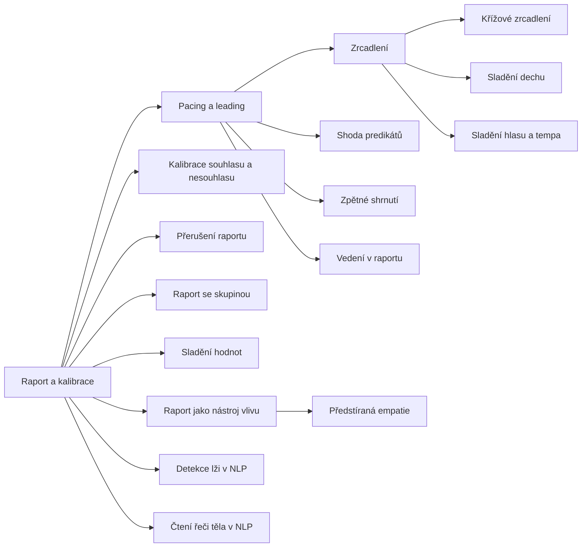

+++
title = "Raport a kalibrace"
description = "Rodina vzorců NLP o vytváření raportu a čtení reakcí druhého: zrcadlení, provázení a vedení, kalibrace a jejich vlivové a podvodné podoby."
weight = 18
sort_by = "weight"
template = "kompendium/section.html"
page_template = "kompendium/page.html"
insert_anchor_links = "right"

[extra]
tags = ["nlp", "nlp-raport-a-kalibrace"]
categories = ["academic"]
toc = true
lang = "cs"
keywords = ["Raport a kalibrace", "Rapport and calibration", "NLP vzorce"]
schema_type = "DefinedTermSet"
catalog = "nlp"
catalog_schema = 1
catalog_export = "data/nlp-katalog.json"
catalog_family = "raport-a-kalibrace"
catalog_code = "18"
catalog_en = "Rapport and calibration"
catalog_size = 16
catalog_members = ["zrcadleni", "krizove-zrcadleni", "pacing-a-leading", "shoda-predikatu", "sladeni-dechu", "sladeni-hlasu-a-tempa", "zpetne-shrnuti", "kalibrace-ano-ne", "vedeni-v-raportu", "preruseni-raportu", "raport-se-skupinou", "sladeni-hodnot", "raport-jako-nastroj-vlivu", "detekce-lzi-v-nlp", "cteni-reci-tela", "pseudoempatie"]
catalog_types = ["concept", "pattern"]
catalog_sources = ["bandler-grinder-1975b", "bandler-grinder-1979", "chartrand-bargh-1999", "cialdini-2009", "grinder-bandler-1981", "haley-1973", "hassan-1988", "heap-1988", "herman-1992", "miller-rollnick-2013", "oconnor-seymour-1990", "passmore-rowson-2019", "rogers-1951", "sharpley-1984", "vrij-2008", "wiseman-2012", "witkowski-2010"]
+++

# Raport a kalibrace

## Co rodina zahrnuje

Rodina Raport a kalibrace sdružuje vzorce, jimiž neurolingvistické programování popisuje
dvě dovednosti, které považuje za základ každé účinné komunikace. První je vytváření
raportu, tedy stavu vzájemného naladění a důvěry, ve kterém druhý ochotně reaguje na
mluvčího. Druhá je kalibrace, tedy schopnost rozpoznat z drobných a opakovaných
neverbálních signálů, jak druhý právě reaguje: zda souhlasí, pochybuje, je napjatý nebo
uvolněný. NLP obě dovednosti spojuje do jednoho cyklu: mluvčí vytváří shodu, sleduje
reakce, a když raport podle jeho pozorování vznikl, přechází k vedení (Bandler a Grinder 1979).
Obecné pojmy, na nichž rodina stojí, jsou popsány ve skupině základních pojmů v heslech
[raport](@/kompendium/nlp-vzorce/zakladni-pojmy/raport.md),
[kalibrace](@/kompendium/nlp-vzorce/zakladni-pojmy/kalibrace.md) a
[smyslová ostrost](@/kompendium/nlp-vzorce/zakladni-pojmy/smyslova-ostrost.md). Tato rodina
se zaměřuje na konkrétní vzorce, které lze v rozhovoru pozorovat.

Hesla rodiny se dají rozdělit do čtyř skupin. První skupinu tvoří prostředky shody v
chování: [zrcadlení](@/kompendium/nlp-vzorce/raport-a-kalibrace/zrcadleni.md), jeho
nepřímá varianta [křížové zrcadlení](@/kompendium/nlp-vzorce/raport-a-kalibrace/krizove-zrcadleni.md),
[sladění dechu](@/kompendium/nlp-vzorce/raport-a-kalibrace/sladeni-dechu.md) a
[sladění hlasu a tempa](@/kompendium/nlp-vzorce/raport-a-kalibrace/sladeni-hlasu-a-tempa.md).
Druhou skupinu tvoří verbální prostředky shody, zejména
[shoda predikátů](@/kompendium/nlp-vzorce/raport-a-kalibrace/shoda-predikatu.md),
[zpětné shrnutí](@/kompendium/nlp-vzorce/raport-a-kalibrace/zpetne-shrnuti.md) a sladění
hodnot. Třetí skupinu tvoří vzorce přechodu a řízení vztahu: obecný vzorec
[pacing a leading](@/kompendium/nlp-vzorce/raport-a-kalibrace/pacing-a-leading.md), vedení v
raportu, záměrné přerušení raportu a raport se skupinou. Čtvrtou skupinu tvoří vzorce, které
se týkají čtení druhého a zneužití vztahu: [kalibrace souhlasu a nesouhlasu](@/kompendium/nlp-vzorce/raport-a-kalibrace/kalibrace-ano-ne.md),
tvrzení NLP o rozpoznávání lži a o čtení řeči těla, raport jako nástroj vlivu a předstíraná
empatie.

## Původ

Rodina vychází z nejstarší vrstvy NLP. Bandler a Grinder v sedmdesátých letech pozorovali
terapeuty, které považovali za mimořádně úspěšné, a všímali si, že Virginia Satirová i
Milton Erickson dokázali navázat s klienty vztah velmi rychle a že tento vztah předcházel
každé změně. Z pozorování odvodili model, podle kterého raport není dar, ale výsledek
pozorovatelné shody v chování a jazyce, a lze se ho tedy naučit (Bandler a Grinder 1979).
Rozbor Ericksonovy práce s hypnózou jim poskytl strukturu provázení a vedení, kterou pak
zobecnili na veškerou komunikaci (Bandler a Grinder 1975b; Grinder a Bandler 1981).
Ericksonovi vykladači přitom zdůrazňovali, že jeho přístup stál na přijetí a využití
toho, co pacient přináší, a na dlouhodobém terapeutickém vztahu, nikoli na izolovaných
technikách (Haley 1973).

Starší kořen rodiny leží v psychoterapii zaměřené na člověka. Rogers popsal empatické
porozumění, přijetí a opravdovost jako podmínky, za nichž se klient může měnit, a chápal
je jako postoj terapeuta, nikoli jako techniku (Rogers 1951). NLP z tohoto pojetí převzalo
pozorovatelné projevy, například ozvěnu klientových slov nebo přizpůsobení tempa, ale
oddělilo je od postoje a nabídlo je jako dovednost, kterou lze použít v jakémkoli
rozhovoru. Toto oddělení je pro kompendium podstatné. Projevy porozumění bez porozumění
jsou právě tím, co v pozdějších vlivových aplikacích umožňuje vyrobit blízkost, která
slouží jinému cíli než dobru druhého. Z terapeutických seminářů se vzorce rodiny rozšířily
do učebnic pro manažery, prodejce a lektory, kde se staly nejznámější částí celého oboru
(O'Connor a Seymour 1990).

## Jak rodinu číst defenzivně

Vzorce této rodiny mají zvláštní postavení, protože popisují jevy, které existují i bez
NLP. Lidé se v rozhovoru spontánně napodobují, přizpůsobují tempo řeči a přejímají výrazy,
a tato koordinace souvisí se sympatií a pocitem plynulé interakce (Chartrand a Bargh 1999).
Přirozená shoda je znakem zájmu a pozornosti, nikoli manipulace. Defenzivní čtení proto
nespočívá v tom, podezírat každého, kdo sedí podobně nebo opakuje naše slova. Spočívá ve
sledování tří věcí, které odlišují vyrobenou blízkost od přirozené.

První je tempo a selektivita. Vyrobená shoda bývá rychlejší, pravidelnější a
mechaničtější než spontánní, a pocit porozumění nastupuje nepřiměřeně brzy vzhledem k délce
známosti. Druhá je vazba na žádost. Blízkost, ke které se po krátké době připojí nabídka,
investice, podpis, pozvání do skupiny nebo nátlak na intimitu, plní funkci přípravy a
rozhodnutí se přesouvá z obsahu nabídky na vztah k mluvčímu. Sociální psychologie vlivu
dokládá, že sympatie a pocit podobnosti zvyšují ochotu vyhovět, i když je podobnost
povrchní (Cialdini 2009). Třetí je reakce na nesouhlas. V přirozeném vztahu lze
nesouhlasit, aniž by se vztah zhroutil. Vyrobená blízkost na nesouhlas reaguje zesíleným
laděním, které má nesouhlas obejít, nebo náhlým ochlazením a výčitkou.

Zvláštní pozornost zaslouží vzorce kalibrace. Tvrzení, že zkušený pozorovatel dokáže z
neverbálních signálů přečíst souhlas, nesouhlas nebo lež lépe, než to druhý vyjádří slovy,
se v praxi může obrátit proti člověku: jeho výslovné „ne“ se prohlásí za neplatné, protože
jeho tělo prý „říká ano“. Takové užití je v kompendiu chápáno jako popření epistemické
autority člověka nad vlastním prožitkem. Výzkum detekce lži přitom ukazuje, že
neverbální znaky klamání jsou slabé a nespolehlivé a že lidé, včetně profesionálů, je
rozpoznávají jen o málo lépe než náhodně (Vrij 2008).

## Stav důkazů

Stav důkazů je v této rodině nerovnoměrný a je třeba ho číst heslo po hesle. Pro obecný
jev spontánního napodobování a jeho vazbu na sympatii existuje experimentální podpora ze
sociální psychologie (Chartrand a Bargh 1999). Pro obecné tvrzení, že kvalita vztahu
ovlivňuje výsledek pomoci a ochotu spolupracovat, panuje shoda v psychoterapii, která se
však opírá o vlastní výzkum a o tradici zaměřenou na člověka, nikoli o techniky NLP
(Rogers 1951; Miller a Rollnick 2013). Pro specifická tvrzení NLP je podpora slabá nebo
žádná. Shoda predikátů s preferovaným smyslovým systémem druhého, jeden z nejčastěji
testovaných předpokladů oboru, v kontrolovaných studiích nepřinesla očekávané zvýšení
důvěry ani porozumění (Sharpley 1984). Pozdější souhrnná hodnocení dospěla k závěru, že
specifické modely NLP nejsou doložené a že užitečné komunikační rady, které obor obsahuje,
pocházejí většinou z jiných přístupů (Heap 1988; Witkowski 2010; Passmore a Rowson 2019).
Pro tvrzení o rozpoznávání lži z pohybů očí přinesl experimentální test jednoznačně
negativní výsledek (Wiseman a kol. 2012).

Z toho plyne závěr, který je pro čtenáře kompendia důležitý v obou směrech. Nelze tvrdit,
že vzorce rodiny „nefungují“, protože jevy, na nichž stojí, jsou skutečné a lidé na
blízkost a pozornost reagují. Nelze ale ani přejímat tvrzení kurzů, že vzorce spolehlivě
a neodhalitelně vytvářejí důvěru nebo umožňují číst myšlenky. Skutečné riziko neleží v
tajemné síle techniky, ale v obyčejném lidském sklonu důvěřovat tomu, kdo nám dává najevo
porozumění, a v tom, že tento sklon lze vědomě využít.

## Obrana

Společným jmenovatelem obrany proti všem vzorcům rodiny je oddělení pocitu blízkosti od
rozhodnutí. Kdo si zvykne, že rychle vzniklý pocit porozumění není důvodem k rychlému
souhlasu, chrání se proti zrcadlení, sladění rytmů i proti přenosu souhlasu ve vzorci
provázení a vedení, aniž by musel kteroukoli z technik rozpoznat. Užitečnou praxí je
odložit rozhodnutí, vyžádat si podmínky písemně a probrat je s někým mimo vztah (Cialdini 2009).
Druhým společným prvkem obrany je trvat na tom, že výslovné slovo má přednost před
jakýmkoli „čtením“ těla: pokud někdo tvrdí, že ví lépe než my, co cítíme nebo chceme, je to
signál ke zvýšené ostražitosti. Třetím prvkem je udržovat vztahy mimo nový vztah nebo
skupinu. Literatura o skupinách s vysokou mírou kontroly popisuje počáteční intenzivní
přijetí a pozdější odříznutí od dřívějších vztahů jako typický průběh (Hassan 1988).

Pro odborníky, kteří s raportem pracují, z rodiny plyne profesní nárok. Projevy porozumění
mají sloužit cílům klienta, musí snést nesouhlas a nemají být skryté. Kompendium nabízí
širší rámec obrany v rozcestníku [obrany a kalibrace důvěry](@/kompendium/06-obrana/_index.md)
a vlivové podoby vzorců rozebírá v rodině [Vliv a zneužití NLP](@/kompendium/nlp-vzorce/vliv-a-zneuziti/_index.md).
U lidí, kteří prošli vztahem postaveným na vyrobené blízkosti, je zotavení spojeno s
obnovou důvěry ve vlastní úsudek a s porozuměním, že sklon reagovat na blízkost je lidský a
že odpovědnost za jeho zneužití nese ten, kdo ho zneužil (Herman 1992).

<!-- kompendium:katalog-vazby:begin (scripts/catalogs.py; neupravovat ručně) -->

## Hesla rodiny

| Kód | Heslo | Anglicky | Druh | Užití | Riziko |
|-----|-------|----------|------|-------|--------|
| `NLP-18.01` | [Zrcadlení](@/kompendium/nlp-vzorce/raport-a-kalibrace/zrcadleni.md) | Mirroring | vzorec | terapeutické i vlivové | střední |
| `NLP-18.02` | [Křížové zrcadlení](@/kompendium/nlp-vzorce/raport-a-kalibrace/krizove-zrcadleni.md) | Cross-over mirroring | vzorec | terapeutické i vlivové | střední |
| `NLP-18.03` | [Pacing a leading](@/kompendium/nlp-vzorce/raport-a-kalibrace/pacing-a-leading.md) | Pacing and leading | vzorec | terapeutické i vlivové | vysoké |
| `NLP-18.04` | [Shoda predikátů](@/kompendium/nlp-vzorce/raport-a-kalibrace/shoda-predikatu.md) | Predicate matching | vzorec | terapeutické i vlivové | nízké |
| `NLP-18.05` | [Sladění dechu](@/kompendium/nlp-vzorce/raport-a-kalibrace/sladeni-dechu.md) | Breathing matching | vzorec | terapeutické i vlivové | střední |
| `NLP-18.06` | [Sladění hlasu a tempa](@/kompendium/nlp-vzorce/raport-a-kalibrace/sladeni-hlasu-a-tempa.md) | Voice and tempo matching | vzorec | terapeutické i vlivové | střední |
| `NLP-18.07` | [Zpětné shrnutí](@/kompendium/nlp-vzorce/raport-a-kalibrace/zpetne-shrnuti.md) | Backtracking | vzorec | terapeutické i vlivové | nízké |
| `NLP-18.08` | [Kalibrace souhlasu a nesouhlasu](@/kompendium/nlp-vzorce/raport-a-kalibrace/kalibrace-ano-ne.md) | Yes/no calibration | vzorec | terapeutické i vlivové | vysoké |
| `NLP-18.09` | [Vedení v raportu](@/kompendium/nlp-vzorce/raport-a-kalibrace/vedeni-v-raportu.md) | Leading in rapport | vzorec | terapeutické i vlivové | střední |
| `NLP-18.10` | [Přerušení raportu](@/kompendium/nlp-vzorce/raport-a-kalibrace/preruseni-raportu.md) | Breaking rapport | vzorec | terapeutické i vlivové | střední |
| `NLP-18.11` | [Raport se skupinou](@/kompendium/nlp-vzorce/raport-a-kalibrace/raport-se-skupinou.md) | Group rapport | vzorec | převážně vlivové | vysoké |
| `NLP-18.12` | [Sladění hodnot](@/kompendium/nlp-vzorce/raport-a-kalibrace/sladeni-hodnot.md) | Value matching | vzorec | převážně vlivové | střední |
| `NLP-18.13` | [Raport jako nástroj vlivu](@/kompendium/nlp-vzorce/raport-a-kalibrace/raport-jako-nastroj-vlivu.md) | Rapport as an influence tool | vzorec | převážně vlivové | vysoké |
| `NLP-18.14` | [Detekce lži v NLP](@/kompendium/nlp-vzorce/raport-a-kalibrace/detekce-lzi-v-nlp.md) | Lie detection claims in NLP | pojem | výkladový pojem | vysoké |
| `NLP-18.15` | [Čtení řeči těla v NLP](@/kompendium/nlp-vzorce/raport-a-kalibrace/cteni-reci-tela.md) | Body-language reading in NLP | pojem | terapeutické i vlivové | střední |
| `NLP-18.16` | [Předstíraná empatie](@/kompendium/nlp-vzorce/raport-a-kalibrace/pseudoempatie.md) | Simulated empathy | vzorec | převážně vlivové | vysoké |

## Mapa rodiny

Mapu odvozuje engine katalogů z vazeb „obecnější heslo“; uzel otevře heslo.

<!-- kompendium:katalog-vazby:end -->

## Literatura

- Bandler, R., & Grinder, J. (1975b). *Patterns of the Hypnotic Techniques of Milton H. Erickson, M.D., Volume 1*. Cupertino: Meta Publications.
- Bandler, R., & Grinder, J. (1979). *Frogs into Princes: Neuro Linguistic Programming*. Moab: Real People Press.
- Chartrand, T. L., & Bargh, J. A. (1999). The chameleon effect: The perception–behavior link and social interaction. *Journal of Personality and Social Psychology*, 76(6), 893–910.
- Cialdini, R. B. (2009). *Influence: Science and Practice* (5. vyd.). Boston: Pearson.
- Grinder, J., & Bandler, R. (1981). *Trance-formations: Neuro-Linguistic Programming and the Structure of Hypnosis*. Moab: Real People Press.
- Haley, J. (1973). *Uncommon Therapy: The Psychiatric Techniques of Milton H. Erickson, M.D.* New York: W. W. Norton.
- Hassan, S. (1988). *Combatting Cult Mind Control*. Rochester: Park Street Press.
- Heap, M. (1988). Neurolinguistic programming: An interim verdict. In M. Heap (Ed.), *Hypnosis: Current Clinical, Experimental and Forensic Practices* (pp. 268–280). London: Croom Helm.
- Herman, J. L. (1992). *Trauma and Recovery*. New York: Basic Books.
- Miller, W. R., & Rollnick, S. (2013). *Motivational Interviewing: Helping People Change* (3. vyd.). New York: Guilford Press.
- O'Connor, J., & Seymour, J. (1990). *Introducing Neuro-Linguistic Programming: Psychological Skills for Understanding and Influencing People*. London: Thorsons.
- Passmore, J., & Rowson, T. S. (2019). Neuro-linguistic programming: A critical review of NLP research and the application of NLP in coaching. *International Coaching Psychology Review*, 14(1), 57–69.
- Rogers, C. R. (1951). *Client-Centered Therapy*. Boston: Houghton Mifflin.
- Sharpley, C. F. (1984). Predicate matching in NLP: A review of research on the preferred representational system. *Journal of Counseling Psychology*, 31(2), 238–248.
- Vrij, A. (2008). *Detecting Lies and Deceit: Pitfalls and Opportunities* (2. vyd.). Chichester: Wiley.
- Wiseman, R., Watt, C., ten Brinke, L., Porter, S., Couper, S.-L., & Rankin, C. (2012). The eyes don't have it: Lie detection and neuro-linguistic programming. *PLoS ONE*, 7(7), e40259.
- Witkowski, T. (2010). Thirty-five years of research on neuro-linguistic programming. NLP research data base. State of the art or pseudoscientific decoration? *Polish Psychological Bulletin*, 41(2), 58–66.

<!-- kompendium:katalog-vazby:begin (scripts/catalogs.py; neupravovat ručně) -->

## Související

- [NLP vzorce](@/kompendium/nlp-vzorce/_index.md) – celý katalog a jeho rodiny
- [Metaprogramy](@/kompendium/nlp-vzorce/metaprogramy/_index.md) – předchozí rodina katalogu
- [Cíle a výsledky](@/kompendium/nlp-vzorce/cile-a-vysledky/_index.md) – další rodina katalogu
- [Trenér rozpoznávání](@/kompendium/trener.md) – procvičení rozpoznání hesel této rodiny

<!-- kompendium:katalog-vazby:end -->
