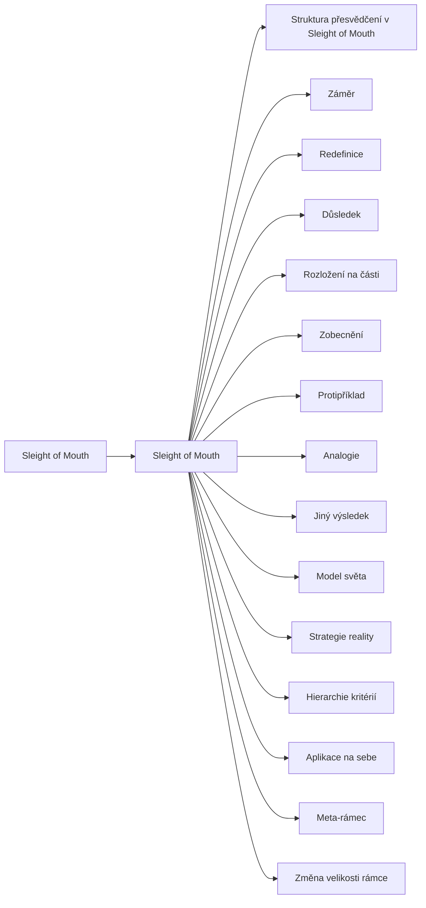

+++
title = "Sleight of Mouth"
description = "Rodina čtrnácti konverzačních vzorců Sleight of Mouth, které mění rámec přesvědčení: jejich původ, stavba, rozpoznání v rozhovoru, stav důkazů a obrana."
weight = 7
sort_by = "weight"
template = "kompendium/section.html"
page_template = "kompendium/page.html"
insert_anchor_links = "right"

[extra]
tags = ["nlp", "nlp-sleight-of-mouth"]
categories = ["academic"]
toc = true
lang = "cs"
keywords = ["Sleight of Mouth", "Sleight of Mouth", "NLP vzorce"]
schema_type = "DefinedTermSet"
catalog = "nlp"
catalog_schema = 1
catalog_export = "data/nlp-katalog.json"
catalog_family = "sleight-of-mouth"
catalog_code = "07"
catalog_en = "Sleight of Mouth"
catalog_size = 16
catalog_members = ["sleight-of-mouth", "struktura-presvedceni-som", "som-zamer", "som-redefinice", "som-dusledek", "som-rozlozeni", "som-zobecneni", "som-protipriklad", "som-analogie", "som-jiny-vysledek", "som-model-sveta", "som-strategie-reality", "som-hierarchie-kriterii", "som-aplikace-na-sebe", "som-meta-ramec", "som-zmena-velikosti-ramce"]
catalog_types = ["concept", "pattern"]
catalog_sources = ["bandler-grinder-1975", "bandler-grinder-1982", "beck-1976", "dilts-1990", "dilts-1999", "dilts-hallbom-smith-1990", "herman-1992", "lifton-1961", "loftus-palmer-1974", "mcguire-1964", "miller-rollnick-2013", "passmore-rowson-2019", "petty-cacioppo-1986", "stark-2007", "sturt-2012", "tosey-mathison-2009", "tversky-kahneman-1974", "tversky-kahneman-1981", "watzlawick-1974", "witkowski-2010", "van-der-linden-2023"]
+++

# Sleight of Mouth

## Co rodina zahrnuje

Rodina Sleight of Mouth shromažďuje jazykové vzorce, kterými se v běžném rozhovoru mění
rámec, v němž člověk drží určité přesvědčení. Robert Dilts, který soubor sepsal a
pojmenoval, rozlišuje čtrnáct vzorců a popisuje je jako konverzační prostředky, jimiž lze
přesvědčení posílit, oslabit nebo přerámovat, aniž by se o něm vedl otevřený spor (Dilts
1999). Název je hříčkou na anglické „sleight of hand“, kouzelnický trik rukou, a sám
naznačuje, o co jde: pozornost posluchače se přesune jinam a přesvědčení se pak jeví jinak,
i když se o jeho obsahu nic nového nedozvěděl. Katalog rodinu otevírá souhrnnou stránkou
[Sleight of Mouth](@/kompendium/nlp-vzorce/sleight-of-mouth/sleight-of-mouth.md) a
výkladovým pojmem
[struktura přesvědčení](@/kompendium/nlp-vzorce/sleight-of-mouth/struktura-presvedceni-som.md),
na který se všechny vzorce odvolávají. Následuje čtrnáct stránek, každá o jednom vzorci.

Vzorce lze pro přehled rozdělit do tří skupin podle toho, s čím v přesvědčení pracují.
Toto rozdělení je pracovní pomůckou kompendia. První skupina
pracuje s jedním z prvků přesvědčení: [redefinice](@/kompendium/nlp-vzorce/sleight-of-mouth/som-redefinice.md)
nahrazuje slovo slovem s jiným hodnocením,
[rozložení na části](@/kompendium/nlp-vzorce/sleight-of-mouth/som-rozlozeni.md) prvek drobí a
[zobecnění](@/kompendium/nlp-vzorce/sleight-of-mouth/som-zobecneni.md) ho povyšuje do širší
kategorie. Druhá skupina pracuje se spojením mezi prvky:
[protipříklad](@/kompendium/nlp-vzorce/sleight-of-mouth/som-protipriklad.md) hledá výjimku,
[analogie](@/kompendium/nlp-vzorce/sleight-of-mouth/som-analogie.md) staví vedle přesvědčení
jiný vztah stejného tvaru a
[aplikace na sebe](@/kompendium/nlp-vzorce/sleight-of-mouth/som-aplikace-na-sebe.md) obrací
přesvědčení proti němu samému. Třetí skupina mění rámec kolem celého přesvědčení: obrací
pozornost k [záměru](@/kompendium/nlp-vzorce/sleight-of-mouth/som-zamer.md), k
[důsledku](@/kompendium/nlp-vzorce/sleight-of-mouth/som-dusledek.md), k
[jinému výsledku](@/kompendium/nlp-vzorce/sleight-of-mouth/som-jiny-vysledek.md), k
[hierarchii kritérií](@/kompendium/nlp-vzorce/sleight-of-mouth/som-hierarchie-kriterii.md), k
[velikosti rámce](@/kompendium/nlp-vzorce/sleight-of-mouth/som-zmena-velikosti-ramce.md), k
[meta-rámci](@/kompendium/nlp-vzorce/sleight-of-mouth/som-meta-ramec.md), k
[modelu světa](@/kompendium/nlp-vzorce/sleight-of-mouth/som-model-sveta.md) nebo ke
[strategii reality](@/kompendium/nlp-vzorce/sleight-of-mouth/som-strategie-reality.md), tedy
k tomu, jak člověk dospěl k jistotě, že je přesvědčení pravdivé. Popisy jednotlivých vzorců
v této i v dalších skupinách vycházejí z Diltsova výkladu (Dilts 1999).

## Původ

Soubor stojí na dvou starších liniích NLP. První je [meta-model](@/kompendium/nlp-vzorce/meta-model/meta-model.md), rozbor toho, jak jazyk
vypouští, zkresluje a zobecňuje zkušenost a jak lze mluvčího otázkami vrátit od zobecnění
ke zkušenosti, ze které vzniklo (Bandler a Grinder 1975). Z meta-modelu pochází pozorování,
že přesvědčení mají v řeči nejčastěji podobu komplexní ekvivalence nebo příčiny a
následku; katalog obě kategorie rozebírá na stránkách
[komplexní ekvivalence](@/kompendium/nlp-vzorce/meta-model/komplexni-ekvivalence.md) a
[příčina a následek](@/kompendium/nlp-vzorce/meta-model/pricina-a-nasledek.md). Druhou linií
je přerámování, které Bandler a Grinder popsali jako změnu kontextu nebo významu, v němž
se chování chápe (Bandler a Grinder 1982), a které má kořeny ve strategické a rodinné
terapii (Watzlawick, Weakland a Fisch 1974). Dilts uvádí, že vzorce začal soustavně
popisovat na přelomu sedmdesátých a osmdesátých let při sledování pohotových verbálních
přerámování Richarda Bandlera, a že je později uspořádal kolem jednoho výchozího
přesvědčení, ke kterému se každý vzorec vztahuje jiným směrem (Dilts 1999). S
přesvědčeními se Dilts zabýval i v dřívějších knihách, kde je spojoval s hodnotami,
identitou a zdravím (Dilts 1990; Dilts, Hallbom a Smith 1990).

Na rozdíl od většiny technik NLP soubor nevyžaduje trans, smyslovou práci ani zvláštní
uspořádání rozhovoru. Je čistě verbální, jak naznačuje už podtitul Diltsovy knihy o
konverzační změně přesvědčení (Dilts 1999), a proto se snadno přenesl do koučinku, prodeje,
vyjednávání, veřejné debaty a politické rétoriky. Tato přenositelnost je pro kompendium
důvodem, proč rodině věnuje samostatnou pozornost: vzorce se v běžném rozhovoru objevují
často i u lidí, kteří o NLP nikdy neslyšeli, protože odpovídají přirozeným rétorickým
pohybům. Soubor je nepojmenovává jako nové jevy, ale shromažďuje a třídí je.

## Jak rodinu číst defenzivně

Stránky rodiny popisují vzorce tak, aby je pozorovatel poznal, ne tak, aby je někdo mohl
použít. U každého vzorce se proto rozlišuje legitimní a manipulativní užití podle
několika obecných kritérií. Prvním je směr: mění se přesvědčení, které škodí tomu, kdo ho
drží, nebo přesvědčení, které je nepohodlné pro mluvčího? Druhým je tempo a prostor: má
posluchač čas nový rámec posoudit a možnost ho bez následků odmítnout? Na čase a možnosti
sdělení zpracovat závisí, zda o jeho působení rozhodují argumenty, nebo vnější vodítka (Petty
a Cacioppo 1986). Třetím je návrat k
věci: vrací se rozhovor po přerámování k původní otázce, nebo ta otázka zmizí? Čtvrtým je
symetrie: uplatňuje mluvčí tytéž vzorce i na vlastní přesvědčení, nebo jen na přesvědčení
druhých?

V manipulativním užití se vzorce obvykle neobjevují jednotlivě. Typický je rychlý sled
několika přerámování v jediné promluvě, ve kterém námitka během několika vět ztratí obsah:
nejprve se přejmenuje, pak se povýší na otázku hodnot, pak se mluvčímu přisoudí dobrý
úmysl a nakonec se posluchači připomenou důsledky, pokud by na námitce trval. Výzkum
rámování rozhodnutí ukázal, že už jediná změna popisu logicky shodné volby mění rozhodnutí
lidí (Tversky a Kahneman 1981); v rychlém sledu několika takových změn posluchač nestihne
žádnou z nich posoudit. Model pravděpodobnosti elaborace popisuje, že když člověk nemá
prostor sdělení důkladně zpracovat, rozhodují o jeho působení spíše vnější vodítka než
kvalita argumentů (Petty a Cacioppo 1986). V uzavřených skupinách a kontrolujících vztazích
se vzorce stávají součástí ustáleného jazyka, kterým se pochybnost obrací v selhání toho,
kdo pochybuje (Lifton 1961; Stark 2007). Kompendium podobné pohyby popisuje i mimo NLP,
například jako [strategickou reinterpretaci](@/kompendium/techniques/ea-1-3-2-strategicka-reinterpretace.md)
nebo [argumentační oslabení](@/kompendium/techniques/ea-1-2-1-argumentacni-oslabeni.md).

Legitimní užití vypadá jinak. Terapeut nebo kouč nabízí jiný úhel pohledu pomalu, jako
otázku, a nechává klienta, aby ho vyzkoušel a případně odmítl. Takové užití se blíží
kognitivní práci s automatickými myšlenkami, při které se přesvědčení testuje proti
klientově vlastní zkušenosti (Beck 1976), a motivačním rozhovorům, ve kterých důvody ke
změně formuluje sám klient (Miller a Rollnick 2013). Rozdíl mezi oběma užitími tedy
nespočívá ve vzorci, ale v tom, komu slouží a jak se s posluchačem zachází.

## Stav důkazů

Kontrolované studie, které by testovaly vzorce Sleight of Mouth jako celek nebo
jednotlivě, nejsou kompendiu známy. Literatura souboru je praktická a ilustrační a
účinnost dokládá příklady z rozhovorů, ne srovnáním s kontrolní skupinou (Dilts 1999).
Obecné přehledy výzkumu NLP shledávají, že kontrolovaných studií je málo, že mají nízkou
kvalitu a že klíčová tvrzení oboru většinou nepodporují (Witkowski 2010; Passmore a Rowson
2019). Systematický přehled účinků NLP na zdraví nenašel dost kvalitních důkazů pro
doporučení jeho intervencí (Sturt a kol. 2012). Kritické hodnocení NLP pro oblast řízení
upozorňuje, že síla jeho modelů leží spíše v rétorické přesvědčivosti než v empirickém
ověření (Tosey a Mathison 2009).

Jednotlivé mechanismy, o které se vzorce opírají, jsou ovšem dobře doloženy mimo NLP. Vliv
slovního rámce na rozhodování (Tversky a Kahneman 1981), vliv volby slov na pozdější
vzpomínky (Loftus a Palmer 1974) a vliv snadno vybavitelných příkladů na odhady četnosti
(Tversky a Kahneman 1974) patří k pevným poznatkům psychologie úsudku. Z toho plyne
opatrný závěr: vzorce zachycují skutečné rétorické pohyby, které na lidi působí, ale
tvrzení, že jejich cílené užití spolehlivě a trvale mění přesvědčení nebo že má
terapeutický účinek nad rámec přístupů, ze kterých čerpá, doloženo není.

## Obrana

Nejúčinnější obranou proti manipulativnímu užití je znát vzorce předem. Výzkum očkování
proti přesvědčování ukázal, že kdo se s oslabenou podobou argumentu a s jeho vyvrácením
setká dopředu, odolává pozdějšímu přesvědčování lépe (McGuire 1964), a novější práce tento
poznatek rozšířily na rozpoznávání manipulačních technik obecně (van der Linden 2023).
Stránky rodiny proto u každého vzorce uvádějí detekční znaky a otázky, které pomáhají
rozlišit legitimní nabídku jiného pohledu od pohybu, kterým se námitka umlčuje.

V rozhovoru pomáhá několik obecných opatření. Zpomalit a vrátit se k původní otázce.
Pojmenovat přesun rámce, například tím, že rozhovor se právě stočil od toho, co se stalo, k
motivu nebo k charakteru toho, kdo námitku vznesl. Oddělit posouzení nového rámce od
rozhodnutí, zda ho přijmout. Trvat na konkrétním popisu toho, co se stalo, protože fakta
jsou vůči přerámování odolnější než hodnotící slova. U lidí, na které byly vzorce
dlouhodobě uplatňovány v blízkém vztahu nebo ve skupině, se často objevuje nejistota, zda
mají právo na vlastní námitku, a sklon předem ji zlehčovat. Zotavení u nich spočívá v obnově
důvěry ve vlastní úsudek a ve vztazích, ve kterých se námitky berou vážně (Herman 1992);
přehled obranných vrstev nabízí oddíl [Obrana a kalibrace](@/kompendium/06-obrana/_index.md).
Kdo vzorce používá v pomáhající profesi, by měl mít na paměti, že pohotovost přerámování
nenahrazuje souhlas klienta a že každý nový rámec má být nabídkou, kterou lze bez následků
odmítnout.

<!-- kompendium:katalog-vazby:begin (scripts/catalogs.py; neupravovat ručně) -->

## Hesla rodiny

| Kód | Heslo | Anglicky | Druh | Užití | Riziko |
|-----|-------|----------|------|-------|--------|
| `NLP-07.01` | [Sleight of Mouth](@/kompendium/nlp-vzorce/sleight-of-mouth/sleight-of-mouth.md) | Sleight of Mouth | vzorec | terapeutické i vlivové | vysoké |
| `NLP-07.02` | [Struktura přesvědčení v Sleight of Mouth](@/kompendium/nlp-vzorce/sleight-of-mouth/struktura-presvedceni-som.md) | Belief structure in Sleight of Mouth | pojem | výkladový pojem | střední |
| `NLP-07.03` | [Záměr](@/kompendium/nlp-vzorce/sleight-of-mouth/som-zamer.md) | Intention | vzorec | terapeutické i vlivové | vysoké |
| `NLP-07.04` | [Redefinice](@/kompendium/nlp-vzorce/sleight-of-mouth/som-redefinice.md) | Redefine | vzorec | terapeutické i vlivové | vysoké |
| `NLP-07.05` | [Důsledek](@/kompendium/nlp-vzorce/sleight-of-mouth/som-dusledek.md) | Consequence | vzorec | terapeutické i vlivové | střední |
| `NLP-07.06` | [Rozložení na části](@/kompendium/nlp-vzorce/sleight-of-mouth/som-rozlozeni.md) | Chunk down | vzorec | terapeutické i vlivové | střední |
| `NLP-07.07` | [Zobecnění](@/kompendium/nlp-vzorce/sleight-of-mouth/som-zobecneni.md) | Chunk up | vzorec | terapeutické i vlivové | vysoké |
| `NLP-07.08` | [Protipříklad](@/kompendium/nlp-vzorce/sleight-of-mouth/som-protipriklad.md) | Counter-example | vzorec | terapeutické i vlivové | střední |
| `NLP-07.09` | [Analogie](@/kompendium/nlp-vzorce/sleight-of-mouth/som-analogie.md) | Analogy | vzorec | terapeutické i vlivové | střední |
| `NLP-07.10` | [Jiný výsledek](@/kompendium/nlp-vzorce/sleight-of-mouth/som-jiny-vysledek.md) | Another outcome | vzorec | terapeutické i vlivové | střední |
| `NLP-07.11` | [Model světa](@/kompendium/nlp-vzorce/sleight-of-mouth/som-model-sveta.md) | Model of the world | vzorec | terapeutické i vlivové | střední |
| `NLP-07.12` | [Strategie reality](@/kompendium/nlp-vzorce/sleight-of-mouth/som-strategie-reality.md) | Reality strategy | vzorec | terapeutické i vlivové | vysoké |
| `NLP-07.13` | [Hierarchie kritérií](@/kompendium/nlp-vzorce/sleight-of-mouth/som-hierarchie-kriterii.md) | Hierarchy of criteria | vzorec | terapeutické i vlivové | vysoké |
| `NLP-07.14` | [Aplikace na sebe](@/kompendium/nlp-vzorce/sleight-of-mouth/som-aplikace-na-sebe.md) | Apply to self | vzorec | terapeutické i vlivové | střední |
| `NLP-07.15` | [Meta-rámec](@/kompendium/nlp-vzorce/sleight-of-mouth/som-meta-ramec.md) | Meta frame | vzorec | terapeutické i vlivové | vysoké |
| `NLP-07.16` | [Změna velikosti rámce](@/kompendium/nlp-vzorce/sleight-of-mouth/som-zmena-velikosti-ramce.md) | Change frame size | vzorec | terapeutické i vlivové | střední |

## Mapa rodiny

Mapu odvozuje engine katalogů z vazeb „obecnější heslo“; uzel otevře heslo.

<!-- kompendium:katalog-vazby:end -->

## Literatura

- Bandler, R., & Grinder, J. (1975). *The Structure of Magic I: A Book about Language and Therapy*. Palo Alto: Science and Behavior Books.
- Bandler, R., & Grinder, J. (1982). *Reframing: Neuro-Linguistic Programming and the Transformation of Meaning*. Moab: Real People Press.
- Beck, A. T. (1976). *Cognitive Therapy and the Emotional Disorders*. New York: International Universities Press.
- Dilts, R. (1990). *Changing Belief Systems with NLP*. Cupertino: Meta Publications.
- Dilts, R. (1999). *Sleight of Mouth: The Magic of Conversational Belief Change*. Capitola: Meta Publications.
- Dilts, R., Hallbom, T., & Smith, S. (1990). *Beliefs: Pathways to Health and Well-Being*. Portland: Metamorphous Press.
- Herman, J. L. (1992). *Trauma and Recovery*. New York: Basic Books.
- Lifton, R. J. (1961). *Thought Reform and the Psychology of Totalism: A Study of „Brainwashing“ in China*. New York: W. W. Norton.
- Loftus, E. F., & Palmer, J. C. (1974). Reconstruction of automobile destruction: An example of the interaction between language and memory. *Journal of Verbal Learning and Verbal Behavior*, 13(5), 585–589.
- McGuire, W. J. (1964). Inducing resistance to persuasion: Some contemporary approaches. In L. Berkowitz (Ed.), *Advances in Experimental Social Psychology* (Vol. 1, pp. 191–229). New York: Academic Press.
- Miller, W. R., & Rollnick, S. (2013). *Motivational Interviewing: Helping People Change* (3. vyd.). New York: Guilford Press.
- Passmore, J., & Rowson, T. S. (2019). Neuro-linguistic programming: A critical review of NLP research and the application of NLP in coaching. *International Coaching Psychology Review*, 14(1), 57–69.
- Petty, R. E., & Cacioppo, J. T. (1986). *Communication and Persuasion: Central and Peripheral Routes to Attitude Change*. New York: Springer.
- Stark, E. (2007). *Coercive Control: How Men Entrap Women in Personal Life*. New York: Oxford University Press.
- Sturt, J., Ali, S., Robertson, W., Metcalfe, D., Grove, A., Bourne, C., & Bridle, C. (2012). Neurolinguistic programming: A systematic review of the effects on health outcomes. *British Journal of General Practice*, 62(604), e757–e764.
- Tosey, P., & Mathison, J. (2009). *Neuro-Linguistic Programming: A Critical Appreciation for Managers and Developers*. Basingstoke: Palgrave Macmillan.
- Tversky, A., & Kahneman, D. (1974). Judgment under uncertainty: Heuristics and biases. *Science*, 185(4157), 1124–1131.
- Tversky, A., & Kahneman, D. (1981). The framing of decisions and the psychology of choice. *Science*, 211(4481), 453–458.
- Watzlawick, P., Weakland, J. H., & Fisch, R. (1974). *Change: Principles of Problem Formation and Problem Resolution*. New York: W. W. Norton.
- Witkowski, T. (2010). Thirty-five years of research on neuro-linguistic programming. NLP research data base. State of the art or pseudoscientific decoration? *Polish Psychological Bulletin*, 41(2), 58–66.
- van der Linden, S. (2023). *Foolproof: Why Misinformation Infects Our Minds and How to Build Immunity*. London: 4th Estate.

<!-- kompendium:katalog-vazby:begin (scripts/catalogs.py; neupravovat ručně) -->

## Související

- [NLP vzorce](@/kompendium/nlp-vzorce/_index.md) – celý katalog a jeho rodiny
- [Jazykové presupozice](@/kompendium/nlp-vzorce/presupozice/_index.md) – předchozí rodina katalogu
- [Reframing a rámce](@/kompendium/nlp-vzorce/reframing/_index.md) – další rodina katalogu
- [Trenér rozpoznávání](@/kompendium/trener.md) – procvičení rozpoznání hesel této rodiny

<!-- kompendium:katalog-vazby:end -->
