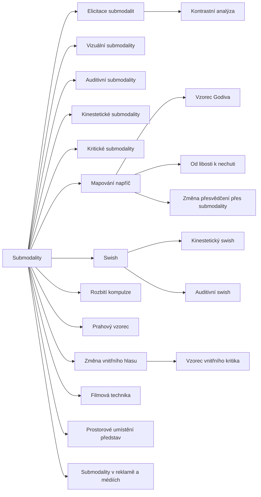

+++
title = "Submodality"
description = "Rodina vzorců NLP, které pracují s kvalitami vnitřních představ: elicitace, srovnání, přenos kvalit a swish, jejich kořeny, defenzivní čtení, doklady a obrana."
weight = 10
sort_by = "weight"
template = "kompendium/section.html"
page_template = "kompendium/page.html"
insert_anchor_links = "right"

[extra]
tags = ["nlp", "nlp-submodality"]
categories = ["academic"]
toc = true
lang = "cs"
keywords = ["Submodality", "Submodalities", "NLP vzorce"]
schema_type = "DefinedTermSet"
catalog = "nlp"
catalog_schema = 1
catalog_export = "data/nlp-katalog.json"
catalog_family = "submodality"
catalog_code = "10"
catalog_en = "Submodalities"
catalog_size = 20
catalog_members = ["elicitace-submodalit", "vizualni-submodality", "auditivni-submodality", "kinesteticke-submodality", "kriticke-submodality", "kontrastni-analyza", "mapovani-napric", "swish", "kinesteticky-swish", "auditivni-swish", "vyhozeni-kompulze", "vzorec-godiva", "od-libosti-k-nechuti", "zmena-presvedceni-submodalitami", "prahovy-vzorec", "zmena-vnitrniho-hlasu", "filmova-technika", "prostorove-umisteni-obrazu", "submodality-v-reklame", "zmena-kriticke-sebeprezentace"]
catalog_types = ["concept", "pattern"]
catalog_sources = ["andreas-andreas-1987", "bandler-1985", "dilts-1990", "dilts-1980", "druckman-swets-1988", "herman-1992", "james-woodsmall-1988", "kirsch-lynn-1995", "lakoff-johnson-1980", "lifton-1961", "mcguire-1964", "miller-rollnick-2013", "norcross-2006", "oconnor-seymour-1990", "passmore-rowson-2019", "roderique-davies-2009", "sharpley-1987", "sturt-2012", "witkowski-2010", "wolpe-1958"]
+++

# Submodality

## Co rodina zahrnuje

Rodina NLP-10 shromažďuje hesla, která v neurolingvistickém programování pracují se
submodalitami, tedy s kvalitami vnitřních představ: s velikostí, jasem a vzdáleností obrazu, s
hlasitostí a tónem vnitřního hlasu, s umístěním, teplotou a pohybem tělesného pocitu (Bandler
1985; Andreas a Andreas 1987). Obecný
pojem submodalit popisuje heslo
[Submodality](@/kompendium/nlp-vzorce/zakladni-pojmy/submodality-pojem.md) v rodině základních
pojmů. Tato rodina navazuje na něj a sdružuje pojmy a vzorce, které z něj vycházejí. Tvoří ji
tři skupiny. První skupinu představují výkladové pojmy, které popisují kvality jednotlivých
smyslových kanálů, tedy
[vizuální](@/kompendium/nlp-vzorce/submodality/vizualni-submodality.md),
[auditivní](@/kompendium/nlp-vzorce/submodality/auditivni-submodality.md) a
[kinestetické submodality](@/kompendium/nlp-vzorce/submodality/kinesteticke-submodality.md), a
pojem [kritických submodalit](@/kompendium/nlp-vzorce/submodality/kriticke-submodality.md),
podle kterého některé kvality strhávají s sebou celý prožitek. Druhou skupinu tvoří
analytické vzorce, kterými praktik kvality zjišťuje a porovnává:
[elicitace submodalit](@/kompendium/nlp-vzorce/submodality/elicitace-submodalit.md) a
[kontrastní analýza](@/kompendium/nlp-vzorce/submodality/kontrastni-analyza.md). Třetí
skupinu tvoří vzorce změny, které mají kvality představ měnit, a tím měnit i reakce, chutě,
přesvědčení nebo sebehodnocení. Patří sem
[mapování napříč](@/kompendium/nlp-vzorce/submodality/mapovani-napric.md), vzorec
[swish](@/kompendium/nlp-vzorce/submodality/swish.md) s jeho kinestetickou a auditivní
variantou, techniky změny chutí a nutkání, práce s přesvědčeními a s vnitřním hlasem, filmová
technika, prostorové umístění představ, vzorec vnitřního kritika a heslo o užití submodalit v
reklamě a médiích.

Rodina je v katalogu jednou z nejpočetnějších a zároveň jednou z nejméně empiricky podložených;
už o NLP jako celku dospěl rozbor kontrolovaných studií k závěru, že jeho tvrzení většinou
nepodporují (Witkowski 2010). Je to i rodina, ve které je nejzřetelnější dvojí povaha NLP:
tytéž vzorce, které
se nabízejí k úlevě od fobie nebo zlozvyku, lze bez jakékoli úpravy použít k oslabení citů a
pochybností, které jsou nepohodlné pro někoho jiného. Kompendium proto čte celou rodinu
defenzivně, jako soubor struktur, které má pozorovatel umět rozpoznat.

## Původ

Představa jemnějších rozlišení uvnitř smyslových kanálů se objevuje v raných systematizacích
NLP, které se zabývaly strukturou subjektivní zkušenosti a pořadím vnitřních reprezentací ve
strategiích (Dilts a kol. 1980). Samostatnou rodinou technik se práce se submodalitami stala
v polovině osmdesátých let. Richard Bandler v knize, která vyšla v roce 1985, zdůraznil, že
lidé mohou svůj prožitek měnit tím, jak si ho představují, a ne pouze tím, o čem přemýšlejí, a
představil v ní mimo jiné vzorec swish (Bandler 1985). Steve a Connirae Andreasovi pak práci se
submodalitami rozpracovali do souboru pokročilých intervencí, které stojí na kontrastní
analýze, hledání kritických kvalit a jejich přenosu (Andreas a Andreas 1987). Úvodní učebnice
počátku devadesátých let zařadily submodality mezi základní pojmy oboru a swish mezi
základní techniky (O'Connor a Seymour 1990). Na tutéž linii navazují i pozdější proudy, které
pracují s vnitřní reprezentací času, například [terapie časové osy](@/kompendium/nlp-vzorce/casova-osa/terapie-casove-osy.md) (James a Woodsmall 1988), a
práce s přesvědčeními v systémovém pojetí (Dilts 1990).

Rodina má i kořeny mimo NLP, které je užitečné znát, protože vysvětlují, proč její tvrzení
působí intuitivně. Behaviorální terapie pracovala se spojováním představ a reakcí v
systematické desenzibilizaci dávno před vznikem NLP (Wolpe 1958). Kognitivní lingvistika
ukázala, že běžný jazyk strukturuje důležitost, blízkost a citový náboj prostorovými a
smyslovými metaforami (Lakoff a Johnson 1980). NLP tyto poznatky nepřevzalo jako vědecké
teorie, ale jako inspiraci, a přidalo k nim vlastní tvrzení o mechanismu, která už oporu
nemají.

## Jak rodinu číst defenzivně

Pro pozorovatele má rodina společnou strukturu, kterou lze rozpoznat bez ohledu na konkrétní
vzorec. Na začátku stojí zjišťování: mluvčí se ptá na podobu představy, ne na její obsah. Pak
následuje porovnání nebo hledání páky: které kvality jsou „rozhodující“. Nakonec přichází
návrh změny: představu zmenšit, oddálit, ztlumit, přesunout, nahradit. Klíčová otázka zní, kdo o
cíli změny rozhoduje. Pokud člověk sám, jde o jeho volbu, kterou i ověřené přístupy ke změně
chování ponechávají na něm (Miller a Rollnick 2013), i když metoda nemá doloženou účinnost.
Pokud mluvčí, skupina nebo organizace, mění se slovník submodalit v nástroj, jak
zasáhnout do citů, pochybností a vztahů druhého pod zdáním technické úpravy představy.

Druhým společným rysem je odpojení formy od obsahu. Vzorce rodiny pracují s tím, jak člověk
prožitek prožívá, ne s tím, proč ho prožívá. To může být úlevou u zlozvyku nebo u nepřiměřené
sebekritiky. U pochybnosti, stesku, nedůvěry nebo tělesného varování to ale znamená, že se
informace, kterou prožitek nese, ztratí, aniž by ji kdo posoudil. Literatura o myšlenkové
reformě popisuje uzavřené systémy, které regulují i to, co člověk smí cítit, a pochybnost
vykládají jako chybu jednotlivce (Lifton 1961). Slovník, který z citů a pochybností dělá
parametry k úpravě, se do takových systémů hodí. Kompendium popisuje cílené přelaďování
citových stavů, které člověk sám nevolí, jako
[latentní emocionální modulaci](@/kompendium/techniques/ea-1-4-2-latentni-emocionalni-modulace.md).

Třetím rysem je nevyvratitelnost. Pokud změna nenastane, nevyvrací to podle logiky rodiny
teorii, ale znamená, že nebyla nalezena správná kritická kvalita nebo že se člověk „brání“.
Kritici NLP tento rys uváděli jako jeden z důvodů, proč jsou tvrzení oboru obtížně testovatelná
(Sharpley 1987). Pro pozorovatele je to důležitý detekční znak: kde je neúspěch vždy vinou
dotazovaného, tam autorita praktika roste s každým pokusem.

Čtvrtým rysem je prostředí. Vzorce této rodiny se často předvádějí na seminářích před sálem,
kde dobrovolník popíše svou představu a lektor po krátké práci ohlásí změnu. Taková ukázka
působí silně, ale její výsledek ovlivňuje očekávání, sociální tlak a ochota vyhovět, tedy
činitelé, které výzkum sugesce zná dlouho (Kirsch a Lynn 1995).

## Stav důkazů

Empirická opora rodiny je slabá. Kontrolovaných studií, které by testovaly specificky tvrzení
o submodalitách, o kritických kvalitách nebo o účinku swishe a mapování napříč, je málo a jejich
metodologická kvalita je podle přehledů nízká. Witkowski při rozboru databáze výzkumů NLP
dospěl k závěru, že naprostá většina kontrolovaných studií tvrzení oboru nepodporuje a že obor
jako celek nese rysy pseudovědy (Witkowski 2010). Systematický přehled účinků NLP na zdravotní
výsledky nenašel dostatek kvalitních důkazů pro doporučení jeho intervencí (Sturt a kol. 2012).
Hodnocení amerických expertů z konce osmdesátých let nenašlo dostatečné doklady pro teorii NLP
ani pro jeho účinky (Druckman a Swets 1988) a mezinárodní anketa odborníků zařadila NLP mezi
metody pokládané za zdiskreditované v léčbě duševních poruch (Norcross, Koocher a Garofalo
2006).

Poctivé čtení musí uvést i druhou stranu. Nezávislý výzkum mentálních představ obecně
podporuje souvislost mezi živostí a perspektivou představy a její citovou intenzitou a ověřené
terapie s představami pracují. Tato shoda však podporuje obecnou intuici, ne konkrétní katalog
NLP, jeho předpovědi o individuálních řídicích kvalitách ani sliby rychlé a trvalé změny.
Kritický přehled pro koučink doporučuje opatrnost u technik, jejichž mechanismus nebyl ověřen
(Passmore a Rowson 2019), a kritická literatura upozorňuje, že NLP napodobuje vnější podobu
vědy bez jejích metod (Roderique-Davies 2009).

## Obrana

Základní obranou proti zneužití celé rodiny je trvat na tom, že o změně vlastních citů,
pochybností a vztahů rozhoduje člověk sám. Pokud někdo navrhuje „zmenšit“ obraz blízkého,
„ztlumit“ varovný hlas nebo „odplavit“ tělesný nesouhlas, je namístě se zeptat, proč by tento
prožitek měl zmizet a komu to prospěje. Druhou obranou je vracet se od formy k obsahu: na
pochybnost se odpovídá důvody a doklady, na stesk rozhovorem s blízkými, na tělesný neklid
odkladem rozhodnutí. Třetí obranou je nepřijímat sliby rychlé a úplné změny a neúspěch
nepřipisovat sobě. Čtvrtou obranou je odmítat veřejné zkoumání soukromých prožitků na
seminářích a ve skupinách, kde má odmítnutí sociální cenu. Inokulační přístup k přesvědčování
ukazuje, že kdo strukturu tahu zná předem, odolává mu lépe (McGuire 1964), a právě k tomu má
tato rodina hesel sloužit.

U lidí, jejichž city a pochybnosti byly v nátlakovém prostředí soustavně přelaďovány, se
zotavení opírá o obnovu vlastnictví prožitku: o právo cítit, co člověk cítí, pochybovat, kde
pochybuje, a slyšet vlastní úsudek. Herman zdůrazňuje, že po zkušenosti kontroly je základem
uzdravení obnova autonomie a bezpečný vztah (Herman 1992). Přehled
[terapeutických přístupů](@/kompendium/06-klinicke-aplikace/terapeuticke-pristupy.md) v
kompendiu ukazuje, že s představami, návyky i následky kontroly lze pracovat ověřenými postupy.
Odborník, který s technikami této rodiny pracuje, by měl klientovi otevřeně říci, že jejich
účinnost není prokázána, a cíl změny vždy ponechat na něm.

<!-- kompendium:katalog-vazby:begin (scripts/catalogs.py; neupravovat ručně) -->

## Hesla rodiny

| Kód | Heslo | Anglicky | Druh | Užití | Riziko |
|-----|-------|----------|------|-------|--------|
| `NLP-10.01` | [Elicitace submodalit](@/kompendium/nlp-vzorce/submodality/elicitace-submodalit.md) | Eliciting submodalities | vzorec | terapeutické i vlivové | střední |
| `NLP-10.02` | [Vizuální submodality](@/kompendium/nlp-vzorce/submodality/vizualni-submodality.md) | Visual submodalities | pojem | výkladový pojem | nízké |
| `NLP-10.03` | [Auditivní submodality](@/kompendium/nlp-vzorce/submodality/auditivni-submodality.md) | Auditory submodalities | pojem | výkladový pojem | nízké |
| `NLP-10.04` | [Kinestetické submodality](@/kompendium/nlp-vzorce/submodality/kinesteticke-submodality.md) | Kinaesthetic submodalities | pojem | výkladový pojem | nízké |
| `NLP-10.05` | [Kritické submodality](@/kompendium/nlp-vzorce/submodality/kriticke-submodality.md) | Critical (driver) submodalities | pojem | terapeutické i vlivové | střední |
| `NLP-10.06` | [Kontrastní analýza](@/kompendium/nlp-vzorce/submodality/kontrastni-analyza.md) | Contrastive analysis | vzorec | terapeutické i vlivové | střední |
| `NLP-10.07` | [Mapování napříč](@/kompendium/nlp-vzorce/submodality/mapovani-napric.md) | Mapping across | vzorec | terapeutické i vlivové | vysoké |
| `NLP-10.08` | [Swish](@/kompendium/nlp-vzorce/submodality/swish.md) | Swish pattern | vzorec | převážně terapeutické | střední |
| `NLP-10.09` | [Kinestetický swish](@/kompendium/nlp-vzorce/submodality/kinesteticky-swish.md) | Kinaesthetic swish | vzorec | převážně terapeutické | střední |
| `NLP-10.10` | [Auditivní swish](@/kompendium/nlp-vzorce/submodality/auditivni-swish.md) | Auditory swish | vzorec | převážně terapeutické | střední |
| `NLP-10.11` | [Rozbití kompulze](@/kompendium/nlp-vzorce/submodality/vyhozeni-kompulze.md) | Compulsion blowout | vzorec | převážně terapeutické | střední |
| `NLP-10.12` | [Vzorec Godiva](@/kompendium/nlp-vzorce/submodality/vzorec-godiva.md) | Godiva chocolate pattern | vzorec | terapeutické i vlivové | střední |
| `NLP-10.13` | [Od libosti k nechuti](@/kompendium/nlp-vzorce/submodality/od-libosti-k-nechuti.md) | Like-to-dislike pattern | vzorec | terapeutické i vlivové | vysoké |
| `NLP-10.14` | [Změna přesvědčení přes submodality](@/kompendium/nlp-vzorce/submodality/zmena-presvedceni-submodalitami.md) | Belief change through submodalities | vzorec | terapeutické i vlivové | vysoké |
| `NLP-10.15` | [Prahový vzorec](@/kompendium/nlp-vzorce/submodality/prahovy-vzorec.md) | Threshold pattern | vzorec | terapeutické i vlivové | vysoké |
| `NLP-10.16` | [Změna vnitřního hlasu](@/kompendium/nlp-vzorce/submodality/zmena-vnitrniho-hlasu.md) | Changing the inner voice | vzorec | terapeutické i vlivové | střední |
| `NLP-10.17` | [Filmová technika](@/kompendium/nlp-vzorce/submodality/filmova-technika.md) | Movie theatre technique | vzorec | převážně terapeutické | střední |
| `NLP-10.18` | [Prostorové umístění představ](@/kompendium/nlp-vzorce/submodality/prostorove-umisteni-obrazu.md) | Spatial location of images | vzorec | terapeutické i vlivové | střední |
| `NLP-10.19` | [Submodality v reklamě a médiích](@/kompendium/nlp-vzorce/submodality/submodality-v-reklame.md) | Submodalities in advertising and media | vzorec | převážně vlivové | střední |
| `NLP-10.20` | [Vzorec vnitřního kritika](@/kompendium/nlp-vzorce/submodality/zmena-kriticke-sebeprezentace.md) | Inner critic pattern | vzorec | terapeutické i vlivové | střední |

## Mapa rodiny

Mapu odvozuje engine katalogů z vazeb „obecnější heslo“; uzel otevře heslo.

<!-- kompendium:katalog-vazby:end -->

## Literatura

- Andreas, S., & Andreas, C. (1987). *Change Your Mind—and Keep the Change: Advanced NLP Submodalities Interventions*. Moab: Real People Press.
- Bandler, R. (1985). *Using Your Brain—for a Change*. Moab: Real People Press.
- Dilts, R. (1990). *Changing Belief Systems with NLP*. Cupertino: Meta Publications.
- Dilts, R., Grinder, J., Bandler, R., & DeLozier, J. (1980). *Neuro-Linguistic Programming: Volume I. The Study of the Structure of Subjective Experience*. Cupertino: Meta Publications.
- Druckman, D., & Swets, J. A. (Eds.) (1988). *Enhancing Human Performance: Issues, Theories, and Techniques*. Washington, DC: National Academy Press.
- Herman, J. L. (1992). *Trauma and Recovery*. New York: Basic Books.
- James, T., & Woodsmall, W. (1988). *Time Line Therapy and the Basis of Personality*. Cupertino: Meta Publications.
- Kirsch, I., & Lynn, S. J. (1995). The altered state of hypnosis: Changes in the theoretical landscape. *American Psychologist*, 50(10), 846–858.
- Lakoff, G., & Johnson, M. (1980). *Metaphors We Live By*. Chicago: University of Chicago Press.
- Lifton, R. J. (1961). *Thought Reform and the Psychology of Totalism: A Study of „Brainwashing“ in China*. New York: W. W. Norton.
- McGuire, W. J. (1964). Inducing resistance to persuasion: Some contemporary approaches. In L. Berkowitz (Ed.), *Advances in Experimental Social Psychology* (Vol. 1, pp. 191–229). New York: Academic Press.
- Miller, W. R., & Rollnick, S. (2013). *Motivational Interviewing: Helping People Change* (3. vyd.). New York: Guilford Press.
- Norcross, J. C., Koocher, G. P., & Garofalo, A. (2006). Discredited psychological treatments and tests: A Delphi poll. *Professional Psychology: Research and Practice*, 37(5), 515–522.
- O'Connor, J., & Seymour, J. (1990). *Introducing Neuro-Linguistic Programming: Psychological Skills for Understanding and Influencing People*. London: Thorsons.
- Passmore, J., & Rowson, T. S. (2019). Neuro-linguistic programming: A critical review of NLP research and the application of NLP in coaching. *International Coaching Psychology Review*, 14(1), 57–69.
- Roderique-Davies, G. (2009). Neuro-linguistic programming: Cargo cult psychology? *Journal of Applied Research in Higher Education*, 1(2), 58–63.
- Sharpley, C. F. (1987). Research findings on neurolinguistic programming: Nonsupportive data or an untestable theory? *Journal of Counseling Psychology*, 34(1), 103–107.
- Sturt, J., Ali, S., Robertson, W., Metcalfe, D., Grove, A., Bourne, C., & Bridle, C. (2012). Neurolinguistic programming: A systematic review of the effects on health outcomes. *British Journal of General Practice*, 62(604), e757–e764.
- Witkowski, T. (2010). Thirty-five years of research on neuro-linguistic programming. NLP research data base. State of the art or pseudoscientific decoration? *Polish Psychological Bulletin*, 41(2), 58–66.
- Wolpe, J. (1958). *Psychotherapy by Reciprocal Inhibition*. Stanford: Stanford University Press.

<!-- kompendium:katalog-vazby:begin (scripts/catalogs.py; neupravovat ručně) -->

## Související

- [NLP vzorce](@/kompendium/nlp-vzorce/_index.md) – celý katalog a jeho rodiny
- [Kotvení](@/kompendium/nlp-vzorce/kotveni/_index.md) – předchozí rodina katalogu
- [Disociace, fobie a trauma](@/kompendium/nlp-vzorce/disociace-a-trauma/_index.md) – další rodina katalogu
- [Trenér rozpoznávání](@/kompendium/trener.md) – procvičení rozpoznání hesel této rodiny

<!-- kompendium:katalog-vazby:end -->
