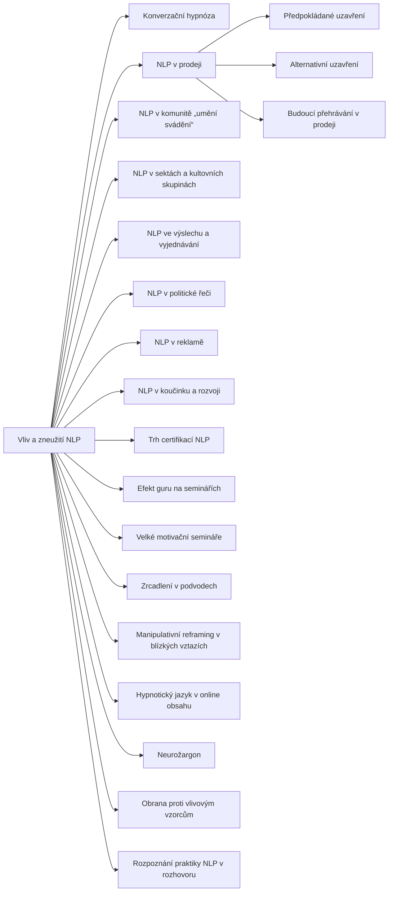

+++
title = "Vliv a zneužití NLP"
description = "Rodina vzorců, v nichž se NLP uplatňuje mimo terapii: prodej, reklama, svádění, sekty, výslech a politika. Jak je rozpoznat, co o nich víme a jak se bránit."
weight = 21
sort_by = "weight"
template = "kompendium/section.html"
page_template = "kompendium/page.html"
insert_anchor_links = "right"

[extra]
tags = ["nlp", "nlp-vliv-a-zneuziti"]
categories = ["academic"]
toc = true
lang = "cs"
keywords = ["Vliv a zneužití NLP", "Influence and misuse of NLP", "NLP vzorce"]
schema_type = "DefinedTermSet"
catalog = "nlp"
catalog_schema = 1
catalog_export = "data/nlp-katalog.json"
catalog_family = "vliv-a-zneuziti"
catalog_code = "21"
catalog_en = "Influence and misuse of NLP"
catalog_size = 20
catalog_members = ["konverzacni-hypnoza", "nlp-v-prodeji", "predpokladovy-zaver", "alternativni-zaver", "budouci-prehravani-v-prodeji", "nlp-v-komunite-svadeni", "nlp-v-sektach", "nlp-ve-vyslechu", "nlp-v-politicke-reci", "nlp-v-reklame", "nlp-v-koucinku", "trh-certifikaci-nlp", "guru-efekt", "velke-seminare", "falesne-zrcadleni-v-podvodech", "manipulativni-reframing-ve-vztazich", "hypnoticky-jazyk-online", "neuro-zargon", "obrana-proti-vlivovym-vzorcum", "rozpoznani-nlp-praktiky"]
catalog_types = ["concept", "pattern"]
catalog_sources = ["charvet-1997", "cialdini-2009", "druckman-swets-1988", "hassan-1988", "herman-1992", "kirsch-lynn-1995", "lifton-1961", "loftus-palmer-1974", "mcguire-1964", "oconnor-seymour-1990", "petty-cacioppo-1986", "sharpley-1987", "singer-lalich-1995", "tosey-mathison-2009", "tversky-kahneman-1974", "tversky-kahneman-1981", "wiseman-2012", "witkowski-2010", "van-der-linden-2023"]
+++

# Vliv a zneužití NLP

## Co rodina zahrnuje

Rodina Vliv a zneužití NLP shromažďuje vzorce, v nichž se pojmy a postupy
neurolingvistického programování přenášejí z terapeutického a výukového kontextu do
prostředí, kde slouží k získání souhlasu, peněz, poslušnosti, informací nebo intimity.
Většina ostatních rodin katalogu popisuje jednotlivé techniky, například jazykové vzorce,
kotvení nebo práci s představami. Tato rodina popisuje kontexty: místa, kde se techniky
setkávají s konkrétním zájmem, mocí a zranitelností. Proto je také rodinou s nejvyšším
rizikem zneužití a proto se její stránky drží nejpřísněji obranného rámce kompendia.
Popisují, jak vzorec rozpoznat, co působí, jaké škody přináší a jak se bránit, a nikdy
nepopisují, jak ho provést.

Rodinu lze pro přehled rozdělit do pěti okruhů. Obchodní okruh zahrnuje [NLP v
prodeji](@/kompendium/nlp-vzorce/vliv-a-zneuziti/nlp-v-prodeji.md) s jeho typickými obraty,
[předpokládaným uzavřením](@/kompendium/nlp-vzorce/vliv-a-zneuziti/predpokladovy-zaver.md),
[alternativním uzavřením](@/kompendium/nlp-vzorce/vliv-a-zneuziti/alternativni-zaver.md) a
[budoucím přehráváním](@/kompendium/nlp-vzorce/vliv-a-zneuziti/budouci-prehravani-v-prodeji.md),
dále [NLP v reklamě](@/kompendium/nlp-vzorce/vliv-a-zneuziti/nlp-v-reklame.md), hypnotický
jazyk v online obsahu a neurožargon. Vztahový okruh zahrnuje [NLP v komunitě „umění
svádění“](@/kompendium/nlp-vzorce/vliv-a-zneuziti/nlp-v-komunite-svadeni.md), manipulativní
[reframing](@/kompendium/nlp-vzorce/reframing/reframing.md) v blízkých vztazích a zrcadlení v podvodech. Skupinový okruh zahrnuje [NLP v
sektách a kultovních skupinách](@/kompendium/nlp-vzorce/vliv-a-zneuziti/nlp-v-sektach.md),
efekt guru na seminářích, velké motivační semináře, NLP v koučinku a trh certifikací.
Institucionální a veřejný okruh zahrnuje [NLP ve výslechu a
vyjednávání](@/kompendium/nlp-vzorce/vliv-a-zneuziti/nlp-ve-vyslechu.md) a [NLP v politické
řeči](@/kompendium/nlp-vzorce/vliv-a-zneuziti/nlp-v-politicke-reci.md). Obranný okruh konečně
tvoří stránky o obraně proti vlivovým vzorcům a o rozpoznání praktiky NLP v rozhovoru, které
shrnují, co mají ostatní stránky společného. Na pomezí stojí [konverzační
hypnóza](@/kompendium/nlp-vzorce/vliv-a-zneuziti/konverzacni-hypnoza.md), která je spíše
obchodním slibem než technikou, ale prostupuje téměř všemi okruhy. Úplný přehled položek
rodiny s jejich kódy podává tabulka na konci této stránky.

## Proč samostatná rodina

Většina vzorců, které se v této rodině objevují, má jinde v katalogu svou „neutrální“
stránku: raport, zrcadlení, presupozice, [iluze volby](@/kompendium/nlp-vzorce/milton-model/iluze-volby.md), kotvení, [budoucí přehrávání](@/kompendium/nlp-vzorce/casova-osa/budouci-prehravani.md) nebo
reframing. Samostatná rodina existuje proto, že tentýž vzorec mění povahu podle kontextu.
Otázka s presupozicí je u lékaře, který ověřuje porozumění, něčím jiným než u prodejce,
který obchází nevyslovené odmítnutí, a představa budoucnosti je v motivačním rozhovoru
něčím jiným než ve vzorovém domě developera. Cialdini ukázal, že principy získávání
souhlasu, tedy reciprocita, závazek a konzistence, sociální důkaz, sympatie, autorita a
nedostatek, působí ve všech těchto prostředích stejně a že profesionálové v získávání
souhlasu je využívají bez ohledu na to, jak je pojmenovávají (Cialdini 2009). Rodina tedy
nepopisuje nové techniky, ale místa, kde se známé mechanismy spojují s cizím zájmem. Pro
čtenáře z toho plyne praktický závěr: posuzovat je třeba situaci, nikoli jednotlivá slova.
Tytéž věty mohou být v jednom kontextu zdvořilostí a v jiném nátlakem.

Rodina má také zvláštní vztah k ostatním rodinám katalogu. Kdo zde narazí na pojem, jako je
raport, presupozice nebo kotva, najde jeho obecný popis na stránce příslušné rodiny, kde je
vysvětlen původ pojmu, jeho terapeutické užití a stav výzkumu. Stránky této rodiny na ně
odkazují a soustředí se jen na to, co se s pojmem stane, když se ocitne v prodeji, ve
skupině nebo ve výslechu. Čtení obou stránek vedle sebe ukazuje nejzřetelněji, jak se
tentýž popis komunikace může stát nástrojem porozumění i nástrojem nátlaku (Tosey a
Mathison 2009).

## Původ

NLP vzniklo v sedmdesátých letech jako modelování terapeutů, ale velmi brzy se šířilo i
mimo terapii. Úvodní učebnice oboru slibují už v podtitulu nejen porozumění lidem, ale také
jejich ovlivňování (O'Connor a Seymour 1990), a literatura o metaprogramech výslovně počítá
s užitím v prodeji, marketingu a náboru (Charvet 1997). Tosey a Mathison popisují NLP jako
obor, jehož výcvikový trh se rozvíjel převážně mimo akademické prostředí, bez jednotné
instituce a bez společných etických pravidel, a upozorňují, že právě obchodní a manažerské
užití přispělo k jeho pověsti manipulativní techniky (Tosey a Mathison 2009). Vedle toho se
od šedesátých let rozvíjela literatura o myšlenkové reformě a o skupinách s vysokými nároky
na členy. Lifton popsal znaky totalitního prostředí, mezi nimi kontrolu prostředí,
zatížení jazyka a nadřazení doktríny člověku (Lifton 1961). Singerová a Lalichová formulovaly
podmínky, za nichž se myšlenková reforma uskutečňuje i v současných skupinách včetně
terapeutických a komerčních výcviků (Singer a Lalich 1995), a Hassan popsal kontrolu mysli
jako kontrolu chování, informací, myšlení a emocí (Hassan 1988). Tyto rámce tvoří páteř,
o kterou se stránky rodiny při posuzování opírají, protože umožňují oddělit otázku, zda
technika funguje, od otázky, zda prostředí poškozuje lidi.

## Jak rodinu číst defenzivně

Každá stránka rodiny klade v různých podobách tytéž tři otázky. První je otázka
průhlednosti: ví člověk, k čemu rozhovor, kurz nebo sdělení slouží, a ví, jaké prostředky
se při tom používají? Druhá je otázka souhlasu a odchodu: může člověk bez ztráty peněz,
vztahů nebo tváře odmítnout, přerušit nebo odejít? Třetí je otázka prospěchu: komu výsledek
slouží, a rozhodl by se člověk stejně, kdyby měl úplné informace a dostatek času? Kde je
odpověď na všechny tři otázky příznivá, jde o legitimní komunikaci, i když používá
přesvědčivé prostředky. Kde je nepříznivá, jde o manipulaci, i když se tváří jako péče,
osobní rozvoj nebo zdvořilý rozhovor. Stránky rodiny proto popisují strukturu vzorce na
úrovni, která pozorovateli umožní poznat ho v rozhovoru, v záznamu nebo v textu, a vždy ji
doplňují o detekční znaky, o odlišení od neškodných jevů, o stav výzkumu a o obranu. Žádná
stránka neobsahuje formulace k použití, pořadí kroků ani rady, jak účinek zesílit nebo
skrýt. Výroky, které stránky uvádějí v trenéru rozpoznávání, jsou krátké, obecné a vždy
doplněné neškodným protějškem, aby čtenář viděl, že rozhoduje kontext, ne slova.

## Stav důkazů

Ve výzkumu se opakuje stejný obraz. Specifické techniky NLP nemají empirickou oporu jako
nástroje vlivu: přehledy výzkumu nenašly podporu pro sladění predikátů a reprezentační
systémy (Sharpley 1987), [hodnocení Národní rady pro výzkum USA](@/kompendium/nlp-vzorce/kriticke-hodnoceni/hodnoceni-narodni-rady-pro-vyzkum.md) nenašlo pro NLP jako
techniku ovlivňování doklady (Druckman a Swets 1988) a databáze kontrolovaných studií
ukazuje, že naprostá většina z nich tvrzení NLP nepodporuje (Witkowski 2010). Představa
skryté hypnózy, která obchází vůli, je v rozporu se sociálně-kognitivním pojetím hypnózy
(Kirsch a Lynn 1995) a užití očních signálů k odhalování lži bylo přímo vyvráceno (Wiseman
a kol. 2012). Naproti tomu mechanismy, o které se vzorce rodiny opírají, jsou dobře
doloženy mimo NLP: principy získávání souhlasu (Cialdini 2009), dvě cesty přesvědčování
(Petty a Cacioppo 1986), rámcování a heuristiky (Tversky a Kahneman 1974; Tversky a
Kahneman 1981) a vliv formulace otázek na paměť (Loftus a Palmer 1974). Z toho plyne
nejdůležitější závěr rodiny. Škodlivost vlivových vzorců nezávisí na tom, zda NLP funguje.
Škodu působí utajení, nátlak, izolace, závislost a zneužitá důvěra, a ty působí bez ohledu
na to, jakým slovníkem se popisují. Slabost důkazů o NLP proto nemá vést k bagatelizaci,
ale k přesnějšímu pojmenování toho, co skutečně škodí.

## Obrana

Obrana proti vzorcům rodiny má několik společných prvků. Prvním je čas: téměř všechny
vlivové vzorce pracují s naléhavostí, a odklad rozhodnutí je proto nejjednodušší a
nejúčinnější ochranou. Druhým je třetí strana: rozhodnutí s důsledky pro peníze, vztahy
nebo svobodu je rozumné probrat s někým, kdo u rozhovoru nebyl a nemá na výsledku zájem.
Třetím je převod na ověřitelná tvrzení: co přesně se slibuje, čím je to doloženo a jak se
pozná, že slib nebyl splněn. Čtvrtým je znalost mechanismů předem. McGuire ukázal, že
seznámení s přesvědčovacími postupy a s argumenty proti nim zvyšuje odolnost podobně jako
očkování (McGuire 1964), a novější výzkum psychologické inokulace potvrzuje, že znalost
manipulačních technik pomáhá je rozpoznat i v nových situacích (van der Linden 2023).
Pátým prvkem je právní a institucionální ochrana: spotřebitelské právo, záznam výslechu,
přítomnost obhájce, etické kodexy profesí a dozor nad reklamou. Pro zotavení je společné,
že člověk potřebuje porozumět mechanismu, kterému byl vystaven, umístit odpovědnost tam,
kam patří, a obnovit důvěru ve vlastní úsudek. Herman popisuje zotavení jako postup od
obnovy bezpečí přes zpracování k novému napojení na druhé lidi (Herman 1992). Kompendium k
tomu nabízí kritéria a klinické postupy na stránkách [Liftonova kritéria myšlenkové
reformy](@/kompendium/techniques/ea-8-2-2-lifton-thought-reform-criteria.md), [Starkův rámec
coercive control](@/kompendium/techniques/ea-8-2-5-stark-coercive-control.md) a [obrana a
kalibrace](@/kompendium/06-obrana/_index.md).

<!-- kompendium:katalog-vazby:begin (scripts/catalogs.py; neupravovat ručně) -->

## Hesla rodiny

| Kód | Heslo | Anglicky | Druh | Užití | Riziko |
|-----|-------|----------|------|-------|--------|
| `NLP-21.01` | [Konverzační hypnóza](@/kompendium/nlp-vzorce/vliv-a-zneuziti/konverzacni-hypnoza.md) | Conversational (covert) hypnosis | vzorec | převážně vlivové | vysoké |
| `NLP-21.02` | [NLP v prodeji](@/kompendium/nlp-vzorce/vliv-a-zneuziti/nlp-v-prodeji.md) | NLP in sales | vzorec | převážně vlivové | střední |
| `NLP-21.03` | [Předpokládané uzavření](@/kompendium/nlp-vzorce/vliv-a-zneuziti/predpokladovy-zaver.md) | Assumptive close | vzorec | převážně vlivové | střední |
| `NLP-21.04` | [Alternativní uzavření](@/kompendium/nlp-vzorce/vliv-a-zneuziti/alternativni-zaver.md) | Alternative close | vzorec | převážně vlivové | střední |
| `NLP-21.05` | [Budoucí přehrávání v prodeji](@/kompendium/nlp-vzorce/vliv-a-zneuziti/budouci-prehravani-v-prodeji.md) | Future pacing in sales | vzorec | převážně vlivové | střední |
| `NLP-21.06` | [NLP v komunitě „umění svádění“](@/kompendium/nlp-vzorce/vliv-a-zneuziti/nlp-v-komunite-svadeni.md) | NLP in the seduction community | vzorec | převážně vlivové | vysoké |
| `NLP-21.07` | [NLP v sektách a kultovních skupinách](@/kompendium/nlp-vzorce/vliv-a-zneuziti/nlp-v-sektach.md) | NLP in cults | vzorec | převážně vlivové | vysoké |
| `NLP-21.08` | [NLP ve výslechu a vyjednávání](@/kompendium/nlp-vzorce/vliv-a-zneuziti/nlp-ve-vyslechu.md) | NLP in interrogation and negotiation | vzorec | terapeutické i vlivové | vysoké |
| `NLP-21.09` | [NLP v politické řeči](@/kompendium/nlp-vzorce/vliv-a-zneuziti/nlp-v-politicke-reci.md) | NLP in political speech | vzorec | převážně vlivové | střední |
| `NLP-21.10` | [NLP v reklamě](@/kompendium/nlp-vzorce/vliv-a-zneuziti/nlp-v-reklame.md) | NLP in advertising | vzorec | převážně vlivové | střední |
| `NLP-21.11` | [NLP v koučinku a rozvoji](@/kompendium/nlp-vzorce/vliv-a-zneuziti/nlp-v-koucinku.md) | NLP in coaching | vzorec | terapeutické i vlivové | střední |
| `NLP-21.12` | [Trh certifikací NLP](@/kompendium/nlp-vzorce/vliv-a-zneuziti/trh-certifikaci-nlp.md) | The NLP certification market | pojem | převážně vlivové | střední |
| `NLP-21.13` | [Efekt guru na seminářích](@/kompendium/nlp-vzorce/vliv-a-zneuziti/guru-efekt.md) | Guru effect in seminars | vzorec | převážně vlivové | vysoké |
| `NLP-21.14` | [Velké motivační semináře](@/kompendium/nlp-vzorce/vliv-a-zneuziti/velke-seminare.md) | Large-group seminars | vzorec | převážně vlivové | vysoké |
| `NLP-21.15` | [Zrcadlení v podvodech](@/kompendium/nlp-vzorce/vliv-a-zneuziti/falesne-zrcadleni-v-podvodech.md) | Mirroring in scams | vzorec | převážně vlivové | vysoké |
| `NLP-21.16` | [Manipulativní reframing v blízkých vztazích](@/kompendium/nlp-vzorce/vliv-a-zneuziti/manipulativni-reframing-ve-vztazich.md) | Manipulative reframing in close relationships | vzorec | převážně vlivové | vysoké |
| `NLP-21.17` | [Hypnotický jazyk v online obsahu](@/kompendium/nlp-vzorce/vliv-a-zneuziti/hypnoticky-jazyk-online.md) | Hypnotic language in online content | vzorec | převážně vlivové | střední |
| `NLP-21.18` | [Neurožargon](@/kompendium/nlp-vzorce/vliv-a-zneuziti/neuro-zargon.md) | Neuro-jargon | pojem | převážně vlivové | střední |
| `NLP-21.19` | [Obrana proti vlivovým vzorcům](@/kompendium/nlp-vzorce/vliv-a-zneuziti/obrana-proti-vlivovym-vzorcum.md) | Defence against influence patterns | vzorec | výkladový pojem | nízké |
| `NLP-21.20` | [Rozpoznání praktiky NLP v rozhovoru](@/kompendium/nlp-vzorce/vliv-a-zneuziti/rozpoznani-nlp-praktiky.md) | Recognising NLP practice in conversation | vzorec | výkladový pojem | nízké |

## Mapa rodiny

Mapu odvozuje engine katalogů z vazeb „obecnější heslo“; uzel otevře heslo.

## Literatura

- Charvet, S. R. (1997). *Words That Change Minds: Mastering the Language of Influence* (2. vyd.). Dubuque: Kendall/Hunt.
- Cialdini, R. B. (2009). *Influence: Science and Practice* (5. vyd.). Boston: Pearson.
- Druckman, D., & Swets, J. A. (Eds.) (1988). *Enhancing Human Performance: Issues, Theories, and Techniques*. Washington, DC: National Academy Press.
- Hassan, S. (1988). *Combatting Cult Mind Control*. Rochester: Park Street Press.
- Herman, J. L. (1992). *Trauma and Recovery*. New York: Basic Books.
- Kirsch, I., & Lynn, S. J. (1995). The altered state of hypnosis: Changes in the theoretical landscape. *American Psychologist*, 50(10), 846–858.
- Lifton, R. J. (1961). *Thought Reform and the Psychology of Totalism: A Study of „Brainwashing“ in China*. New York: W. W. Norton.
- Loftus, E. F., & Palmer, J. C. (1974). Reconstruction of automobile destruction: An example of the interaction between language and memory. *Journal of Verbal Learning and Verbal Behavior*, 13(5), 585–589.
- McGuire, W. J. (1964). Inducing resistance to persuasion: Some contemporary approaches. In L. Berkowitz (Ed.), *Advances in Experimental Social Psychology* (Vol. 1, pp. 191–229). New York: Academic Press.
- O'Connor, J., & Seymour, J. (1990). *Introducing Neuro-Linguistic Programming: Psychological Skills for Understanding and Influencing People*. London: Thorsons.
- Petty, R. E., & Cacioppo, J. T. (1986). *Communication and Persuasion: Central and Peripheral Routes to Attitude Change*. New York: Springer.
- Sharpley, C. F. (1987). Research findings on neurolinguistic programming: Nonsupportive data or an untestable theory? *Journal of Counseling Psychology*, 34(1), 103–107.
- Singer, M. T., & Lalich, J. (1995). *Cults in Our Midst*. San Francisco: Jossey-Bass.
- Tosey, P., & Mathison, J. (2009). *Neuro-Linguistic Programming: A Critical Appreciation for Managers and Developers*. Basingstoke: Palgrave Macmillan.
- Tversky, A., & Kahneman, D. (1974). Judgment under uncertainty: Heuristics and biases. *Science*, 185(4157), 1124–1131.
- Tversky, A., & Kahneman, D. (1981). The framing of decisions and the psychology of choice. *Science*, 211(4481), 453–458.
- Wiseman, R., Watt, C., ten Brinke, L., Porter, S., Couper, S.-L., & Rankin, C. (2012). The eyes don't have it: Lie detection and neuro-linguistic programming. *PLoS ONE*, 7(7), e40259.
- Witkowski, T. (2010). Thirty-five years of research on neuro-linguistic programming. NLP research data base. State of the art or pseudoscientific decoration? *Polish Psychological Bulletin*, 41(2), 58–66.
- van der Linden, S. (2023). *Foolproof: Why Misinformation Infects Our Minds and How to Build Immunity*. London: 4th Estate.

## Související

- [NLP vzorce](@/kompendium/nlp-vzorce/_index.md) – celý katalog a jeho rodiny
- [Jazykové vzorce](@/kompendium/nlp-vzorce/jazykove-vzorce/_index.md) – předchozí rodina katalogu
- [Kritické hodnocení NLP](@/kompendium/nlp-vzorce/kriticke-hodnoceni/_index.md) – další rodina katalogu
- [Trenér rozpoznávání](@/kompendium/trener.md) – procvičení rozpoznání hesel této rodiny

<!-- kompendium:katalog-vazby:end -->
