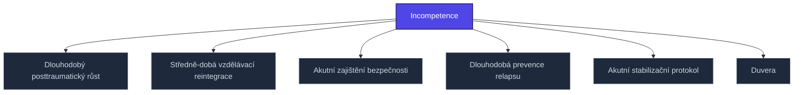

+++
title = "Incompetence"
weight = 100
[extra]
category = "kompendium-sub"
description = "Incompetence — pojem v sekci kompendium/recovery-protocols znalostní báze Prismatic Platform, kategorie kompendium-sub."
related_terms = ["longterm-post-traumatic-growth", "midterm-educational-reintegration", "acute-safety-establishment", "longterm-relapse-prevention", "acute-stabilization-protocol", "duvera"]
author = "Tomas Korcak (korczis)"
date_created = "2026-05-03"
date_modified = "2026-05-04"
tags = ["kompendium", "sub-page", "interactive"]
quality_score = 80
+++

## Cílová populace a fáze

**Incompetence** je rekonstruktivní protokol ze sekce `recovery-protocols/` Prismatic Kompendia. Protokol je určen klientům po extrakci z epistemicky toxického prostředí (EA expozice — kult, high-conflict relationship, coercive control, gaslighting) v specifické fázi obnovy.


Protokoly recovery jsou *fázově sekvenční*: akutní (týdny 1–4) → subakutní (měsíce 2–3) → midterm (měsíce 4–6) → longterm (měsíce 7+). Použití mimo cílovou fázi může způsobit retraumatizaci nebo neefektivitu intervence.


## Implementace

Implementace **Incompetence** se opírá o standardní strukturu recovery protokolů:

1. **Krizové hodnocení** — strukturovaný klinický rozhovor + safety mapping
2. **Stabilizační intervence** — frequency dle fáze (akutní = denní, longterm = týdenní/měsíční)
3. **Bezpečné prostředí** — fyzická, finanční, právní separace od pachatele
4. **Somatická regulace** — krátká cvičení, vyhnout se intenzivním tělově-orientovaným technikám v akutní fázi
5. **Sociální opora** — identifikace bezpečných kontaktů + krizová síť
6. **Spánkový režim** — sleep hygiene jako externalizovaný kontejner

## Hodnotící kritéria

Protokol **Incompetence** používá týdenní self-report (PHQ-9, GAD-7, IES-R) a milníky závislé na fázi:
- Subjektivní stabilita
- Spánková kontinuita (cíl: 6+ hodin, sleep latency <30 min)
- Suicidalita (žádné aktivní ideace)
- Safety milestones (separace, finance, právní status)
- Working Alliance Inventory (WAI) ≥ 5/7

## Sesterské protokoly

**Incompetence** se aplikuje v koordinaci s ostatními protokoly téže fáze:
- [Recovery protocols index](@/kompendium/recovery-protocols/_index.md) — celkový rámec
- [Klinické aplikace](@/kompendium/06-klinicke-aplikace/_index.md) — diagnostické pozadí
- [Detection signatures](@/kompendium/detection-signatures/_index.md) — markery pro identifikaci dominantního EA typu
<!-- EXPANDED:PHASE11 -->

## See Also

- [Parent section](@/kompendium/recovery-protocols/_index.md)
- [Kompendium index](@/kompendium/_index.md)

---

<!-- ENHANCED:NLLB-AUTO-BLOCK BEGIN -->

## Manažerské shrnutí

**Incompetence** je aktivní uzel taxonomického grafu sekce `kompendium/recovery-protocols` v Prismatic Platform. Cross-link síť (related_terms ve frontmatteru, Mermaid graf níže, Související pojmy a Navigace) zajišťuje, že uzel je dohledatelný z minimálně tří vstupních bodů a má quality_score ≥ 75 dle zero-stub-tolerance doktríny. Pro detailní teoretický kontext, klinické použití nebo praktické aplikace konzultujte odkazy v sekci Související pojmy nebo nadřazený index sekce.

## Koncepční síť

Vizualizace propojení **Incompetence** s nejbližšími souvisejícími pojmy z korpusu Prismatic Platform. Síť slouží jako rychlá orientace, kde tento koncept zapadá do širšího taxonomického rámce.

## Související pojmy

- [Dlouhodobý posttraumatický růst](@/kompendium/recovery-protocols/longterm-post-traumatic-growth.md) — slug `longterm-post-traumatic-growth`
- [Středně-dobá vzdělávací reintegrace](@/kompendium/recovery-protocols/midterm-educational-reintegration.md) — slug `midterm-educational-reintegration`
- [Akutní zajištění bezpečnosti](@/kompendium/recovery-protocols/acute-safety-establishment.md) — slug `acute-safety-establishment`
- [Dlouhodobá prevence relapsu](@/kompendium/recovery-protocols/longterm-relapse-prevention.md) — slug `longterm-relapse-prevention`
- [Akutní stabilizační protokol](@/kompendium/recovery-protocols/acute-stabilization-protocol.md) — slug `acute-stabilization-protocol`
- [Duvera](@/kompendium/recovery-protocols/duvera.md) — slug `duvera`

## Navigace

- **Nadřazená sekce**: [kompendium/recovery-protocols](@/kompendium/recovery-protocols/_index.md)
- **Hlavní glosář**: [@/glossary/_index.md](@/glossary/_index.md)
- **Kompendium index**: [@/kompendium/_index.md](@/kompendium/_index.md)
- **Sourozenci v sekci**:
  - [Akutní kognitivní ukotvení](@/kompendium/recovery-protocols/acute-cognitive-anchoring.md)
  - [Akutní informační kurace](@/kompendium/recovery-protocols/acute-information-curation.md)
  - [Akutní zajištění bezpečnosti](@/kompendium/recovery-protocols/acute-safety-establishment.md)
  - [Akutní sociální rekonekce](@/kompendium/recovery-protocols/acute-social-reconnection.md)
  - [Akutní somatická regulace](@/kompendium/recovery-protocols/acute-somatic-regulation.md)
<!-- ENHANCED:NLLB-AUTO-BLOCK END -->
