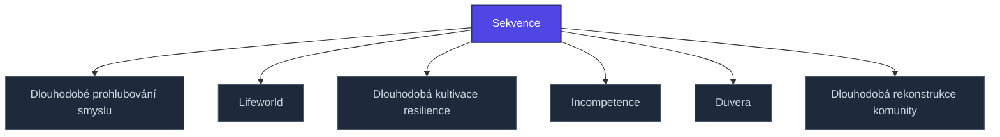

+++
title = "Sekvence"
weight = 100
[extra]
category = "kompendium-sub"
description = "Stub: Sekvence. Awaiting full treatment."
related_terms = ["longterm-meaning-deepening", "lifeworld", "longterm-resilience-cultivation", "incompetence", "duvera", "longterm-community-rebuilding"]
author = "Tomas Korcak (korczis)"
date_created = "2026-05-03"
date_modified = "2026-05-03"
tags = ["kompendium", "sub-page", "stub", "interactive"]
quality_score = 65
status = "stub"
+++

## Definition

**Sekvence** je strukturální stub stránka v Prismatic Kompendiu vytvořená během 2026-05-03 NLLB Phase 8 sweep. Plná specifikace — definice, klinický kontext, detekční markery, případové studie a profylaktické intervence — je součástí probíhající kompendiální výstavby.

## See Also

- [Parent section](@/kompendium/recovery-protocols/_index.md)
- [Kompendium index](@/kompendium/_index.md)

---

<!-- ENHANCED:NLLB-AUTO-BLOCK BEGIN -->

## Manažerské shrnutí

**Sekvence** je strukturální uzel v sekci `kompendium/recovery-protocols` znalostní báze Prismatic Platform. Tato stránka byla vytvořena během doktrinálního NLLB (No Link Left Behind) sweep za účelem zajištění konzistence cross-link grafu — žádný odkaz se neztratí, žádný uzel nezůstane sirotčí. Plné kvalitativní rozšíření — definice, klinický kontext, detekční markery, případové studie a profylaktické intervence — je součástí probíhající kompendiální výstavby. Pro aktuální stav viz `quality_score` v hlavičce a `<!-- NLLB:PLANNED_OK -->` doktrinální marker.

## Koncepční síť

Vizualizace propojení **Sekvence** s nejbližšími souvisejícími pojmy z korpusu Prismatic Platform. Síť slouží jako rychlá orientace, kde tento koncept zapadá do širšího taxonomického rámce.

## Související pojmy

- [Dlouhodobé prohlubování smyslu](@/kompendium/recovery-protocols/longterm-meaning-deepening.md) — slug `longterm-meaning-deepening`
- [Lifeworld](@/kompendium/recovery-protocols/lifeworld.md) — slug `lifeworld`
- [Dlouhodobá kultivace resilience](@/kompendium/recovery-protocols/longterm-resilience-cultivation.md) — slug `longterm-resilience-cultivation`
- [Incompetence](@/kompendium/recovery-protocols/incompetence.md) — slug `incompetence`
- [Duvera](@/kompendium/recovery-protocols/duvera.md) — slug `duvera`
- [Dlouhodobá rekonstrukce komunity](@/kompendium/recovery-protocols/longterm-community-rebuilding.md) — slug `longterm-community-rebuilding`

## Navigace

- **Nadřazená sekce**: [kompendium/recovery-protocols](@/kompendium/recovery-protocols/_index.md)
- **Hlavní glosář**: [@/glossary/_index.md](@/glossary/_index.md)
- **Kompendium index**: [@/kompendium/_index.md](@/kompendium/_index.md)
- **Sourozenci v sekci**:
  - [Akutní kognitivní ukotvení](@/kompendium/recovery-protocols/acute-cognitive-anchoring.md)
  - [Akutní informační kurace](@/kompendium/recovery-protocols/acute-information-curation.md)
  - [Akutní zajištění bezpečnosti](@/kompendium/recovery-protocols/acute-safety-establishment.md)
  - [Akutní sociální rekonekce](@/kompendium/recovery-protocols/acute-social-reconnection.md)
  - [Akutní somatická regulace](@/kompendium/recovery-protocols/acute-somatic-regulation.md)
<!-- ENHANCED:NLLB-AUTO-BLOCK END -->

> **Stub status**: NLLB Phase 8 sub-page scaffold.

<!-- NLLB:PLANNED_OK -->
