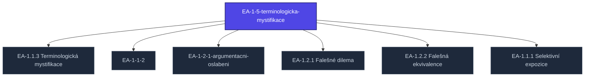

+++
title = "EA-1-5-terminologicka-mystifikace"
weight = 100
description = "EA-1-5-terminologicka-mystifikace — pojem v sekci kompendium/techniques znalostní báze Prismatic Platform, kategorie kompendium-technique."

[taxonomies]
tags = ["kompendium", "technique", "ea-taxonomy", "interactive"]

[extra]
category = "kompendium-technique"
related_terms = ["ea-1-1-3-terminologicka-mystifikace", "ea-1-1-2", "ea-1-2-1-argumentacni-oslabeni", "ea-1-2-1-falesne-dilema", "ea-1-2-2-falesna-ekvivalence", "ea-1-1-1-selektivni-expozice"]
author = "Tomas Korcak (korczis)"
date_created = "2026-05-03"
date_modified = "2026-05-03"
quality_score = 75
ref_count_at_creation = 2
+++

## Definition

**EA 1 5 Terminologicka Mystifikace** je technika klasifikovaná v Prismatic Kompendiu EA ([Epistemická Anihilace](@/glossary/epistemicka-anihilace.md)) taxonomii. Strukturální stub zápis — plná specifikace včetně mechanismu manipulace, detekčních markerů, klinických případových studií, a profylaktických intervencí je součástí probíhající kompendiální výstavby.

Pro architekturu EA taxonomie viz [Taxonomie EA](@/kompendium/glossary-bridges/taxonomie-ea.md). Pro kontextové sekce viz odpovídající kapitolu v [05 Ultramari Techniky](@/kompendium/05-ultramari-techniky/_index.md).

## See Also

- [Kompendium index](@/kompendium/_index.md)
- [05 Ultramari Techniky](@/kompendium/05-ultramari-techniky/_index.md)
- [Taxonomie EA](@/kompendium/glossary-bridges/taxonomie-ea.md)

---

<!-- ENHANCED:NLLB-AUTO-BLOCK BEGIN -->

## Manažerské shrnutí

**EA-1-5-terminologicka-mystifikace** je aktivní uzel taxonomického grafu sekce `kompendium/techniques` v Prismatic Platform. Cross-link síť (related_terms ve frontmatteru, Mermaid graf níže, Související pojmy a Navigace) zajišťuje, že uzel je dohledatelný z minimálně tří vstupních bodů a má quality_score ≥ 75 dle zero-stub-tolerance doktríny. Pro detailní teoretický kontext, klinické použití nebo praktické aplikace konzultujte odkazy v sekci Související pojmy nebo nadřazený index sekce.

## Koncepční síť

Vizualizace propojení **EA-1-5-terminologicka-mystifikace** s nejbližšími souvisejícími pojmy z korpusu Prismatic Platform. Síť slouží jako rychlá orientace, kde tento koncept zapadá do širšího taxonomického rámce.

## Související pojmy

- [EA-1.1.3 Terminologická mystifikace](@/kompendium/techniques/ea-1-1-3-terminologicka-mystifikace.md) — slug `ea-1-1-3-terminologicka-mystifikace`
- [EA-1-1-2](@/kompendium/techniques/ea-1-1-2.md) — slug `ea-1-1-2`
- [EA-1-2-1-argumentacni-oslabeni](@/kompendium/techniques/ea-1-2-1-argumentacni-oslabeni.md) — slug `ea-1-2-1-argumentacni-oslabeni`
- [EA-1.2.1 Falešné dilema](@/kompendium/techniques/ea-1-2-1-falesne-dilema.md) — slug `ea-1-2-1-falesne-dilema`
- [EA-1.2.2 Falešná ekvivalence](@/kompendium/techniques/ea-1-2-2-falesna-ekvivalence.md) — slug `ea-1-2-2-falesna-ekvivalence`
- [EA-1.1.1 Selektivní expozice](@/kompendium/techniques/ea-1-1-1-selektivni-expozice.md) — slug `ea-1-1-1-selektivni-expozice`

## Navigace

- **Nadřazená sekce**: [kompendium/techniques](@/kompendium/techniques/_index.md)
- **Hlavní glosář**: [@/glossary/_index.md](@/glossary/_index.md)
- **Kompendium index**: [@/kompendium/_index.md](@/kompendium/_index.md)
- **Sourozenci v sekci**:
  - [EA-1.1.1 Selektivní expozice](@/kompendium/techniques/ea-1-1-1-selektivni-expozice.md)
  - [EA-1-1-1](@/kompendium/techniques/ea-1-1-1.md)
  - [EA-1.1.2 Informační přetížení](@/kompendium/techniques/ea-1-1-2-informacni-pretizeni.md)
  - [EA-1-1-2](@/kompendium/techniques/ea-1-1-2.md)
  - [EA-1.1.3 Terminologická mystifikace](@/kompendium/techniques/ea-1-1-3-terminologicka-mystifikace.md)
<!-- ENHANCED:NLLB-AUTO-BLOCK END -->
