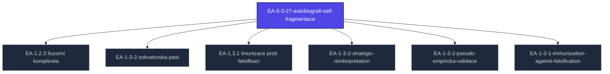

+++
title = "EA-5-3-27-autobiografi-self-fragmentace"
weight = 100
[extra]
category = "kompendium-technique"
description = "EA taxonomy technique stub for EA-5-3-27-autobiografi-self-fragmentace. Awaiting full treatment."
related_terms = ["ea-1-2-3-iluzorni-komplexita", "ea-1-3-2-sokratovska-past", "ea-1-3-1-imunizace-proti-falsifikaci", "ea-1-3-2-strategic-reinterpretation", "ea-1-3-2-pseudo-empiricka-validace", "ea-1-3-1-immunization-against-falsification"]
author = "Tomas Korcak (korczis)"
date_created = "2026-05-03"
date_modified = "2026-05-03"
tags = ["kompendium", "technique", "ea-taxonomy", "stub", "interactive"]
quality_score = 65
status = "stub"
ref_count_at_creation = 2
+++

## Definition

**EA 5 3 27 Autobiografi Self Fragmentace** je technika klasifikovaná v Prismatic Kompendiu EA (Epistemická Anihilace) taxonomii. Strukturální stub zápis — plná specifikace včetně mechanismu manipulace, detekčních markerů, klinických případových studií, a profylaktických intervencí je součástí probíhající kompendiální výstavby.

Pro architekturu EA taxonomie viz [Taxonomie EA](@/kompendium/glossary-bridges/taxonomie-ea.md). Pro kontextové sekce viz odpovídající kapitolu v [05 Ultramari Techniky](@/kompendium/05-ultramari-techniky/_index.md).

## See Also

- [Kompendium index](@/kompendium/_index.md)
- [05 Ultramari Techniky](@/kompendium/05-ultramari-techniky/_index.md)
- [Taxonomie EA](@/kompendium/glossary-bridges/taxonomie-ea.md)

---

<!-- ENHANCED:NLLB-AUTO-BLOCK BEGIN -->

## Manažerské shrnutí

**EA-5-3-27-autobiografi-self-fragmentace** je strukturální uzel v sekci `kompendium/techniques` znalostní báze Prismatic Platform. Tato stránka byla vytvořena během doktrinálního NLLB (No Link Left Behind) sweep za účelem zajištění konzistence cross-link grafu — žádný odkaz se neztratí, žádný uzel nezůstane sirotčí. Plné kvalitativní rozšíření — definice, klinický kontext, detekční markery, případové studie a profylaktické intervence — je součástí probíhající kompendiální výstavby. Pro aktuální stav viz `quality_score` v hlavičce a `<!-- NLLB:PLANNED_OK -->` doktrinální marker.

## Koncepční síť

Vizualizace propojení **EA-5-3-27-autobiografi-self-fragmentace** s nejbližšími souvisejícími pojmy z korpusu Prismatic Platform. Síť slouží jako rychlá orientace, kde tento koncept zapadá do širšího taxonomického rámce.

## Související pojmy

- [EA-1.2.3 Iluzorní komplexita](@/kompendium/techniques/ea-1-2-3-iluzorni-komplexita.md) — slug `ea-1-2-3-iluzorni-komplexita`
- [EA-1-3-2-sokratovska-past](@/kompendium/techniques/ea-1-3-2-sokratovska-past.md) — slug `ea-1-3-2-sokratovska-past`
- [EA-1.3.1 Imunizace proti falsifikaci](@/kompendium/techniques/ea-1-3-1-imunizace-proti-falsifikaci.md) — slug `ea-1-3-1-imunizace-proti-falsifikaci`
- [EA-1-3-2-strategic-reinterpretation](@/kompendium/techniques/ea-1-3-2-strategic-reinterpretation.md) — slug `ea-1-3-2-strategic-reinterpretation`
- [EA-1-3-2-pseudo-empiricka-validace](@/kompendium/techniques/ea-1-3-2-pseudo-empiricka-validace.md) — slug `ea-1-3-2-pseudo-empiricka-validace`
- [EA-1-3-1-immunization-against-falsification](@/kompendium/techniques/ea-1-3-1-immunization-against-falsification.md) — slug `ea-1-3-1-immunization-against-falsification`

## Navigace

- **Nadřazená sekce**: [kompendium/techniques](@/kompendium/techniques/_index.md)
- **Hlavní glosář**: [@/glossary/_index.md](@/glossary/_index.md)
- **Kompendium index**: [@/kompendium/_index.md](@/kompendium/_index.md)
- **Sourozenci v sekci**:
  - [EA-1.1.1 Selektivní expozice](@/kompendium/techniques/ea-1-1-1-selektivni-expozice.md)
  - [EA-1-1-1](@/kompendium/techniques/ea-1-1-1.md)
  - [EA-1.1.2 Informační přetížení](@/kompendium/techniques/ea-1-1-2-informacni-pretizeni.md)
  - [EA-1-1-2](@/kompendium/techniques/ea-1-1-2.md)
  - [EA-1.1.3 Terminologická mystifikace](@/kompendium/techniques/ea-1-1-3-terminologicka-mystifikace.md)
<!-- ENHANCED:NLLB-AUTO-BLOCK END -->

> **Stub status**: This entry is a structurally complete EA-technique stub
> created during the 2026-05-03 NLLB Phase 6 sweep. Auto-generated from
> 2 unresolved references in content. Full mechanism, detection
> markers, case studies, and prophylactic interventions are part of the
> ongoing kompendium buildout.

<!-- NLLB:PLANNED_OK -->
